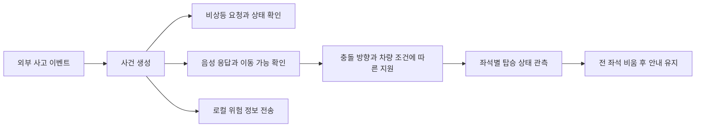

# 세이프티스탭 SafetyStep

고속도로 사고·고장 후 정차 상황에서 탑승자의 응답을 확인하고, 차량 상태에 맞는 다음 안전 행동을 지원하는 **Pleos Connect 기술 프로토타입**입니다. 사고 직후 화면의 다음 버튼을 반복해서 누르기 어렵다는 문제에서 출발했습니다. 사건을 받으면 비상등 요청과 음성 확인을 시작하고, 좌석별 탑승 상태와 비트박스 진행 상태를 한 화면에 유지합니다.

현재 **0.5.0-safetystep**은 에뮬레이터에서 기능과 분기를 검증하는 버전입니다. 실제 사고 대응용 배포 앱이나 기획 전체의 완성본이 아닙니다.

- GitHub: [A-ITM/pleos-app](https://github.com/A-ITM/pleos-app)
- 현재 구현: [codex/secondary-accident-prototype](https://github.com/A-ITM/pleos-app/tree/codex/secondary-accident-prototype)
- [자동 대응 계획](docs/safetystep-automatic-plan.md) · [검수 결과](docs/safetystep-automatic-validation.md) · [콘솔 실행·재현 안내](tools/operator-console/README.md)

## 보여주는 시나리오

본편은 사고 전부터 시작하는 **후방 충돌과 전방 충돌** 두 상황을 연결합니다. 운전자와 동승자가 탑승한 상태에서 시작하며, 사건 접수 이후 정상 대응 흐름의 앱 터치는 0회입니다. 사고·충돌 방향·후방 공간 확인은 외부 콘솔의 재현 입력입니다.

| 장면 | 앱 동작과 확인할 내용 |
| --- | --- |
| 사고 전 주행 | 사건이 없는 평상시 화면. 기본 차량 상태는 좌측, 내비게이션은 중앙, 앱은 우측 패널에 배치 |
| 충돌 후 정차 | 비상등 자동 요청. 명령 접수와 실제 점멸 관측을 구분 |
| 응답 확인 | 실제 Pleos TTS로 질문하고 STT로 “네, 들려요. 저는 운전자예요.”를 인식. 이어 “움직일 수 있어요.” 응답 확인 |
| 후방 충돌 | 트렁크 개방 보류. 주변을 살피고 안전하게 내릴 수 있을 때 이동하도록 안내 |
| 전방 충돌 | 이동 가능 응답·최신 P 기어와 정지·후방 공간 확인 조건을 모두 만족하면 트렁크를 1회 자동 요청. 실제 열림이 관측되면 체크 |
| 운전자 하차 | 문 열림과 운전석 비움을 반영. 동승자가 남아 있으면 해당 좌석을 계속 표시 |
| 전 좌석 비움 | 관측 좌석의 비움이 유지되면 차량 복귀나 완료 버튼 조작 없이 안내 전환. 안전한 장소에서 스마트폰으로 신고하도록 안내 |

**비트박스**는 비상등·트렁크·밖으로 이동·스마트폰 신고를 기억하도록 돕는 안내 구조입니다. 트렁크는 사고 방향과 조건에 따라 보류할 수 있고, 센서로 관측한 사실만 완료 상태에 반영합니다. 좌석 비움은 안전지대 도착이나 도로 위험 해소를 뜻하지 않으므로 사건은 유지합니다.

접근 차량은 별도 검사에서 **동일 사건 ID 수신**, 반대 방향·다른 도로·통과한 지점·오래된 위치의 경고 제외를 확인했습니다. 본편 영상에는 접근 차량 장면을 포함하지 않습니다.

## 실제 연동과 재현 범위

| 항목 | 현재 구현·검증 범위 |
| --- | --- |
| 차량 조회 | 실제 Vehicle SDK와 Vehicle Service로 기어·속도·문·트렁크·좌석 조회. 미지원·오래된 값을 정상 상태로 대체하지 않음 |
| 좌석 상태 | Vehicle 2.3.2의 Boolean 변환 문제 때문에 debug 에뮬레이터에서 같은 권한의 Vehicle Service/AIDL 1.1.1 값 해석 |
| 비상등 | SDK 직접 쓰기는 현재 이미지에서 권한 오류 800001. 본편은 명시 선택한 에뮬레이터 콘솔 어댑터로 앱이 ON을 요청하고 Vehicle Service에서 실제 점멸 확인 |
| 트렁크 | 전방 분기의 조건을 통과하면 실제 Pleos SDK로 개방 요청 및 열림 조회. 후방 충돌·도움 필요·조건 미확인에서는 보류 |
| 음성 | 실제 Pleos TTS/STT. 본편 운전자 응답은 재현용 합성 PCM을 STT에 입력. 무응답·인식 오류·도움 필요는 별도 분기 |
| 사고 시작 | 외부 콘솔 시험 이벤트. 실제 충돌 감지·에어백에 의한 앱 자동 기동은 미검증 |
| Gleo | App Schema·Action·Callback 계약 및 텍스트 시험 호출 확인. 사고 상황의 선제 대화·자동 기동 완료를 주장하지 않음 |
| 위험 전파 | 로컬 Deno 서버와 두 앱의 실제 HTTP 교환. 도로·위치는 모의 값. 현재 클라이언트 필터 방식이며 서버의 구간별 구독 전파는 후속 범위 |
| 외부 서비스 | Supabase 운영 DB/Auth/Realtime, 공공 교통정보, 외부 내비게이션 전파, 긴급기관 신고·배차는 미연결 |

문 열림, 좌석 비움, 통신 단절 또는 정보 만료로 사건을 자동 종료하지 않습니다. 무응답만으로 의식불명을 판정하지 않습니다. 차량 제어는 debug 에뮬레이터에서만 허용합니다.

## 화면과 상태 관리

라이트·다크·시스템 테마를 지원합니다. 차량의 기존 화면을 유지하면서 앱을 우측 패널에 배치하며, 음성 질문 중에도 좌석도와 비트박스 현황을 유지합니다. 화면 배치는 Pleos의 창 관리로 설정합니다.



사건·응답·차량 제어·좌석·통신 상태를 따로 관리합니다. 요청 실패를 성공 체크로 표시하지 않고, 재시작·테마 변경으로 같은 사건의 제어 명령을 중복 실행하지 않습니다.

## 개발 환경과 실행

| 항목 | 버전·구성 |
| --- | --- |
| Android | Kotlin 2.0.21 / Jetpack Compose / min 28, compile·target 35 |
| 빌드 | 기존 JDK 17 / Gradle 8.10.2 / AGP 8.8.2 |
| Pleos | Vehicle 2.3.2 / NaviHelper 3.0.5 / TTS·STT 3.3.1 |
| 검증 환경 | Pleos Connect 에뮬레이터 2.1, Android 14, arm64 |
| 로컬 서버 | Deno 2.9.6 / Python 3 운영 콘솔 |

Android Studio에서 `android/`를 열고 기존 JDK 17, Android SDK Platform 35·Build Tools 35.0.0을 지정합니다. `demoDebug`는 일반 Android에서 샘플 값으로 실행하고, `pleosDebug`는 Pleos 전용 에뮬레이터에서 실행합니다. [환경 설치 안내](docs/development.md)를 참고하세요.

```sh
git clone https://github.com/A-ITM/pleos-app.git
cd pleos-app
git switch codex/secondary-accident-prototype
./scripts/check-android.sh
```

빌드는 호스트의 기존 JDK와 공용 Gradle 캐시를 사용합니다. 별도 JDK·Docker·작업별 Gradle 캐시를 만들 필요가 없습니다.

로컬 서버는 별도 터미널에서 유지합니다. 설치된 Deno가 없으면 스크립트가 `npx deno@2.9.6`을 사용하므로 Node.js/npm이 필요합니다.

```sh
./scripts/run-prototype-server.sh
```

별도 터미널에서 Android SDK의 `platform-tools/adb`로 설치·실행합니다.

```sh
adb reverse tcp:8787 tcp:8787
adb install -r android/app/build/outputs/apk/pleos/debug/app-pleos-debug.apk
adb install -r android/app/build/outputs/apk/demo/debug/app-demo-debug.apk
adb shell am start --user 10 -n io.github.aitm.pleosapp/io.github.aitm.pleosapp.MainActivity
```

사용자 10은 검증한 Pleos 이미지 기준입니다. 실제 차량 신호 변경에는 기존 Virtual Console의 `DDS ONLINE` 상태가 필요합니다. 운영 콘솔·음성 입력 준비·자동 시나리오는 [재현 안내](tools/operator-console/README.md)를 따릅니다. 현재 촬영 도구는 macOS·`emulator-5554`·사용자 10 기준입니다.

## 저장소 구성

```text
android/app/src/main/          사고·응답·지원 상태, 현황판, 차량/음성 인터페이스
android/app/src/demo/          샘플 차량·음성 구현
android/app/src/pleos/         실제 차량 SDK 연동
android/app/src/pleosDebug/    에뮬레이터 제어·좌석 어댑터, 음성 및 진단 도구
android/app/src/test/          분기·좌석·응답·사건 정책 단위 테스트
android/app/src/androidTest/   화면·음성·연동 계측 테스트
supabase/                     공통 사건 검증 로직, 로컬 HTTP 서버, health 함수
tools/operator-console/       외부 입력·관측·시나리오·촬영·편집 도구
docs/                         설계, 실행 환경, SDK 조사 및 검수 기록
```

Supabase 클라우드 프로젝트나 인증 정보 없이 빌드할 수 있습니다. 기존 `BackendHealthClient`는 별도 health 연결 확인 코드이며 현재 프로토타입은 loopback 서버를 사용합니다. [백엔드 설명](docs/backend.md)을 참고하세요.

## 검증 결과

2026-11-15 기준 두 flavor의 단위 테스트 각 19개, lint와 debug APK 빌드가 통과했습니다. Deno 형식·정적 검사와 사건 처리 테스트 5개도 통과했습니다. 실제 제어·음성·좌석·재시작 중복 방지 검사와 영상 검수는 [0.5 검수 기록](docs/safetystep-automatic-validation.md)에 범위별로 정리했습니다. 과거 0.1~0.4 기록은 개발 과정의 자료이며 현재 동작은 이 README와 0.5 기록을 기준으로 봅니다.

PR의 GitHub Actions가 Android와 서버 검사를 실행하고 개발용 APK를 Artifacts로 제공합니다. 로컬 권한 파일·키·SDK 바이너리·생성 영상·녹음·APK는 소스 커밋에 포함하지 않습니다.

## 공모전 참고자료 안내

접수양식의 **7. 참고자료**에 기재할 저장소는 위 GitHub 주소이며, 현재 구현을 바로 보려면 프로토타입 브랜치 링크를 사용합니다. 이 저장소에는 프로토타입 소스, 실행 방법, 시나리오 및 검증 범위가 포함됩니다.

별도 제출용 영상 `SafetyStep-0.5-automatic-voice.mp4`는 약 2분 7초이며 후방 개방 보류와 전방 조건부 자동 개방을 이어 보여줍니다. 실제 앱 TTS 출력과 시험용 운전자 합성 음성을 장면에 맞춰 편집했고 화자·설명 자막을 넣었습니다. 대화 장면의 원본 프레임 유지가 포함되어 실시간 STT 지연 측정 자료는 아닙니다. 영상과 APK는 Git 저장소에 포함하지 않습니다.

저장소는 현재 비공개이므로 외부 심사자의 접근 권한은 별도로 준비해야 합니다. 양식은 공유 자료의 개인정보·계정정보·개발자 실명 노출도 확인하도록 명시합니다. 제출 전 GitHub 계정·기존 커밋 이력과 첨부자료까지 확인해야 하며, 비공개 URL만 적는 것으로 외부 열람이 보장되지는 않습니다.
