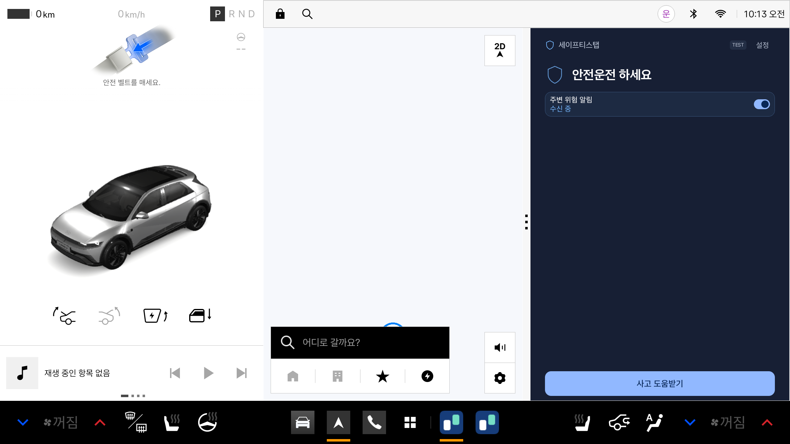
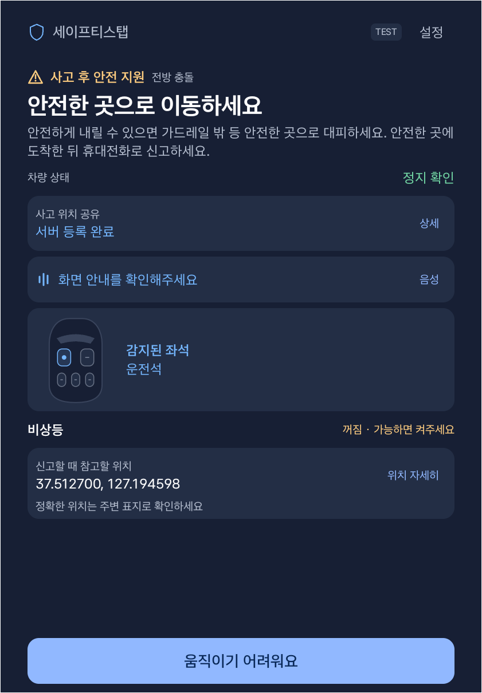
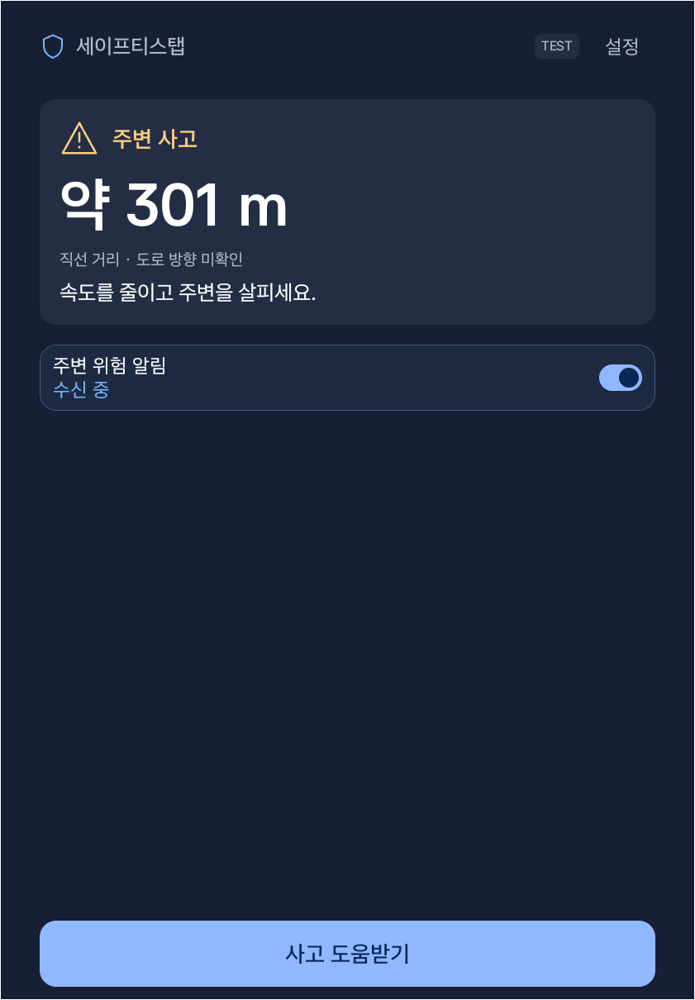

# 세이프티스탭 SafetyStep

세이프티스탭은 고속도로 사고 후 탑승자에게 대피와 도움 요청 방법을 안내하는 Pleos Connect 앱입니다. 사고 차량이 위치를 공유하면, 주변 위험 알림을 켠 다른 차량에서 **주변 사고**와 사고 지점까지의 직선거리를 볼 수 있습니다. 현재 버전은 에뮬레이터에서 사용하는 프로토타입입니다.

## 1. 실행 환경 준비하기

**처음부터 차량 간 사고 공유까지 사용하려면 Pleos 에뮬레이터 한 대를 준비하세요.** 같은 에뮬레이터에서 사고 차량 앱과 주변 차량 앱을 번갈아 엽니다. 이미 Pleos 차량 홈이 열려 있다면 2단계부터 시작하세요.

1. 컴퓨터에 Android Studio를 설치하고 처음 실행할 때 설정 마법사에서 Android SDK 설치를 마칩니다. [Android Studio 설치 및 시스템 요구사항](https://developer.android.com/studio/install)
2. 시작 화면에서 **More Actions → SDK Manager**를 엽니다. 프로젝트를 연 상태에서는 **Tools → SDK Manager**를 선택하세요. **SDK Tools** 탭에서 **Android Emulator**와 **Android SDK Platform-Tools**를 선택하고 **Apply**를 누릅니다. 창 위쪽의 **Android SDK Location**이 SDK 설치 경로입니다.
3. **SDK Update Sites → +**에서 이름을 `Pleos Connect System Image`로 입력하고, 컴퓨터에 맞는 아래 주소를 등록합니다.

   | 환경 | SDK Update Site에 붙여 넣을 주소 |
   | --- | --- |
   | Apple Silicon Mac | `https://nexus-playground.pleos.ai/repository/raw-releases/connect-avd/2.x/crp-arm64-sys-img.xml` |
   | Windows / Linux (x86-64) | `https://nexus-playground.pleos.ai/repository/raw-releases/connect-avd/2.x/crp-sys-img.xml` |

4. **SDK Platforms → Show Package Details**에서 **Android 14 (API 34)** 아래의 **Pleos Connect** 시스템 이미지를 설치한 뒤 Android Studio를 다시 엽니다.
5. 시작 화면에서 **More Actions → Virtual Device Manager → Create Virtual Device**를 엽니다. **Automotive → Pleos Connect v2.1.0**과 방금 받은 API 34 이미지를 선택합니다. 고급 설정에서 RAM을 **4 GB**, 부팅 방식을 **Cold**로 지정하고 **Finish → ▶**를 누릅니다. **차량 홈 화면이 뜨면 준비가 끝났습니다.** [Pleos 에뮬레이터 설치 화면 안내](https://document.pleos.ai/docs/connect/guide/getting-started/application-development/setup-connect-sdk-emulator)

**사고 안내 화면만 둘러보려면** 2번까지 진행한 뒤 일반 Android 에뮬레이터를 사용해도 됩니다. Virtual Device Manager에서 **Phone**과 API 28 이상의 이미지를 선택해 실행하고, 다음 단계에서 **세이프티스탭 Demo**만 설치하세요. Demo의 차량 상태는 샘플이며, 사고 안내는 화면으로 확인할 수 있습니다. [Android 가상 기기 만들기](https://developer.android.com/studio/run/managing-avds)

## 2. 앱 설치하고 열기

1. GitHub에 로그인한 뒤 앱 빌드 목록에서 성공한 최신 실행을 엽니다. 아래쪽 **Artifacts → debug-apks-…**를 내려받아 압축을 풉니다. [앱 빌드 목록](https://github.com/A-ITM/SafetyStep/actions/workflows/ci.yml?query=branch%3Amain)
2. 아래 APK를 실행 중인 에뮬레이터 창에 끌어다 놓습니다. 두 차량을 사용할 때는 두 파일을 모두 같은 창에 설치합니다.

   | 앱 목록에 표시되는 이름 | 압축 안의 파일 | 용도 |
   | --- | --- | --- |
   | **세이프티스탭 Demo** | `demo/debug/app-demo-debug.apk` | 사고 안내 화면 둘러보기, 주변 차량 B에서 사고 수신 |
   | **세이프티스탭** | `pleos/debug/app-pleos-debug.apk` | 사고 차량 A에서 차량 상태 확인과 사고 위치 공유 |

3. 에뮬레이터의 앱 목록에서 **세이프티스탭 Demo**를 엽니다. 정차 상태에서 **안전운전 하세요**와 **사고 도움받기** 버튼이 보이면 다음 단계로 넘어가세요. Pleos에서 창을 넓히라는 안내가 나오면 내비게이션과 우측 앱 패널 사이의 경계선을 왼쪽으로 끌어주세요.



<details>
<summary>APK 다운로드 기간이 지났거나 소스에서 직접 설치할 때</summary>

GitHub의 빌드 파일은 7일간 보관됩니다. 직접 빌드할 때는 이 저장소를 내려받아 Android Studio에서 `android/`를 엽니다. SDK Manager에서 **Android SDK Platform 35**와 **Build Tools 35.0.0**을 설치하고 Gradle JDK로 **JDK 17**을 선택합니다. Gradle Sync가 끝나면 **Build Variants**에서 `demoDebug` 또는 `pleosDebug`를 고르고 실행 대상 에뮬레이터를 선택해 ▶를 누릅니다. 두 앱이 필요하면 다른 빌드도 같은 방법으로 실행합니다. [소스 빌드 환경](docs/development.md#android-studio)

</details>

## 3. 사고 차량 화면 사용하기

1. 정차 상태의 홈 화면에서 **사고 도움받기**를 누릅니다. 일반 정차만으로는 사고가 등록되지 않습니다.
2. **사고 후 안전 지원**에서 차량 상태와 첫 안내를 확인합니다. 정지가 확인되면 대피와 안전한 곳에서 휴대전화로 신고하는 순서를 안내합니다. Pleos에서 음성이 가능하면 첫 안내를 읽어줍니다. 안내를 계속 듣기 위해 버튼을 누를 필요는 없습니다.
3. 도움이 필요할 때 **움직이기 어려워요**를 누르면 도움 안내로 바뀝니다. Pleos에서는 첫 안내 뒤 음성으로도 도움을 요청할 수 있습니다. **119 전화 열기**는 전화 앱을 엽니다. 통화는 사용자가 직접 시작합니다.
4. 좌석에 탑승 신호가 남으면 해당 좌석이 표시됩니다. 탑승 이력이 있는 상태에서 관측한 좌석 전체가 3초간 비어 있으면 실내 음성과 마이크가 멈춥니다. 사고 위치 공유는 별도로 유지됩니다.

## 4. 다른 차량에서 주변 사고 확인하기

**A에서 ‘서버 등록 완료’를 확인한 뒤 B로 전환**하세요. 에뮬레이터 한 대에서는 두 앱이 같은 기기의 GPS를 사용하므로, 이 순서대로 위치를 바꾸면 A의 사고 지점과 B의 현재 위치를 구분할 수 있습니다.

### 두 앱을 같은 서버에 연결하기

터미널에서 `adb devices`를 실행합니다. 목록에 `emulator-5554   device`처럼 표시되면 컴퓨터와 에뮬레이터가 연결된 것입니다. 아래 모든 명령에서 `emulator-5554`를 실제 번호로 바꾸세요. 명령을 찾을 수 없으면 1단계에서 확인한 SDK 설치 경로 아래의 `platform-tools`를 PATH에 추가하고 터미널을 다시 엽니다.

새로 설치한 두 앱은 기본으로 **로컬 시험**을 사용합니다. 계정 없이 진행하려면 로컬 서버를 선택하세요. 이미 두 앱에 **클라우드 파일럿**이 설정돼 있다면 세션 유효 시간을 확인하고 다음 단계로 넘어가세요.

<details>
<summary>로컬 서버 사용하기 · 계정 없이 같은 컴퓨터에서 실행</summary>

이 단계에는 Git과 Deno 또는 Node.js(`npx`)가 필요합니다. macOS·Linux는 터미널, Windows는 Git Bash에서 실행하세요. 이미 저장소를 받았다면 해당 폴더에서 마지막 명령만 실행합니다. [Git 설치](https://git-scm.com/install/) · [Node.js 설치](https://nodejs.org/en/download)

```sh
git clone https://github.com/A-ITM/SafetyStep.git
cd SafetyStep
./scripts/run-prototype-server.sh
```

서버 터미널은 열어 두고, 새 터미널에서 에뮬레이터의 8787 포트를 방금 실행한 서버에 연결합니다.

```sh
adb -s emulator-5554 reverse tcp:8787 tcp:8787
```

두 앱의 **설정** 상단에 **로컬 시험**이 표시되는지 확인하세요. 기존 클라우드 연결을 로컬로 변경하려면 [로컬 모드로 복귀](docs/pilot-cloud-android.md#로컬-모드로-명시적으로-복귀)의 명령을 A와 B에 각각 실행한 뒤 앱을 다시 엽니다.

</details>

<details>
<summary>배포된 Supabase 서버 사용하기 · 파일럿 계정 필요</summary>

인터넷에 연결한 뒤 [파일럿 연결 절차](docs/pilot-cloud-android.md)에 따라 A와 B를 각자의 허용된 계정으로 연결하고 앱을 다시 엽니다. 두 앱의 **설정** 상단에서 각각 **클라우드 파일럿 · A**, **클라우드 파일럿 · B**를 확인하세요. 세션은 최대 1시간이며, 만료되면 같은 절차로 갱신합니다. 이 모드에서는 로컬 서버 실행과 포트 연결을 건너뜁니다.

</details>

### 사고 지점과 주변 차량 위치 바꾸기

앞에서 Demo의 사고 안내를 열어보았다면 **설정 → 개발 도구 → 시험 상태 초기화**로 홈에 돌아오세요. 정차 상태에서 두 앱의 **설정 → 위치 권한 설정**으로 들어가 **정확한 위치**를 앱 사용 중 허용합니다. 권한이 이미 있으면 이 버튼은 생략됩니다. **A의 ‘위험 위치 공유 동의’**는 사고를 보내는 설정이고, **B의 ‘주변 위험 알림’**은 사고를 받는 설정입니다.

| 순서 | 조작 | 화면에서 확인할 내용 |
| --- | --- | --- |
| ① 사고 등록 | A를 열고 **위험 위치 공유 동의**를 켭니다. 홈에서 아래 A 좌표를 입력하고 약 20초 기다려 GPS가 갱신된 뒤 **사고 도움받기**를 누릅니다. | **사고 위치 공유 → 서버 등록 완료**. **상세**에서 위도 37.5127, 경도 127.1946 부근인지 확인합니다. |
| ② 근처에서 수신 | B를 열고 홈의 **주변 위험 알림**을 켠 뒤 B 근처 좌표를 입력합니다. 앱을 전면에 둡니다. | **수신 중**과 **주변 사고** 카드에 약 300m(예시 표시 **약 301 m**) |
| ③ 반경 밖으로 이동 | B를 열어 둔 상태에서 B 바깥 좌표를 입력합니다. | 정상 조회 후 사고 카드가 사라지고 **주변 위험 알림**은 **수신 중**으로 유지됩니다. |

아래 명령은 **각 단계에서 한 줄씩** 실행합니다. 입력 순서는 경도, 위도입니다.

```sh
adb -s emulator-5554 emu geo fix 127.1946 37.5127  # ① A 사고 지점
adb -s emulator-5554 emu geo fix 127.1946 37.5154  # ② B 약 300m
adb -s emulator-5554 emu geo fix 127.1946 37.5277  # ③ B 약 1.67km
```

아래는 같은 사고를 두 앱에서 차례로 확인한 화면입니다. 왼쪽에서 A의 등록 결과를, 오른쪽에서 B가 수신한 경고와 거리를 확인하세요.

| 사고 차량 A · 위치 등록 | 주변 차량 B · 사고 수신 |
| --- | --- |
| [](docs/images/usage/accident-registered.png) | [](docs/images/usage/nearby-accident.png) |

경고 범위는 **직선 반경 1km**이며 진행 방향은 판별하지 않습니다. 클라우드에서 사고가 조회되는 시간은 발생 후 **5분**입니다. 그 안에 B로 전환해 주세요. 반경을 벗어나거나 유효 시간이 지나 카드가 내려가도 도로의 사고가 해소됐다는 뜻은 아닙니다.

## 원하는 화면이 보이지 않을 때

| 화면 또는 증상 | 확인할 것 |
| --- | --- |
| **설정**이나 **사고 도움받기**가 보이지 않음 | Pleos가 주행 중이면 조작이 제한됩니다. 에뮬레이터를 정차 상태로 바꿉니다. 이전 사고 화면에서 다시 시작하려면 **설정 → 개발 도구 → 시험 상태 초기화**를 사용합니다. |
| A에 **위치 확인 중 · 공유 보류**가 표시됨 | 정확한 위치 권한을 확인하고 A가 전면에 있을 때 A 좌표를 다시 입력합니다. 사고 입력 뒤 30초가 지났다면 시험 상태를 초기화하고 새 사고로 시작합니다. |
| A에 **서버 등록 대기**가 계속 표시됨 | A의 공유 동의와 서버 연결을 확인합니다. 로컬은 서버 터미널과 `adb reverse`, 클라우드는 인터넷과 파일럿 세션을 확인합니다. |
| B에 카드가 보이지 않음 | B의 **홈**에서 **주변 위험 알림**이 **수신 중**인지 확인합니다. **연결·위치 확인 필요**라면 B를 전면에 두고 위치를 다시 입력합니다. A와 B의 서버가 같고 사고가 반경·유효 시간 안에 있어야 합니다. **개발 도구 → 접근 차량 화면**은 이전 시험용 화면입니다. |

[사고 후 좌석·음성 동작](docs/cabin-exit-flow.md) · [두 앱의 클라우드 실행 결과](docs/backend.md#에뮬레이터에서-확인한-결과) · [소스 저장소](https://github.com/A-ITM/SafetyStep)
