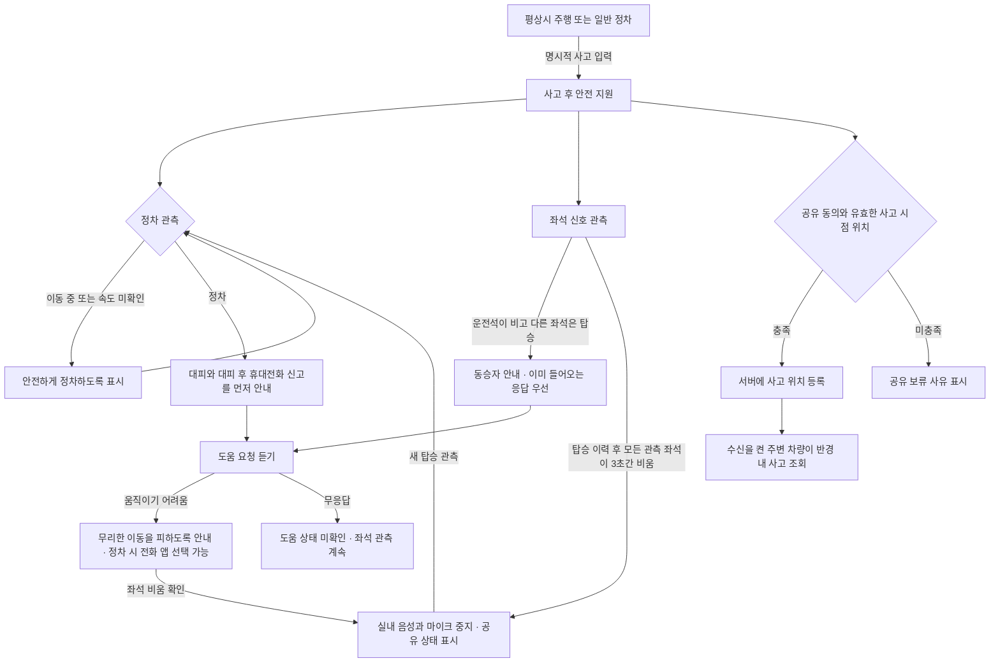

# 사고 차량의 하차 전후 유저 플로우

교내 공모전용 SafetyStep 0.7 프로토타입의 사용자 흐름이다. 사고 차량에서는 탑승자가 차 안에서 다음 행동을 미리 듣고 안전하게 내릴 수 있게 한다. 주변 차량에서는 사고 위치 공유가 독립적으로 이어진다. 한국도로공사가 안내하는 대피 후 스마트폰 신고 순서를 첫 발화에 반영했다. [정책브리핑에 소개된 한국도로공사 비트박스 안내](https://www.korea.kr/news/policyNewsView.do?newsId=148931463)

## 한 사고에서 동시에 일어나는 두 가지 흐름



## 화면과 음성의 판단 기준

| 상황 | 탑승자가 경험하는 동작 | 판단 근거 |
| --- | --- | --- |
| 일반 정차 | 평상시 화면 유지 | 0.7의 정상 경로는 명시적 사고 입력으로 시작한다. |
| 사고 입력 후 차량 이동 또는 속도 미확인 | 정차를 먼저 안내한다. 대피 음성은 정차 확인을 기다린다. | 주행하면서 문을 열거나 화면을 조작하도록 유도할 수 없다. |
| 정차했고 이동 불가 요청이 없음 | 첫 안내에서 대피와 **안전한 곳에서 휴대전화로 신고**하는 순서를 듣는다. 이어서 음성 응답을 할 수 있다. | 대피를 시작하는 데 확인 버튼이나 음성 응답이 필요하지 않다. |
| 운전석이 비고 동승 좌석에 탑승 신호가 남음 | 동승자 안내를 표시한다. 음성이 가능하면 사건당 한 번 안내한다. 이미 도움 응답을 듣고 있으면 그 청취가 끝난 뒤에도 사람이 감지되는지 다시 본다. | 운전석에는 이전 탑승 관측이 필요하다. 처음부터 비어 있던 운전석만으로 운전자 하차를 추정할 수 없다. |
| 움직일 수 없다고 응답 | 도움을 우선하고, 조작 가능한 정차 화면에서 신고 참고 위치와 119 전화 앱을 열 수 있다. | 도움 요청을 저장하며 자동 발신하지 않는다. 단순 긍정이나 무응답으로 의식·이동 능력을 확정하지 않는다. |
| 이전에 탑승이 관측됐고 모든 관측 좌석이 연속해서 비움 | 진행 중인 음성·청취를 취소하고 전화·도움 버튼과 열린 상세 창을 내린다. 기존 도움 요청은 기록으로 남고, 사고 위치 공유 상태를 계속 표시한다. | 센서가 확인한 것은 좌석 상태다. 도로 위험 해소와 안전지대 도착에는 별도 근거가 필요하다. |
| 관측 누락·오래된 값·재실행 | 비움 확인 전에는 불완전한 신호로 안내를 종료하지 않는다. 확인 뒤에는 같은 사건의 실내 안내 중지를 복원한다. | 새 탑승이 관측될 때만 다시 차 안에서 지원한다. 기존 도움 요청과 사고 ID를 유지한다. |
| 공유 보류·연결 단절 | 차 안에서 들려주는 대피 안내는 계속 동작한다. 공유 영역에 실제 등록 상태를 표시한다. | 좌석, 음성 원문, 도움 요청은 공유 payload에 넣지 않는다. 등록 확인과 다른 차량의 수신은 별도로 검증한다. |

센서 기준은 에뮬레이터용이다. 비움은 이전에 보였던 모든 좌석에서 시각이 갱신된 표본으로 최소 3초간 확인한다. 두 표본 사이가 2초를 넘거나 좌석이 누락되면 확인 시간을 다시 센다. 지원 좌석의 수는 차량에 따라 달라질 수 있다. 음성과 마이크는 앱이 전면에 있을 때 사용한다.

## 검수 재현

Pleos AVD, 같은 사용자에 설치한 demo·pleos 디버그 및 시험 APK, 별도 터미널에서 실행하는 로컬 서버를 사용한다. 스크립트는 선택한 에뮬레이터에서 시험용 좌석·GPS와 앱의 로컬 지원 상태를 변경한다. 호스트 마이크 입력은 무음으로 두며 결과와 원본 화면을 저장소의 무시 디렉터리 `output/cabin-flow-qa/` 아래에 남긴다.

```sh
./scripts/check-android.sh assembleDemoDebugAndroidTest assemblePleosDebugAndroidTest
./scripts/run-prototype-server.sh --port=8787 --data=output/cabin-flow-qa/accidents.json
```

```sh
python3 scripts/verify-cabin-flow.py --serial emulator-5554 --ui-only --output output/cabin-flow-qa/ui
python3 scripts/verify-cabin-flow.py --serial emulator-5554
```

## 무엇을 보고 통과로 판단하는가

| 검증 지점 | 증거 |
| --- | --- |
| 정차 후 첫 발화 → 예외 청취 | Pleos의 TTS 재생·완료 뒤 STT 시작 또는 실제 입력 레벨 콜백이 도착해야 화면에 마이크가 켜진다. 서비스 준비 알림만 받은 단계에서는 청취 중으로 표시하지 않는다. |
| 운전석만 비움 → 동승 좌석 탑승 지속 | 화면 맨 위의 안내가 바뀐다. 진행 중인 청취를 끝까지 유지하고 동승자 안내 시작·완료는 각각 한 번만 기록한다. |
| 모든 관측 좌석 비움 | 진행 중인 청취 또는 동승자 발화를 취소하고 음성 상태가 유휴, 입력이 없음으로 바뀐다. 설정·위치 상세·119 전화 버튼이 사라진다. |
| 도움 요청 후 하차 → 앱 재실행 → 재탑승 | 비움 확인과 도움 기록은 같은 사건에 저장한다. 빈 차 재실행으로 음성을 재생하지 않는다. 더 최근의 탑승 관측이 들어오면 같은 사건에서 지원을 재개한다. |
| 사고 차량이 조용해진 후 주변 조회 | 시험 서버 저장본과 다른 차량 B의 주변 조회 응답에서 동일한 사고 ID·버전·활성 상태를 대조한다. |
| 센서 일부 누락·시각 역전·앱 주행 제한 | JVM 시험에서 누락·오래된 값·중복 표본으로 상태가 잘못 바뀌는지 확인한다. Compose 시험에서는 정차·이동·도움·좌석 비움 우선순위와 주행 제한 시 조작이 사라지는지를 두 빌드에서 확인한다. |

시험에서 노트북 마이크에 사람이 말하는 과정과 실차 좌석 센서의 감지 정확도는 측정하지 않는다. 위치 전파 시험의 B는 다른 차량 권한으로 조회하는 HTTP 클라이언트다. 두 앱에서 실제 위치를 주고받는 기존 시험의 범위와 결과는 [0.7 위치 공유 검수](safetystep-v07-validation.md)에 있다. 음성 단계의 기준은 [Pleos STT 리스너 명세](https://document.pleos.ai/docs/pleos-only/connect-sdk-pleos/SpeechToText/result-listeners)를 따른다.
