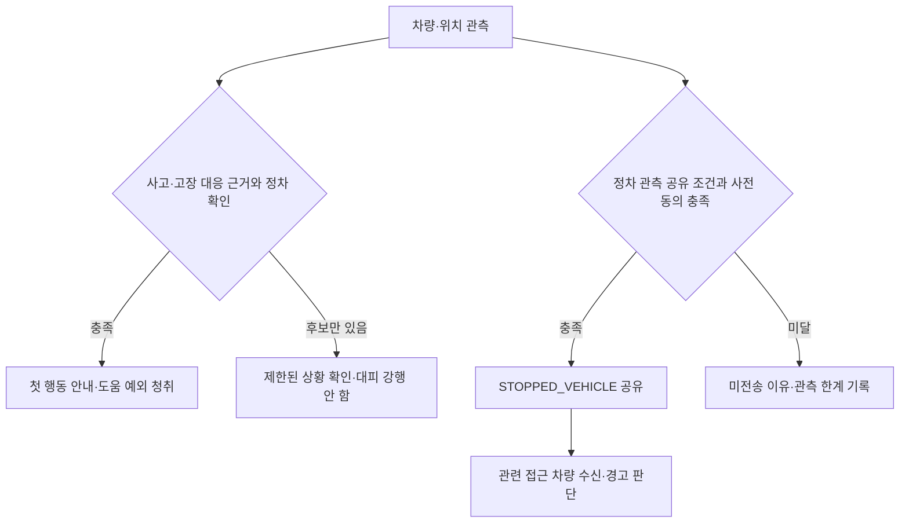
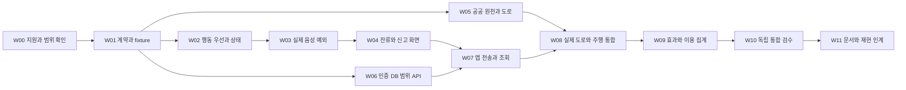

# 세이프티스탭 실행 계획 1.3 — Phase별 작업·인수인계 기준

> 이번 개발 PR의 범위는 사용자의 후속 프로토타입 지시에 따른 [0.6 구현·검수 계약](safetystep-prototype-v06-plan.md)이 우선한다. 아래 1.3의 운영 연동·연구 단계는 장기 기준으로 보존하며 이번 완료와 혼동하지 않는다.

작성일: 2026-11-17 · 대상 기준: main `78b0fddac8f41529747825d7c3b7759acbcd1206` / SafetyStep 0.5

저장소: [A-ITM/SafetyStep](https://github.com/A-ITM/SafetyStep)

**이번 산출물은 개발 전 실행 계획이다. 앱·서버 구현은 아직 시작하지 않는다.** 모델이 이전 대화를 몰라도 이 문서, 지정 작업 카드, 저장소 AGENTS.md, 동결된 계약·fixture로 같은 방향의 결과를 만들도록 구성했다. 6.1-sol 등 작업 모델의 성능을 가정하기보다 변경 범위와 확인 가능한 증거로 일관성을 관리한다.

## 0. 이 문서의 우선순위와 사용법

현재 사용자 지시와 저장소 AGENTS.md를 먼저 따른다. 후속 개발의 범위·순서는 **이 실행 계획 1.3**을 기준으로 삼는다. 서비스 설계 1.1은 문제·예외·시험의 참고 자료이며, 과설계 검토의 축소안을 유지하되 1.2에서 누락된 정차 관측 공유·평상시 수신·신고 위치 연결을 보완했다. 이전 문서의 Phase 번호·P0/P1/P2와 이 문서의 Phase 번호를 혼용하지 않는다. [1.3 피드백 검토](safetystep-feedback-review-v1.3.md)에 채택·보완·보류 이유와 공식 근거, 기획서 교체 문안을 기록했다.

이 문서에서 `W00`~`W11`은 작업 ID, `I01`~`I12`는 공통 불변 조건, `G0`~`G4`는 단계 통과 기준이다. 작업자는 배정된 W 카드만 구현하며 배정되지 않은 다음 Phase를 스스로 시작하지 않는다. 세부 구현 방법은 계약 안에서 선택할 수 있다.

실행 담당자는 다음 순서로 사용한다.

1. 현재 checkout과 변경 상태를 확인하고 이 문서와 AGENTS.md를 읽는다.
2. 1~4절의 제품 범위·불변 조건·계약을 확인한다.
3. 배정된 W 카드의 선행 산출물과 변경 허용 파일을 읽는다.
4. 8절의 작업 지시문으로 구현한다. 작업 범위 안의 일반적인 코딩·검증은 별도 확인을 반복하지 않고 진행한다.
5. 9절의 증거 형식으로 결과를 넘긴다. 검토자가 G 조건을 확인한 뒤 다음 작업에 넘긴다.

문서의 **기존 경로**는 현재 저장소에 있다. **신규 경로(제안)**는 해당 W 작업이 만들 산출물이며 지금 존재한다고 가정하지 않는다. 계획 작성 시 없는 계약·테스트 결과를 읽었다고 주장하지 않는다.

## 1. 첫 제품의 목적과 범위

### 1.1 목적

고속도로 사고·고장으로 정차한 뒤 이동 가능한 탑승자가 위험 장소에 머무는 시간을 줄이고, 접근 차량이 사고 지점에 도달하기 전에 위험을 알 수 있게 한다.

사고·고장 대응이 필요한 근거와 정차가 확인된 일반 경로에서는 **짧은 조건부 행동 안내 → 차 안에 남은 사람의 도움 요청·예외 청취**로 진행한다. 역할·의식·이동 가능 질문을 모두 통과해야 대피 안내가 나오는 흐름을 만들지 않는다. 이미 이동 불가·특수 위험이 알려진 경우에는 적절한 도움 경로가 우선이다.

**대피 안내 시작과 정차 관측 공유의 조건은 서로 다르다.** 단순 정차 후보에는 사고로 단정한 대피 지시를 하지 않지만, 검증된 도로·정차 관측 조건을 만족하면 응답을 기다리지 않고 `STOPPED_VEHICLE`로 공유한다. 응답·비상등 수동 조작을 공유의 필수 조건으로 만들지 않는다. 사전 공유 동의·유효한 위치/관측·실행/통신 경로는 필요하며, 이 조건이 없을 때 ‘전원 무응답이어도 항상 전파’한다고 약속하지 않는다.

### 1.2 이번 구현에서 완료할 것

- 첫 행동 안내, 비상등 상태 확인·짧은 안내, 실제 음성 도움 요청 처리.
- 좌석별 탑승·비움·불명과 하차 중 잔류 확인 알림.
- 노선·방향·대략 위치·연락처의 신고 도우미. 통화 API가 없어도 정보 제공.
- 기존 우측 패널·디자인 시스템·라이트/다크를 유지한 행동 우선 화면.
- 선정한 도로 범위에서 공공 돌발정보 1종을 기본 경고원으로 실제 연동.
- 사고 제보와 응답 없이 가능한 정차 관측 공유, 서버의 범위별 HTTP 조회, 인증·영속 저장·갱신·종료·신선도.
- 정차 중 수신 설정, 다음 주행의 설정 복원, 평상시 주행 화면과 접근 경고. 실제 수신 가능 상태를 표시.
- 구간 진입·이탈·재연결·역순 응답·통신 오류에서 일관된 경고.
- 앱 내부/관측부터의 첫 안내 시간, 경고 리드타임, 자체/공공 수신 시각 비교, 고정 안내 비교 모드, 로컬 효과 로그와 간단 이용 집계.
- 최소 본선/시설 판정과 한 가지 보조 시작 후보 규칙의 오탐·누락 시험. 자동 사고 확정과 구분.

지원되는 실행 상태·차종/이미지·도로 범위를 명시한 제한적 MVP다. 현재 에뮬레이터 debug 기능을 그대로 실차 배포 기능으로 간주하지 않는다. 자동 시작·주행 중 경고·실제 음성의 플랫폼 경로가 지원되지 않으면 해당 제품 약속은 미완료다. 부분적인 기술 진척은 계속할 수 있지만 최종 결과의 범위를 바꿔 숨기지 않는다.

### 1.3 이번 구현에서 추가하지 않을 것

| 제외·보류 항목 | 이번 대체 범위 |
| --- | --- |
| 서버의 지속 수신 등록·lease·차량별 전달 이력·knownIncidentIds·removals 프로토콜 | 요청마다 현재 위치·방향을 검증하는 범위 조회 |
| Realtime 채널·변경 로그 재생·커서 | 단일 HTTP 조회와 완전 목록, 로컬 구간 세대·사건 버전 |
| 전국 도로 그래프·일반화된 사고 탐지 | 선정 구간의 실제 매칭과 한 가지 후보 규칙 |
| 무응답/좌석 기반 공유 위험도 차등·동적 전파 범위 | 모든 사건에 한 가지 경고 정책. 도움·잔류 처리는 로컬 유지 |
| 감속 기반 재경고 | 첫 경고와 자체/공공 선행 시간 비교를 필수로 구현. 재경고는 G3 뒤 별도 실험으로 유지 |
| 트렁크 요청형·자동 개방 확대 | 새 정상 흐름에서 트렁크 호출 안 함. 과거 debug 검증 코드는 분리 보존 |
| 계정 통합·차량 식별 자동 병합·분석 대시보드 | 동의된 파일럿 ID, 이벤트 중복 제거, CSV/간단 집계 |
| 자동 긴급 신고·배차·휴대전화 인계 | 확인 가능한 신고 정보 제공 |
| 범용 workflow 엔진·마이크로서비스·새 Gradle 모듈 체계 | 기존 모듈 안의 작은 처리부와 정책 함수 |

제외 항목은 구현 실패를 감추기 위한 fallback이 아니다. 다시 도입하려면 목적·실측 필요성·비용·추가 시험을 실행 담당자에게 제시해 범위를 갱신한다.

### 1.4 목적 지표

| 지표 | 시작·끝 | 초기 시험 목표 |
| --- | --- | --- |
| N: 첫 행동 안내 | 앱의 지원 시작 입력 수신 → 핵심 행동 문장 음성 출력 완료 | 발화 시작 2초, 핵심 문장 완료 8초 이내 |
| N_total: 체감 종단 안내 지연 | 경로별 최초 근거 관측 → 핵심 행동 문장 음성 출력 완료 | W01에서 경로별 상한을 수치로 고정. 정차 지속·질문·응답 대기를 포함 |
| Y: 첫 뒤차 경고 | 실제 사고 지점 도달 시각 − 첫 경고 수신/핵심 음성 완료 시각 | 수신과 핵심 음성 완료 모두 10초 이상의 리드타임 |
| H: 정차 위험 전달 지연 | 최초 정차 관측 → 접근 차량 첫 수신/핵심 경고 음성 완료 | W01의 정차 판정 시간과 Y 예산에서 상한 도출. 무응답 후보 경로도 평가 |
| Δ: 자체 정보의 선행 시간 | 같은 사건의 공공 정보 첫 수신 − 자체 관측 첫 수신 | 비교 결과를 보고하며 양수라고 미리 가정하지 않음 |

수치는 실도로 안전 기준이 아니라 기존 검토에서 정한 초기 공학 목표다. W01 계약 버전 1에는 이 초기값과 측정 정의를 넣고 구현을 시작한다. W00/W02 파일럿을 근거로 조정할 필요가 있으면 실행 담당자가 이유와 계약 버전을 갱신해 본 평가 전에 고정한다. 결과를 본 뒤 기준을 완화해 통과시키지 않는다. 신호 발생→앱 입력/기동 지연, 공공 원천 지연, 출력 불가·통화 중단·늦은 진입도 따로 기록한다. 실패·미측정을 평균이나 성공 분모에서 숨기지 않는다.

서버 내부 단계별 0.5초·1초 배분은 구현을 지시하는 고정 계약이 아니다. 현재 2초 폴링도 실제 간격이 보장된 값이 아니다. W07에서 실제 업로드·조회·음성 지연을 측정하고 W08에서 Y를 최종 평가한다. W01에는 기본 경고 거리·최대 범위와 최악 폴링 위상의 지연 예산을 함께 적는다. 서버의 제공 범위도 이 거리를 포함해야 한다. `필요 선행거리 ≥ 속도 × (남은 전달 지연 + Y)`로 초기 조건을 확인하되, 실제 합격은 음성 완료 때 남은 거리·시간으로 판정한다.

N_total은 ① 지원 사고 신호의 발생/최초 수신, ② 후보 규칙의 최초 정차 관측(지속 조건 충족 전), ③ 사용자 음성 시작의 실제 발화 시작으로 나눠 보고한다. 알 수 없는 시작 시각은 불명이며 텍스트 인식 완료로 바꿔 지연을 축소하지 않는다. 후보 확인이 끝나지 않아 대피 안내가 시작되지 않은 건은 ‘안내 미시작’으로 남기고 N 통계에서 사라지지 않게 한다. 무응답 후보 경로는 대피 강행 대신 H/Y가 통과해야 한다. 아직 지원하지 않는 에어백 경로는 시험 입력 결과와 실제 지원을 구분한다.

Δ는 동일 사건으로 대조 가능한 경우에만 계산한다. 같은 수신 시계 또는 오차를 기록한 시계를 쓰고, 공공 발생일을 공공 최초 수신 시각으로 쓰지 않는다. 관찰 종료까지 공공 정보가 안 나오면 ‘미관측/관찰 기간’을 적으며 무한히 빨랐다고 계산하지 않는다. fixture 재생 비교는 실측 우위의 증거가 아니다. 조기 제보와 차량 내 행동 지원을 차별화 가설로 검증하며, 타 내비 제품보다 우수하다고 미리 주장하지 않는다.

## 2. 작업자가 반드시 지킬 공통 조건

| ID | 불변 조건 |
| --- | --- |
| I01 | 대응 필요 근거가 확인된 경로의 첫 행동 안내는 역할 응답·트렁크·서버 ACK를 기다리지 않는다. 후보만 있으면 대피를 강행하지 않는다. 정차 관측 공유 조건이 충족되면 응답 여부와 독립해 공유한다. |
| I02 | 무응답·인식 오류·중단을 구분한다. 무응답=의식불명, ‘네’=이동 가능으로 추정하지 않는다. |
| I03 | 단순 정차·급감속은 사고 확정이 아니다. ACCIDENT와 STOPPED_VEHICLE을 구분한다. 타 차량 경고 수신은 내 차량 사고 세션을 시작하지 않는다. |
| I04 | 좌석 불명·미지원·오래된 값은 비움이 아니다. 좌석 비움은 안전지대 도착이 아니다. |
| I05 | 비상등 실제 켜짐 전 성공 발화를 하지 않는다. 배포 기본은 읽기·안내이며, 권한 오류 뒤 debug 어댑터로 몰래 대체하지 않는다. |
| I06 | 새 정상 흐름은 트렁크 명령을 내리지 않는다. 실차 제어 금지, 기존 debug 에뮬레이터 제한 유지. |
| I07 | 하차·앱 이탈·통신 단절·TTL·빈 목록은 도로 위험 해소가 아니다. 도로 사건 종료도 남은 탑승자 지원을 지우지 않는다. |
| I08 | 서버가 관련 사건만 반환한다. 전국 목록을 받아 UI에서만 숨기거나 클라이언트 지정 범위를 무검증 수락하지 않는다. |
| I09 | 명령·서버 접수·실제 관측·수신·음성 출력은 각각 기록한다. fixture·합성 PCM·운영자 입력과 실제 센서·마이크를 구분한다. |
| I10 | 원음·생체·좌석·도움 상태를 공유 사건 payload에 넣지 않는다. 서비스 키·기관 API 키를 APK·로그·문서에 넣지 않는다. |
| I11 | 기존 화면 영역·토큰·테마를 사용한다. 새로운 디자인 시스템이나 순차 다음/완료 UI를 만들지 않는다. |
| I12 | 외부 API·Pleos 미지원은 미지원으로 보고한다. 샘플 데이터·기본값으로 제품 기능을 완성한 것처럼 대체하지 않는다. |

판단 예: “네”가 들리면 응답 사실만 기록한다. 도움 표현이 들어오면 안내 순서보다 우선 처리한다. 운전석 비움·동승석 점유면 잔류 안내를 유지한다. 서버 목록이 비어도 ‘안전 확인’으로 쓰지 않는다. 가장 쉬운 정상 시나리오를 위해 위 조건을 삭제하지 않는다.

## 3. 현재 구현과 재사용 경계

| 영역 | 현재 사실·기존 경로 | 변경 방향 |
| --- | --- | --- |
| 사고 실행 | `android/app/src/main/java/io/github/aitm/pleosapp/prototype/PrototypeViewModel.kt` | 질문 우선 흐름 변경, 화면과 지원 책임 일부 분리. 전체 재작성 금지 |
| 상태·정책 | 같은 디렉터리의 `Incident.kt`, `SafetyStepState.kt`, `BitboxPolicy.kt` | 지원 세션/도로 상태 분리, 작은 순수 함수로 유지 |
| 음성 | `speech/ResponseInterpreter.kt`, `speech/SpeechGateway.kt` | 기존 경계 재사용, 예외 발화·지연 콜백·중단 검수 |
| 차량·좌석 | `vehicle/VehicleGateway.kt`, `VehicleSnapshot.kt`, `CabinOccupancy.kt` | 관측 품질·지원 좌석 범위 보존 |
| 화면 | `ui/IncidentDashboard.kt`, `CabinMap.kt`, `SafetyStepApp.kt`, `SafetyStepTokens.kt`, `SafetyStepTheme.kt` | 행동 안내 위계·잔류·위치 표시. 토큰 중심 수정 |
| 로컬 저장/HTTP | `prototype/HazardClient.kt` | 저장 기록 재사용, 실제 인증·새 API 연결. 업로드와 조회 분리 |
| 서버 | `supabase/functions/_shared/prototype.ts`, `supabase/local/serve-prototype.ts` | 기존 메모리·A/B 인증은 시험용 유지. 실제 DB/API와 혼동 금지 |

위 표의 축약 Android 경로는 `android/app/src/main/java/io/github/aitm/pleosapp/` 아래다.

현재 SDK 직접 비상등 쓰기는 권한 오류, 에어백 속성은 미지원 기록이 있다. 좌석 어댑터와 TTS/STT 의존성·팩토리는 debug/release 구성이 다르다. `android/app/build.gradle.kts`, `android/app/src/pleosDebug/`, `android/app/src/pleosRelease/`를 대조해야 한다. **debug 빌드 통과를 release 기능 지원으로 간주하지 않는다.**

현재 네트워크는 `syncNetwork()`가 업로드 대기열을 처리하고 목록을 조회한 뒤 2초 쉬는 구조다. W07은 업로드가 경고 조회를 밀지 않도록 고친다. 현재 전면 상태에 묶인 관측·음성·네트워크 루프도 그대로 재사용하면 비전면 지원을 보장하지 못한다. 시작·지원 생명주기는 W02, 음성은 W03, 수신은 W07이 W00의 지원표에 맞춰 담당한다. DB·지도·외부 API·기관 종료 확인은 아직 운영 연결 완료가 아니다.

## 4. P0에서 동결할 작은 계약

이 절은 W01의 출발 계약이다. W00의 원천·지원 확인 결과로 필요한 값을 채우고, 작업자가 공유하는 **계약 버전 1**을 만든다. W02 이후 작업자가 enum·API 의미·단위를 각자 바꾸지 않는다. 변경이 필요하면 변경 이유·기존 consumer·fixture 영향을 전달하고 계약과 양쪽 구현을 함께 갱신한다. 외부 API 키 대기와 계약 의미의 미정은 다르다. 키가 없어도 고정 가능한 로컬 지원 계약을 먼저 확정하며, 미정인 원천 계약만 해당 W05/W06 작업 범위를 제한한다.

### 4.1 계약 파일 — 신규 경로(제안)

| 파일 | 내용 |
| --- | --- |
| `docs/contracts/mvp-contract.md` | 대피/공유 각각의 시작 조건, 사건 유형, 수신 설정/기본값, N_total/H 경로별 상한, 첫 안내/도움/잔류 문구와 출처, 상태·API·오류·시간 의미, 역할·동의 정책, 지원 범위, 계약 버전 |
| `docs/contracts/road-scope.json` | 선정 구간·방향·좌표/거리 기준·본선/시설 구분·데이터 출처·지원 한계 |
| `docs/contracts/fixtures/*.json` | 사건·빈 목록·STALE·종료·잘린 응답·위치 불명·역순/이전 구간 사례 |
| `docs/verification/W00.md` 등 | 작업별 결정·검증 요약. 원음·키·개인정보는 제외 |

별도 계약 배포 서비스나 자동 코드 생성 체계는 만들지 않는다. 앱과 서버가 같은 JSON fixture를 소비해 해석이 같은지 확인하면 된다. 시험 fixture는 `TEST`로 표시하며 실제 도로 데이터로 가장하지 않는다.

### 4.2 로컬 상태

- `supportSessionId`와 `incidentId`를 분리한다. 위치·동의·통신 문제로 아직 공유 사건이 없어도 로컬 지원은 진행한다.
- 음성 관측: `NOT_LISTENING / LISTENING / HEARD / NO_RESPONSE / UNAVAILABLE / INTERRUPTED`. 상태 명칭을 기존 코드에 맞춰 변환할 수 있지만 의미를 합치지 않는다.
- 도움: `UNKNOWN / HELP_NEEDED / SELF_REPORTED_CAN_MOVE`. 발화가 가리킨 대상(본인/다른 탑승자/불명)을 함께 보존하며 동승자 응답을 운전자 상태로 덮어쓰지 않는다. 이동 가능 응답은 첫 안내의 선행 조건이 아니다.
- 좌석: `OCCUPIED / EMPTY / UNKNOWN / UNSUPPORTED`, 값마다 관측 시각·출처. 문·벨트와 점유를 같은 값으로 취급하지 않는다.
- 사건 생명주기: `ACTIVE / RESOLVED / RETRACTED`. 신선도 `FRESH / STALE / UNKNOWN`는 별도다.
- 저장해야 할 최소 상태: 지원·사건 ID, 도움 상태, 관측 근거 시각, 전송 대기, 기존 제어 시도, 경고 중복 이력. 재시작 때 오래된 허용 조건은 재검증한다.

지원 처리부 하나, 기존 차량·음성 gateway, 사건 저장/전송 처리부, 작은 정책 함수면 충분하다. 상태 축마다 Android Service나 모듈을 만들지 않는다.

### 4.3 서버 API의 최소 의미

구체 URL은 W01에서 고정한다. 아래 네 책임이면 충분하며 관리자 종료 기능은 기존 권한 도구/제한된 API로 처리하고 새 운영 대시보드를 만들지 않는다.

인증은 기존 Supabase 구성 안에서 해결한다. W01에서 파일럿 계정 발급·토큰 갱신 방식을 하나 선택하고 W06/W07이 같은 방식을 구현한다. 공개 회원가입·프로필·차량 계정 통합 UI는 이번 범위가 아니다. 시험용 고정 Bearer 문자열을 실제 인증으로 옮기지는 않는다.

| 책임 | 입력 | 서버 책임·응답 |
| --- | --- | --- |
| 자체 제보 생성 | 인증, clientEventId/idempotencyKey, 사건 관측·위치 | 신원·동의 범위·출처·위치 검사, incidentId/version/접수 시각. 클라이언트가 PUBLIC 출처를 지정할 수 없음 |
| 관측 갱신 | 사건 ID, expectedVersion, 새로운 관측 근거 | 권한 검사·원자적 버전 증가, 같은 관측 재전송으로 신선도 연장 금지 |
| 현재 범위 조회 | 인증, requestId, 현재 위치·방향·관측 시각·정확도, 구간 후보 | 서버가 지원 도로·범위를 판정해 관련 사건의 완전 목록 반환 |
| 권한 있는 종료/철회 | 사건 ID, expectedVersion, 근거·권한 주체 | 도로 위험 해소는 공공 어댑터/통제 시험 관리자. 자기 STOPPED_VEHICLE 관측 철회는 4.6의 제한된 근거 검증. 다른 사건 임의 종료 금지 |

공유 사건 필수 의미: ID, version, eventType(`ACCIDENT / STOPPED_VEHICLE / PUBLIC_OTHER`), lifecycle, sourceType/sourceEventId, 발생 시각(불명 허용), 실제 관측 시각, 서버 접수 시각, freshUntil, 위치·도로·방향, 관측 근거 코드/정책 버전, TEST/PILOT 구분. `ACCIDENT`에도 운전자 보고/공공/지원 신호 등 출처를 보존하며 앱이 사고를 공적으로 확정했다고 표현하지 않는다. 공유 우선도·좌석·건강·음성 필드는 추가하지 않는다. 시각은 UTC epoch 밀리초, 거리는 m, 속도는 m/s로 통일한다. 불명 값은 null/명시 상태이며 0이나 현재 시각으로 보정하지 않는다.

조회 응답은 `requestId`, 정규화한 `scopeKey`, `scopeVersion`, `serverNow`, `complete`, `sourceHealth`, `items`를 가진다. `scopeVersion`은 선정 도로 설정 버전이며 차량별 서버 등록 세대가 아니다. `sourceHealth`는 원천 갱신 정상/저하/미초기화를 구분한다. 빈 DB와 정상 수집된 빈 목록을 혼동하지 않는다. 서버 전체 사건 목록·차량별 수신 등록·lease·전달 이력은 없다.

단일 조회를 한 번에 하나만 실행하고 구간/방향 변경 때 앱의 `contextGeneration`을 증가시킨다. 매 위치 tick에서 증가시키지 않는다. 옛 구간 응답·낮은 사건 version은 버린다. 서버는 각 요청의 최신성·범위를 검증하며 GPS의 실제 진실성을 인증만으로 입증했다고 주장하지 않는다.

### 4.4 목록·종료·신선도 처리표

| 관측 | 앱 처리 |
| --- | --- |
| 완전한 같은 범위의 ACTIVE/FRESH | 현재 경고 후보로 반영 |
| ACTIVE/STALE 또는 소스 갱신 저하 | 최신 상태 미확인으로 표시, 새 최신 경고처럼 반복 음성 금지 |
| 명시 RESOLVED/RETRACTED | 해당 ID 경고만 해제. 다른 사건·탑승자 지원 유지 |
| 새 구간 진입 | 이전 범위 표시만 내리고 새 조회. 서버 사건은 변경하지 않음 |
| 완전 목록에서 이전 항목 부재 | 현재 게시 대상 아님으로 처리. RESOLVED로 바꾸지 않음 |
| timeout·complete=false·원천 미초기화 | 성공한 빈 목록으로 적용하지 않음. 기존 관련 정보의 최신성 미확인 |
| 정상적인 빈 목록 | 현재 구간의 표시 대상 없음. 도로 안전 판정 아님 |

서버는 ACTIVE를 만료 때문에 삭제하지 않고 STALE로 반환한다. 종료 레코드는 선정 범위에서 확인 가능한 기간 보관한다. 실사용 게시/보관 기간은 W00에서 운영 범위에 맞춰 정하며, 통제 시험은 자동 정리를 꺼서 상태 전이를 검증할 수 있다. 종료·초기화·데이터 삭제의 의미를 원천별로 문서화한다. 미확정 보관 정책으로 실제 운영을 완료했다고 하지 않는다.

### 4.5 계측의 최소 계약

`support_started`, `action_audio_started`, `action_clause_completed`, `help_reported`, `seat_observation`, `warning_received`, `warning_audio_completed`, `interaction`, `receiver_enabled_driving`를 최소 이벤트로 둔다. 각 항목에 eventId, 세션/사건 ID(해당 시), 단조 시각과 UTC 시각, 입력 출처, 모드, 계약/빌드 버전, 성공/실패/불명을 기록한다. 원음·대화 원문 전체·이동 궤적 전체는 기본 저장하지 않는다.

첫 안전 행동·안전 구역 도착·물리 버튼 조작은 앱 센서로 모두 확정할 수 없다. 평가자의 로컬 관찰 기록을 세션 ID와 연결하고, 앱 자동 이벤트와 구분한다. 관찰하지 못한 값은 결측으로 남긴다. 별도 평가용 앱은 만들지 않는다.

연구 모드는 `STATIC_GUIDE`와 `ACTION_FIRST` 두 개만 둔다. 실험자가 사전 선택하고 사고 중 사용자에게 전환을 요구하지 않는다. 로컬 JSONL/CSV와 집계 스크립트면 충분하다. MAU는 동의된 파일럿 차량이 수신 기능을 켜고 실제 주행한 수, 유지율은 첫 활성 주행일 뒤 28~34일의 재활성 주행이다. 실제 기간이 부족하면 관측 중으로 남긴다. W01은 동의 거절/철회 시 미전송 대기열·로컬 로그의 처리와 수집 제외 기준도 정한다. 분석용 신원 통합 기능은 만들지 않는다.

1.3 추가 시각은 `first_stop_observed`, `support_qualified`, `stopped_report_qualified`, `report_accepted`, `receiver_state_changed`, `warning_suppressed`다. 사건별 자체/공공 최초 수신도 구분한다. 후보 시작 시각을 저장해 지원 세션 생성 전 대기 시간을 보존한다. 계측 ID를 더 만들기 위한 별도 플랫폼은 필요 없다.

### 4.6 대피 시작·정차 관측 공유 분리

| 입력/상태 | 대피 안내 | 공유 |
| --- | --- | --- |
| 지원되는 사고 신호 또는 명시적 사고·고장 도움 요청 + 정차 확인 | 행동 우선 안내, 알려진 이동 불가 등은 도움 경로 | 출처가 표시된 사고/고장 관련 관측 공유 |
| 정차 후보만 있음, 공유 관측 조건 미달 | 상황 확인 가능. 무응답을 대피 허가로 해석하지 않음 | 보내지 않고 미달 이유 기록 |
| 유효한 고속도로 정차 관측 조건 충족, 무응답 또는 STT 오류 | 확인되지 않은 사고로 대피 강행 안 함 | 사전 동의가 있으면 STOPPED_VEHICLE 공유. 질문 종료/응답을 기다리지 않음 |
| 휴게소·졸음쉼터·요금소 등 정상 정차 시설 또는 도로 매칭 불명 | 자동 대피 지시 안 함 | 해당 규칙에 의한 정밀 공유 제외/보류, 이유·누락 기록 |

W01은 선정 본선/갓길 위치의 신뢰도·방향·관측 신선도·연속 정차 시간·속도 오차와 정상 시설 제외 기준을 수치/fixture로 고정한다. 비상등은 보조 관측이며 필수 ON 조건으로 잠그지 않는다. 차로/갓길 구분이 지원되지 않으면 그 위치를 확정했다고 보내지 않는다. 정체도 같은 정차 조건을 충족할 수 있으므로 ‘사고 확인’이라는 음성을 사용하지 않고 과잉 공유·경고 비용을 측정한다. 사람의 상태나 무응답 여부는 payload에 넣지 않는다.

후보 확인 질문은 자동으로 최대 한 번 제안하고 대기 상한을 W01에 정한다. 무응답이어도 공유 조건 평가는 계속한다. 이후 명시적인 도움 요청에 대응하는 대화까지 한 번으로 제한하는 뜻은 아니다.

하나의 연속 정차에는 하나의 clientEventId를 유지한다. heartbeat로 관측을 새로 만들지 않는다. 유효한 재출발 관측이나 정정으로 **자기 정차 관측**을 철회하는 정책은 W01이 정하고 W06 서버가 소유권·새 관측·버전을 검증한다. 이것은 도로 전체의 안전/사고 해소 판정이 아니며 다른 제보·공공 사건을 종료하지 않는다. 구간 이탈·통신 단절·TTL만으로 철회하지 않는다. 이 유형별 정책이 미정이면 W06의 공유 생명주기 계약은 완료가 아니다.



### 4.7 평상시 수신과 음성 억제

- 최초 사용은 동의·설정 전 OFF. 정차 중 수신 켜기를 제공하고, 명시적 ON 설정은 다음 주행에 복원한다. 사건 공유 동의와 수신 동의 범위도 구분한다.
- 저장된 ON과 실제 상태 `OFF / ACTIVE / PAUSED / UNAVAILABLE`을 분리한다. 비전면 미지원이면 허용된 전면 주행 모드에서만 동작하며 화면 이탈 뒤 ‘수신 중’으로 표시하지 않는다. 앱이 다른 앱 위로 강제로 나오거나 정책을 우회하지 않는다.
- W04가 평상시 화면·설정·경고 카드, W07이 실제 수신/생명주기 연결, W08이 주행 UX 검증을 맡는다. 주행 중 경고에는 확인/다음 버튼을 요구하지 않는다. 자체 사고 지원과 뒤차 경고가 겹치면 자체 지원을 우선한다.
- 정차 관측 경고에서 유효한 속도가 일정 시간 저속이면 **첫 음성**을 보류하는 규칙 하나를 W01에 둔다. 화면의 관련 위험은 유지하고 억제 이유를 기록한다. 속도 불명·위험 지점 근접·공공/확인 사고까지 일괄 억제하지 않는다. 가속/거리 변화 시 아직 말하지 않은 첫 경고를 재평가한다. 이미 말한 사건의 감속 기반 재경고는 여전히 보류다.
- ON 플래그만으로 MAU를 세지 않는다. 실제 ACTIVE 수신 가능 상태와 유효한 주행이 겹친 구간에서 활성 주행 이벤트를 기록한다. 오프라인/미지원은 별도 상태로 집계한다.

### 4.8 신고 위치와 첫 안내 문구

신고용 위치 조회는 서버의 전파용 도로 매칭과 분리해 W04에서 구현한다. 공식 NaviHelper 샘플의 `getCurrentLocationInfo`/`onCurrentLocationInfo`와 로컬 SDK의 좌표·heading·address 필드를 확인했다. 다만 heading은 도로의 상/하행·목적지 방향과 같지 않으며, 에뮬레이터 값의 실제 제공·신선도는 W00 시험 대상이다. 유효한 주소/좌표를 먼저 표시하고 확인된 도로명·방향만 덧붙인다. 현재 도로 연결을 모르면 방향을 생성하지 않는다. [공식 샘플](https://github.com/Pleos-Playground/pleos-sample-navi-app)

Android Geocoder는 오프라인·응답·정확도를 보장하지 않고 안전 관련 판단에 쓰지 말라는 API 안내가 있다. 첫 MVP 신고 위치의 확정 근거나 방향 판정에 쓰지 않는다. 읽기 실패·오래된 위치는 사실대로 표시하되, W04를 위치 불명 화면만으로 완료하지 않는다. 지원 경로에서 실제 제공값을 표시하는 시험이 필요하다. [Android Geocoder](https://developer.android.com/reference/android/location/Geocoder)

첫 핵심 음성에 트렁크 열기를 필수 행동으로 넣지 않는 것을 이번 기본안으로 정한다. 트렁크 제어·완료 대기는 없다. W01은 비상등 관측에 맞춘 짧은 문장, 대피 행동, 도움 예외를 공식 근거와 대조하고 원문과 앱용 축약을 구분해 계약에 기록한다. 한국도로공사의 비트박스에는 트렁크가 포함되므로 앱의 축약 문구를 ‘공식 비트박스 전체’로 소개하지 않는다. 근거·누락 이유·적용 조건을 W10이 검토한다. [도로공사 캠페인 안내를 수록한 정부 자료](https://www.korea.kr/news/policyNewsView.do?newsId=148931463)

## 5. Phase·작업 의존성

| Phase | 작업 | 진입 조건 | 통과 기준 |
| --- | --- | --- | --- |
| P0 기준·지원·계약 | W00, W01 | 현재 저장소·기획 자료 확인 | G0: 지원표·선정 원천/도로·계약/fixture와 미정 사항의 영향이 명확함 |
| P1 사고 차량 지원 | W02, W03, W04 | W01 로컬 계약 확정 | G1: 행동 우선·예외 음성·잔류·실제 신고 위치 연결, 평상시 수신 UI, 지원 경로의 N/N_total 검수 |
| P2 공공 정보·서버 | W05, W06 | W01 원천/API 계약 확정 | G2: 실제 공공 어댑터와 실제 인증·DB·범위 API 각각 검수, 원천 지연·종료 의미 확인. 전체 연결은 G3 |
| P3 주행 수신 통합 | W07, W08 | 각 카드의 의존 작업 완료 | G3: 무응답 정차 공유·평상시 수신·주행 UX·서버 필터·후보 경로 N_total/H/Y·중단 복구, 자체/공공 비교 기록 |
| P4 계측·독립 검수·인계 | W09, W10, W11 | W08 완료 | G4: 계측 도구·수집분 결과·필수 시험·한계·계획 대비 차이가 검토되고 재현 가능 |

P1과 P2는 W01 이후 파일 소유권을 분리하면 병행할 수 있다. 기본 운영은 작업자 1명이 카드 하나씩 수행하는 방식이다. 병행 여부를 성능 목표로 삼지 않는다. W00의 외부 키·권한이 대기 중이어도 계약 기반 로컬 작업은 가능하지만, 해당 의존 기능의 G2/G3/G4를 통과시킬 수는 없다.

G4는 기술적 완료 기준이다. **약 20명 비교 실험과 실제 28~34일 유지율 관측은 별도 연구 완료 상태**로 기록한다. 참가자나 관측 기간이 부족해도 도구 검수·W10·W11은 진행할 수 있지만, 효과 검증 완료나 실제 유지율 결과를 주장할 수 없다. 개발 범위나 제품 약속을 바꿀 결정은 검토 기록에 남긴다.



## 6. 작업 카드

각 카드의 파일 목록은 **수정 허용 범위**다. 읽기는 관련 저장소 파일을 확인할 수 있다. 새 경로나 라이브러리가 필요하면 실행 담당자에게 이유와 영향 범위를 알린다. 공유 계약·Manifest·빌드 의존성을 몰래 변경해 다른 카드의 조건을 바꾸지 않는다.

모든 카드에는 자기 작업의 `docs/verification/Wxx.md`와 로컬 증거 디렉터리 쓰기가 공통으로 포함된다. 검수 문서는 결정·명령·결과·남은 문제를 담은 짧은 기록이면 충분하다. 별도 보고서·관리 서비스를 만들지 않는다. 후속 작업은 선행 담당자가 인계한 실제 파일 목록을 기준으로 수정한다. 아래 신규 경로를 미리 존재한다고 가정하지 않는다.

### W00 — 지원 범위와 외부 의존 확인

- **Phase/선행**: P0 / 없음.
- **입력**: 본 문서, AGENTS.md, README, `docs/airbag-gleo-investigation.md`, `docs/safetystep-automatic-validation.md`, `android/app/build.gradle.kts`, Pleos debug/release factory.
- **작업**: 실제 사고 입력·Gleo 진입·TTS/STT·비상등 읽기/쓰기·좌석·NaviHelper 현재 위치 조회·주행 UX·실행 상태를 지원/조건부/미지원/미확인으로 표기. 위치는 경로 안내 ON/OFF·에뮬레이터 입력 변화·오래된 값·주소/방향 누락을 확인한다. 공공 API 후보 중 한 곳과 선정 도로 범위를 근거로 선택. 공식 필드·이용 조건·위치/방향·갱신/종료·접근 자격뿐 아니라 키/IP 인증, 호출량·갱신 주기와 서버 실행 환경의 호환성을 확인한다.
- **쓰기**: 신규 `docs/verification/W00.md`, 계약 초안 메모. 진단 산출물은 로컬 output. 앱 수정은 이 카드에 포함하지 않는다.
- **산출물**: 지원표, 선택 이유, API 키/접근 등 필요한 외부 입력 목록, 미정 항목별 영향받는 W/G, N/N_total/H/Y 파일럿 조건. 외부 의존마다 사람 담당·신청일/예정일·답변 필요 시점·대기 중 가능한 작업을 기록한다.
- **완료**: ADB 직접 실행·fixture를 플랫폼 자동 기동 증거로 사용하지 않음. release/debug 차이 명시. API 접근 미확인이면 W05 live gate 미완료로 명시.
- **금지**: SDK 우회·새 JDK 설치·실차 제어·미지원 기능의 가상 성공·외부 문의 무단 발송.
- **대외 창구**: 별도 지정 전 프로젝트 요청자가 팀 대표 창구를 맡는 기본안이다. W00 시작 때 실제 신청 담당을 기록한다. Pleos 자동 기동/비상등 권한, 공공 API 키·인증은 P0 착수부터 병렬로 확인한다. 모델은 문의 초안·필요 목록을 준비하고 명시적 발송 지시 없이 문의·신청을 제출하지 않는다.
- **원천 선택 주의**: UTIC는 키+IP 인증이고 Supabase Edge Functions는 고정 송신 IP를 제공하지 않는다. ITS를 우선 검토 후보로 두되 인증/응답을 실제 확인한 뒤 선정한다. UTIC를 위해 고정 IP 중계 서버를 자동 추가하지 않는다. 필요하면 비용·운영 부담을 포함한 별도 범위 결정으로 올린다. 근거와 ITS 미확인 항목은 1.3 피드백 검토 문서에 있다.

### W01 — 작은 계약·fixture 동결

- **Phase/선행**: P0 / W00.
- **입력**: 4절, W00 지원표·선정 범위·남은 의존성.
- **작업**: 상태·단위·소스·API·목록 의미·인증 역할·정정/종료 권한을 계약 버전 1로 고정. 4.6의 대피/공유 조건과 사건 유형별 철회, 4.7의 수신 기본값·저속 음성 억제, 4.8의 신고 위치/문구와 출처를 포함한다. 정차·질문 대기를 포함한 N_total/H 상한과 경로별 기대 결과를 숫자로 정한다. 비상등 OFF·무응답에서도 정차 공유가 가능한 fixture를 반드시 넣는다. 정방향·반대 방향·평행 도로·STALE·종료·빈/불완전 목록·원천 실패·권한 거절 fixture 작성.
- **쓰기**: `docs/contracts/`만. 코드 생성기·신규 프레임워크를 만들지 않는다.
- **산출물**: 4.1의 파일들, 각 fixture의 기대 결과, 공개 가능한 원천 샘플(허용 범위·민감값 제거), unresolved 목록.
- **완료**: Android와 서버가 추가 추측 없이 같은 enum·시간·위치 의미를 구현 가능. 원천이 제공하지 않는 값은 불명으로 계약에 포함. 정차 공유 조건/철회, 수신 기본값, N_total/H 상한, 첫 안내의 트렁크 제외·출처가 빠져 있으면 관련 계약을 동결하지 않는다. 필요한 결정과 차단 W를 표시한다.
- **검수**: 실행 담당자가 fixture 3개를 골라 앱/서버의 기대 결과를 각각 읽어 모순 여부 확인.

### W02 — 행동 우선·지원 상태·기본 계측

- **Phase/선행**: P1 / W01.
- **읽기**: `PrototypeViewModel.kt`, `Incident.kt`, `SafetyStepState.kt`, `BitboxPolicy.kt`, 기존 저장과 unit tests.
- **쓰기**: 위 상태/실행 파일, 필요한 작은 지원 처리 클래스(같은 패키지), 저장 코드의 로컬 상태 부분, 대응 단위 테스트, 신규 최소 계측 파일. W00에서 확인한 시작·생명주기 경로의 연결 파일과 필요한 Manifest 변경은 작업 패킷에 경로·근거를 명시해 포함한다. 공공/서버 API 구현은 제외.
- **작업**: 대응 필요 근거가 있는 지원 시작에서 첫 행동 문장을 먼저 실행. 역할·트렁크·서버 대기 제거. 단순 후보 확인과 행동 안내를 구분하고, 알려진 도움 필요는 우선 분기. 지원과 도로 종료의 의존 분리. W00에서 확인된 입력→앱 진입 및 비전면 지원 유지 경로 연결. 최초 관측→판정→질문/응답→핵심 문장 완료를 기록해 N_total을 보존한다.
- **산출물**: 실행 가능한 Demo/Pleos 코드, `docs/verification/W02.md`, N/N_total 파일럿 로그, 대피/공유가 독립적인 상태 전이 표.
- **완료**: 정차 근거가 있는 일반 경로에서 무응답·서버 지연·비상등 읽기 실패가 첫 안내를 막지 않음. 도로 RESOLVED로 도움 화면 초기화 안 됨. 새 흐름의 트렁크 명령 0회. 자동 진입/비전면 실행은 지원표의 각 상태별로 실제 검수하며 ADB 실행으로 대체하지 않음. 플랫폼 경로가 불가능하면 로컬 구현은 PARTIAL로 인계하고 자동 시작 요구를 완료로 처리하지 않음.
- **기존 코드 경계**: 0.5 자동 제어 시험 경로는 명시적 debug 테스트에서만 남기고 새 정상 흐름에서 호출하지 않는다. 과거 시나리오 기대값을 무작정 삭제하지 말고 대체 시험/보존 이유를 기록한다.

### W03 — 실제 음성의 예외·중단·늦은 입력

- **Phase/선행**: P1 / W02.
- **쓰기**: `speech/`, `prototype/PrototypeViewModel.kt`의 음성 연결, 필요한 지원 처리부, 관련 단위/계측 시험. SDK factory 및 음성 빌드 의존성 변경은 W00 지원표에 근거해 작업 패킷에 해당 flavor/경로를 포함한다. 근거 없는 release 의존성 복사는 하지 않는다.
- **작업**: ‘도와줘/못 움직여요’, 부정·불확실, 동승자 보고, 무음, 마이크/STT 오류, 통화·오디오 중단, 늦은 도움 요청. sessionId/questionId로 옛 콜백 배제. 역할 질문은 선행 단계에서 제거.
- **산출물**: 평가 문장·기대 결과, 실제 마이크 로그, 지원되는 중간 발화/재호출 방식, `W03.md`.
- **완료**: 실제 사람이 말한 도움 요청이 도움 경로로 연결. 합성 PCM 시험과 실제 마이크 시험을 각각 표시. 무응답 재확인 무한 반복 없음. 차 밖 마이크 도달을 가정하지 않음.
- **자원**: 에뮬레이터·마이크 사용은 예약된 한 작업자만. 사용자 발화가 필요하면 시간을 안내하고 도구로 요청한다. 과거 임시 마이크 허용을 영구 허용으로 간주하지 않는다.

### W04 — 잔류·실제 신고 위치·평상시 수신 UI

- **Phase/선행**: P1 / W03.
- **쓰기**: `vehicle/CabinOccupancy.kt`, `ui/IncidentDashboard.kt`, `CabinMap.kt`, `SafetyStepApp.kt`, 기존 토큰/테마, 지원 처리 연결, 관련 테스트. 작은 NaviHelper 위치 어댑터·수신 설정 저장·평상시 경고 UI 파일을 작업 패킷에 지정한다. 새 디자인 시스템/자체 내비는 제외.
- **작업**: 좌석 전체성·신선도와 하차 중 잔류 알림. NaviHelper 현재 주소/좌표의 실제 조회와 신고 카드 연결을 P1 안에서 수행하고 서버 도로 매칭을 기다리지 않는다. 모르는 노선 방향은 만들지 않는다. 평상시 화면·정차 중 수신 켜기·기본값/복원·실제 상태와 경고 카드 표현을 구현한다. 서버 연결 전 시험 데이터는 명시한다. 고정 안내 연구 모드는 기존 구성요소로 추가한다.
- **산출물**: 양쪽 테마/패널 폭, 잔류·불명·전 좌석 비움, 실제 위치/오래된 위치/부분 위치, 평상시 OFF/ACTIVE/PAUSED/경고 화면, `W04.md`.
- **완료**: 동승자 잔류를 놓치지 않음. 좌석 비움=대피 완료로 표시하지 않음. 첫 안내가 위치 조회를 기다리지 않음. 실제 제공 위치를 신고 카드에 연결한 증거가 필요하며 불명 처리만으로 완료하지 않음. 전체 흐름에 다음/완료 버튼 필수 없음. 저장 ON을 실제 수신 중으로 가장하지 않음.

### W05 — 공공 원천 1종·선정 도로 데이터

- **Phase/선행**: P2 / W01.
- **쓰기**: 신규 `supabase/functions/_shared/public-feed/`와 원천 수집 entrypoint, 해당 시험·fixture. 도로 설정 변경은 W01 계약 버전을 갱신한 경우만. W06의 인증/DB handler 직접 수정 금지.
- **작업**: 공식 원천 호출·정규화·방향/위치 매칭·갱신/종료 의미. 데이터 출처·시각·방향 불명·원천 장애 보존. 앱 사건과 공공 사건은 source namespace로 분리하고 임의 자동 병합하지 않는다.
- **산출물**: 정규화 어댑터, Deno 시험, 실제 원천 응답의 민감값 제거 증거, 선정 구간의 위치→구간/방향 기대 fixture, `W05.md`.
- **완료**: 실제 제공 데이터로 한 사건 또는 유효한 빈 응답을 처리. 실제 원천 성공과 합성 fixture를 분리. 현재 데이터가 없을 때 가짜 사건을 live인 것처럼 만들지 않음. 종료 부재의 의미를 증명 못하면 임의 종료 안 함.
- **차단 대응**: 키·허가·제공 데이터 부족이면 어댑터/fixture 진척까지만 완료 보고. G2 live 조건은 남김.

### W06 — 인증·영속 DB·범위 HTTP API

- **Phase/선행**: P2 / W01. W05와 독립 개발 가능, 최종 연결은 W08.
- **쓰기**: 신규 `supabase/migrations/`, 최소 권한 시험 경로, 신규 `supabase/functions/_shared/hazards/`와 API entrypoint, 관련 Deno 검증. 기존 로컬 prototype handler는 시험용 보존.
- **작업**: managed Auth 신원, 역할·RLS/DB 권한, 유형별 관측 근거·사건 저장·원자적 version·중복 제보 방지, 권한 있는 종료와 4.6의 자기 정차 관측 철회, 요청별 위치/방향 검증과 서버 필터. 기본 조회 인덱스와 범위의 완전성 확인. service role은 서버 전용.
- **산출물**: migration·API·DB 허용/거절 시험, 재시작 보존·동시 갱신·범위 필터 증거, `W06.md`.
- **완료**: 실제 DB와 인증을 통한 허용/거절 검증. 시험용 Bearer A/B를 실제 Auth라고 사용하지 않음. 소유자라도 임의로 도로 위험 종료 불가. 만료는 STALE. 완전 목록 한도 초과는 명시 실패.
- **금지**: subscription/lease/delivery ledger, Realtime, 운영 대시보드, client에 service key, 모든 인증 사용자에게 전체 사건 SELECT 허용.

### W07 — 앱 업로드·범위 조회·복구 연결

- **Phase/선행**: P3 / W04, W06.
- **쓰기**: `prototype/HazardClient.kt`, 필요한 작은 사건 repository/연결 처리, `PrototypeViewModel.kt`의 네트워크 연결, 관련 시험. Auth 의존성/설정 변경은 근거·버전·권한 영향과 함께 기록하고 W06 계약과 맞춘다.
- **작업**: 실제 Auth/API 연결. upload retry와 receiver poll을 독립 실행해 대기열이 조회를 막지 않도록 함. 단일 in-flight 조회, 로컬 contextGeneration, 버전·완전성·원천 건강 검사. 재연결은 현재 범위 스냅샷. 범위 밖/통과 경고 제거와 서버 사건 상태 분리. 비전면 수신 생명주기를 W00 지원표와 W02 구현에 맞춰 연결한다. 계정/동의 철회 시 전송 대기와 수신 중단은 W01 계약을 따른다.
- **산출물**: 지연/오프라인/재시작/역순·이전 구간 응답 시험, 조회 시작 간격·접수·음성 지연 로그, `W07.md`.
- **완료**: 느린 업로드 중에도 수신 진행. 중복 제보·중복 최초 음성 없음. HTTP 오류/잘린 응답을 빈 목록으로 덮어쓰지 않음. 새 Auth가 없는 Demo는 명시적 test 환경으로 기존 독립 실행 유지.
- **수신 UI 연결**: W04 화면을 실제 OFF/ACTIVE/PAUSED/UNAVAILABLE 상태와 연결하고 주행 시작 설정 복원·화면 이탈·권한 철회 때 상태가 일치하는지 확인한다. 검증된 정차 공유 요청은 음성 세션의 응답/완료를 기다리지 않는다.
- **금지**: 무한 병렬 요청·업로드 동안 UI 정지·국가 전체 목록 다운로드·옛 필터 성공만으로 서버 필터 통과 주장.

### W08 — 실제 위치·보조 후보·주행 경고 통합

- **Phase/선행**: P3 / W05, W07.
- **쓰기**: W04 위치 어댑터의 전파용 도로 매칭, 지원·수신 정책, 보조 후보와 정차 관측 공유 규칙, 저속 음성 억제·미발화 첫 경고 재평가, 관련 시험. W05 수집 entrypoint와 W06 저장 호출부의 통합 코드도 포함한다. 실제 경로를 인계받아 담당자의 수정이 끝난 뒤 작업한다. API/스키마/지도 범위 확대는 제외하며 필요 결함은 원래 W로 되돌린다.
- **작업**: 선정 본선/갓길/시설/불명 구분, 제한된 도움 확인 후보와 응답 독립 정차 공유 연결. 공공 어댑터→DB→수신·갱신 실행을 기존 Supabase 수단 안에서 연결. 실제 CarUxRestrictions·음성 우선순위·저속 억제 후 가속 재평가. 무응답 상태에서 동일 정차 사건 ID가 접근 차량에 도달하는지 확인.
- **산출물**: 정체·휴게소·요금소·졸음쉼터의 후보/지원 오탐, 과잉 공유·불필요 경고와 양성 누락, 주행 UX·속도별 N_total/H/Y 로그. 자체/공공 동일 사건의 최초 수신 시각 비교(Δ), 미매칭/미관측 건수·관찰 기간, 실제/재생 시험 구분, `W08.md`. 비교용 대응 관계는 검수 자료로 관리하며 서버 자동 병합 기능을 추가하지 않는다.
- **완료**: 선정 범위의 live 공공 수집→DB→조회와 자체 제보 연결. 실제 원천에 사건이 없으면 유효한 빈 수집·fixture 경고·live 사건 미관측을 분리한다. 범위 밖·반대 방향·평행/통과 차량에 상세 payload 없음(검증한 요청 위치 기준). 무응답+비상등 OFF에서도 공유 조건 충족 시 STOPPED_VEHICLE 전달과 H/Y를 검수한다. 후보만으로 ACCIDENT 확정·차량 제어·대피 강행 없음. 저속 음성 억제는 화면 위험을 지우거나 이미 경고한 것으로 기록하지 않음.
- **한계 보고**: 늦은 원천·늦은 진입은 전체 위험 접근 건수에서 제외하지 않음. 신호 불명·매칭 불명은 샘플값으로 보완하지 않음.

### W09 — 효과 비교·이용 계측 산출물

- **Phase/선행**: P4 / W08.
- **쓰기**: 신규 로컬 분석 스크립트·시험 fixture, 필요 최소 이벤트 누락 보완, `docs/verification/W09.md`. W02/W07의 계측 인계 경로를 패킷에 적고 누락 이벤트만 보완한다. 운영 대시보드·계정 통합 제외.
- **작업**: 두 연구 모드의 동일 조건 확인, 첫 행동·조작·음성·경고 시각과 N_total/H/Δ의 CSV 요약. 파일럿 ID별 실제 ACTIVE 주행 중복 제거·28~34일 코호트 집계. 결과/목표/가정을 분리.
- **산출물**: 재실행 가능한 내보내기/집계, 결측·중복·날짜 경계 fixture, 비교 실험 진행안과 실제 수집분 결과.
- **완료**: 좌석 비움을 안전 구역 도달로 계산하지 않음. 실제 기간 없는 유지율은 관측 중. 시간 이동 fixture 결과를 실제 사용자 수치로 사용하지 않음. 도구 검수와 약 20명 본 평가를 별도 상태로 기록한다. 도구 검수 통과 후 W10을 진행할 수 있으며, 본 평가는 참가자 확보 후 같은 도구로 완료한다.

### W10 — 독립 통합 검수와 수정 확인

- **Phase/선행**: P4 / W09.
- **역할**: 해당 변경의 주 작성자와 구분한 검토자. 가능한 경우 대화 이력 없이 계획·diff·증거만 받는다.
- **쓰기**: 원칙적으로 `docs/verification/W10.md`만. 발견 사항은 담당 W에 되돌리고 무관한 기능을 검토자가 추가하지 않는다.
- **작업**: I01~I12, N/N_total/H/Y와 Δ의 근거, 7절 필수 시험, 실제/합성 입력 경계, 데이터·권한, 지원 범위 확인. 대표 재현을 독립 실행하고 수정 후 영향 시험만 재검증.
- **완료**: unresolved 항목을 영향·심각도·차단 G로 명시. ‘로그 파일 존재’나 기존 영상만으로 기능 통과를 승인하지 않음. 테스트 실행 불가와 테스트 통과를 분리.
- **실행 자원**: 실제 에뮬레이터·마이크·콘솔 조작은 한 명만 수행. 기기 ID·앱 패키지·사용자 ID를 실제 환경에서 확인한다.

### W11 — 실행 재현과 선택 촬영

- **Phase/선행**: P4 / W10의 필수 결함 해결.
- **쓰기**: README·실행/검수 문서, 필요한 콘솔 시나리오 스크립트. 수정된 코드가 필요하면 담당 W로 되돌림.
- **작업**: 기능별 실제 지원·모의 입력·미지원, 실행 절차·산출물·commit·검수 경로를 정리. 기획서의 질문 우선·트렁크 제어·Realtime·무응답 시나리오를 1.3 검토 문서의 교체안과 최종 구현에 맞춘다. 기획서 원본 편집은 별도 문서 작업으로 수행한다. 촬영은 검수한 빌드와 일치하게 하고 운영 콘솔을 함께 보여준다.
- **완료**: 새 흐름은 사고 전→사고/정차→첫 안내→도움/잔류→신고 정보. 과거 전방 자동 개방을 새 정상 기능으로 홍보하지 않음. 영상 편집 시간은 성능 지표에 사용하지 않음.
- **출력**: 로컬 파일과 저장소의 공개 가능한 요약. 원음·개인정보·키·생성 영상을 ChatGPT 원격 chats/Pages/Spaces에 저장하지 않음. 외부 공개는 해당 작업에 대한 실제 사용자 지시에 따른다.

## 7. 시험과 Phase 통과 기준

### 7.1 실행할 최소 검증

Android 코드 변경 작업은 기존 `scripts/check-android.sh`로 두 flavor의 unit/lint/APK를 검증한다. 호스트에서는 기존 JDK 17과 `$HOME/.gradle`을 재사용한다. 공개 문서의 이 표기는 기존 호스트 캐시를 가리키며 실제 실행은 현재 사용자 지시·AGENTS.md의 경로를 그대로 따른다. JDK·Gradle cache를 작업별로 만들지 않는다. UI/음성/생명주기 변경은 관련 계측 시험과 실제 에뮬레이터 관측을 추가한다.

```sh
./scripts/check-android.sh
deno fmt --check supabase/functions supabase/local
deno lint supabase/functions supabase/local
deno check --config supabase/functions/deno.json supabase/functions/health/index.ts supabase/local/serve-prototype.ts supabase/functions/_shared/prototype_test.ts
deno test --config supabase/functions/deno.json supabase/functions/_shared/prototype_test.ts
```

위 Deno 명령은 **현재 기존 코드의 기준 명령**이다. W05/W06이 새 entrypoint·시험을 추가하면 그 파일을 명시한 fmt/lint/check/test와 DB 권한·migration 검사를 함께 추가한다. 기존 5개 시험만 통과하고 새 API·DB도 검증했다고 보고하지 않는다. 설치된 도구를 우선 사용하고 불필요한 환경 설치·업그레이드는 범위에 포함하지 않는다.

기존 계측 파일은 `android/app/src/androidTest/java/io/github/aitm/pleosapp/prototype/`의 `SafetyStepSpeechTest.kt`, `SafetyStepUiTest.kt`, `PrototypeInstrumentedTest.kt`다. 실행 명령·device/user/package는 W00에서 실제 환경으로 확인한다. 이전 0.5 자동 촬영 스크립트를 새 흐름 검수 명령으로 그대로 사용하지 않는다.

### 7.2 유지할 검수 묶음

| 묶음 | 핵심 사례 | 주 담당/통과 G |
| --- | --- | --- |
| 안내·응답 | 대응 필요 근거가 있으면 무응답이어도 첫 안내, 단순 후보 대피 강행 금지, 도움/오류/중단/늦은 응답, N/N_total | W02~W03 / G1 |
| 좌석·신고·UI | 운전자 하차+동승자 잔류, 누락·미지원, 전 좌석 비움, 실제/부분/오래된 위치, 평상시 수신 설정·경고 화면, 두 테마 | W04 / G1 |
| 서버·원천 | 범위 밖 payload 제외, 후진입, 두 사건 중 하나 종료, 버전/중복/권한, 원천 장애, DB 재시작 | W05~W06 / G2 |
| 주행·복구 | 실제 CarUxRestrictions·출력, 무응답 정차 공유, 저속 음성 억제 후 재평가, 느린 업로드, 옛 구간 응답, 빈/불완전/STALE, 60/100/120km/h, N_total/H/Y·Δ | W07~W08 / G3 |
| 효과·이용 | 동일 조건 비교, 실제 시각·결측·중복, 활성 주행/정차/OFF, 코호트 날짜 | W09 / G4 |
| 독립 재현 | 대표 정상·도움·잔류·오프라인·공공/자체 수신을 다른 검토자가 재현 | W10 / G4 |

기존 1.1의 A/N/E ID는 추적 자료로 유지한다. 이 실행 범위의 필수 의미를 작은 단위 시험·서버 계약 시험·소수 실제 연속 시험으로 묶으며, 51개를 모두 별도 대형 자동화로 만들지 않는다.

### 7.3 이전 시험의 명시적 처리

| 기존 ID | 1.3 처리 |
| --- | --- |
| A01, A08~A23 | 해당 기능 필수. A17은 실행 상태별 지원표, A20은 선정 구간 후보 규칙과 응답 독립 정차 공유. N_total 추가 |
| A02~A04, A24 | 새 트렁크 기능 보류. 정상 흐름 명령 0회와 과거 경로 격리만 이번에 확인 |
| A05~A07 | 비상등 읽기/지원 제어의 오류·재시작·중복 부분 유지. 트렁크 부분은 명시적 과거 debug 회귀로 분리 |
| N01~N13, N16~N20, N23 | 의미 유지. 등록/lease/knownIncidentIds 관련 표현은 요청 범위·로컬 세대·권한으로 대체 |
| N14 | Realtime 미도입이므로 비적용, 통과로 세지 않음 |
| N15 | 선정 도로에서 가능한 위치 오류 시험 유지. 미지원 복잡 환경은 범위 밖·불명으로 검수 |
| N21~N22 | 재경고·공유 우선도 미도입이므로 비적용. 로컬 도움·잔류 시험은 계속 유지 |
| E01~E04 | 간단 연구 모드·내보내기·집계로 유지. 실제 장기 관측 결과와 fixture 시험 분리 |

### 7.4 1.3에서 추가한 연결 시험

| 사례 | 기대 결과·담당 |
| --- | --- |
| 본선/검증된 갓길의 정차 조건 충족 + 전원 무응답 + 비상등 OFF | 대피 강행 없이 STOPPED_VEHICLE 공유, 접근 차량 동일 ID 수신·H/Y 검수 / W06~W08 |
| 같은 입력에서 위치 오래됨·시설 정차·사전 공유 동의 없음 | 공유 보류 이유 명시, 사고 확정·전송 완료 허위 표시 없음 / W01·W08 |
| 정체 후보 + 저속 수신 차량 | 해당 정차 관측의 첫 음성 보류·화면 유지, 과잉 공유/경고 비용 기록 / W08 |
| 음성 보류 후 가속·근접, 속도 불명, 확인 사고 수신 | 첫 경고 재평가, 무조건 저속/불명 억제 없음. 억제를 이미 발화한 것으로 기록하지 않음 / W08 |
| 정차 관측 후 재출발·새 관측 없는 heartbeat·다른 사건 공존 | 검증된 자기 관측만 철회, heartbeat/TTL로 해소하지 않음, 다른 사건 유지 / W06~W08 |
| 최초 OFF→정차 중 ON→다음 주행→화면 이탈/권한 철회 | 설정과 실제 수신 상태 일치, ACTIVE 주행만 이용 계측 / W04·W07 |
| 정차 지속/확인 질문이 긴 후보 경로 | N이 짧아도 N_total/H 초과를 숨기지 않음. 미시작·무경고 건수 유지 / W02·W08 |
| 동일 사건 자체/공공 수신 및 공공 미관측 | 대조 가능한 Δ와 미관측 기간 구분. 비교용 보조 계측 때문에 음성을 추가하지 않음. 일반 소스 간 자동 병합 기능을 요구하지 않음 / W08·W09 |
| P1 신고 정보, 경로 안내 OFF·주소만 있음·좌표만 있음 | 서버 없이 실제 제공값 표시, heading→상/하행 임의 변환 없음 / W04 |

G 통과에는 범위 내 금지 동작·거짓 완료·권한 우회 0건과 목적 지표 통과가 함께 필요하다. G1은 지원 가능한 일반 경로의 N/N_total, G3는 후보 경로의 N_total 또는 정차 공유 H와 사전 정의 접근 시험의 Y를 충족해야 한다. W01에서 N_total/H 상한이 빠지면 관련 G 판정은 미완료다. 성공 요구 사례와 늦은 진입·원천 지연·정책상 음성 억제·30초 폴링처럼 별도 결과를 확인할 사례를 평가 전에 구분한다. 지연·억제 사례도 전체 경고 보고의 분모에서 빼지 않으며 억제를 음성 전달 성공으로 세지 않는다. 결과를 기록했다는 이유만으로 G를 통과시키지 않는다.

이는 정의한 시험 세트의 기준이며 실도로 무오류 보장이 아니다. 플랫폼/원천 부족으로 달성 못한 지표는 ‘지원 제약’으로 설명하되 성공으로 집계하지 않는다. 원천의 실제 빈 응답은 live 수집 검수 증거가 될 수 있지만, 실제 공공 사건의 화면·음성 관측을 대신하지 않는다.

## 8. 하위 작업 모델에 전달할 지시문

### 8.1 복사해서 사용할 작업 패킷

아래 빈칸은 실행 담당자가 채운다. W ID와 경로만 던지지 말고 기준 commit과 이미 끝난 작업의 산출물을 같이 준다. 같은 문서를 모든 작업자가 임의로 다시 설계하게 하지 않는다.

W00/W01에는 아직 계약 파일이 없다. 이 두 작업은 아래 계약 항목을 ‘작성 대상/해당 없음’으로 표시하고 4절을 입력으로 전달한다. W02 이후에는 배정 작업에 필요한 계약 부분과 선행 증거가 있는지 확인한다. 없는 계약을 먼저 읽으라고 지시해 첫 작업을 막지 않는다.

```text
역할: 세이프티스탭의 지정 작업 구현자. 이번 배정은 [W ID / 이름] 하나다.
checkout: [절대 경로]
기준 commit: [실제 SHA]
작업 브랜치: [codex/...]
기준 문서: docs/safetystep-execution-plan.md 1.3
계약: docs/contracts/mvp-contract.md [버전/commit]
선행 완료 증거: [W ID → 검수 파일/commit]
읽을 기존 파일: [카드의 목록]
수정 허용 파일: [카드의 목록 + 승인된 추가 경로]
사용 가능한 자원: [에뮬레이터/마이크/DB 없음 또는 지정 환경]

AGENTS.md와 실행 계획 1~4절, 배정 카드를 먼저 읽어라.
기획 목적 두 가지와 I01~I12를 지켜라. 이전 1.1의 구독 서버,
트렁크 자동 개방, 공유 위험도, 재경고를 범위에 다시 넣지 마라.
대피 시작과 정차 관측 공유 조건을 합치지 마라. 무응답을 이유로
조건을 충족한 STOPPED_VEHICLE 전송을 막거나 사고로 확정하지 마라.
구현 전 현재 동작·바꿀 결과·검증 방법·미정 의존성을 8줄 이내로 정리하라.
계약과 선행 입력이 충분하면 별도 확인을 반복하지 않고 구현·검증하라.
계약 충돌·없는 API·필수 입력 부족이면 추측 구현하지 말고 필요한 결정을
구체적으로 보고하라. 독립적으로 가능한 범위는 계속하되 완료 상태를 분리하라.
다른 작업자의 파일·브랜치를 변경하거나 다음 W를 임의 수행하지 마라.
실제 입력/fixture, 수행한 시험/수행 불가 시험을 구분하라.
최종 응답은 9절 인수인계 형식으로 작성하라.
```

### 8.2 모델에게 위임할 판단과 위임하지 않을 판단

| 작업자가 결정 가능 | 실행 담당자가 계약·범위를 확인할 것 |
| --- | --- |
| 계약 안의 함수명·작은 클래스 분리·중복 제거·시험 구성 | 상태 enum의 의미, 단위·API·출처·권한 변경 |
| 관련 결함 수정·기존 토큰으로 정렬 조정 | 새 제품 기능·새 디자인·지도 범위·플랫폼 지원 주장 |
| 해당 작업의 fixture·실패 분기 보강 | N/N_total/H/Y 합격 수치 변경, 미지원 사례를 성공/제외로 재분류 |
| 승인된 의존성의 국소적 사용 | 새 SDK·대형 라이브러리·Gradle/Java 업그레이드·서비스 추가 |
| 결과·한계의 구체적 기록 | 데이터 공개·실차 제어·자동 신고·촬영을 통한 성능 주장 |

실행 담당자의 확인은 작업 조율이며 매번 사용자에게 승인을 되묻는 절차가 아니다. 사용자 결정이 필요한 외부 조건만 질문한다. 도구 실패·권한 부족을 제품 정책으로 임의 바꾸지 않는다.

### 8.3 병행 작업과 공유 환경

- 기본은 W 카드 하나씩 진행한다. W01 이후 P1(Android)과 P2(server)처럼 파일이 분리된 일만 병행한다.
- W02/W03/W04/W07은 `PrototypeViewModel.kt` 등 공통 파일을 사용하므로 동시에 수정하지 않는다. W05/W06도 계약 파일 수정은 W01 담당자에게 돌린다.
- 병행 checkout이 필요하면 코드·빌드 출력만 분리한다. 호스트 JDK와 `$HOME/.gradle`은 재사용한다. 다른 작업자가 쓰는 브랜치를 switch/reset하지 않는다.
- 에뮬레이터·마이크·기존 Pleos 콘솔·녹화 창은 단일 소유자다. 실행 담당자가 작업 시작/종료를 알리고 다른 작업자는 정적 작업만 한다.
- 문서·원음·영상·소스를 ChatGPT 원격 chats/Pages/Spaces로 올리지 않는다. 검수용 자료는 로컬에 둔다. 비밀값이 없는 코드·요약의 GitHub 처리는 사용자 지시 범위를 따른다.

## 9. 완료·보류 보고와 검토 절차

### 9.1 작업 결과 형식

```text
작업: Wxx / 계약 버전 / 기준 commit / 결과 commit(있는 경우)
상태: DONE | PARTIAL | BLOCKED
목적에 기여한 변화: [실제로 달라진 동작]
수정 파일: [경로와 이유]
지킨 불변 조건: [관련 I ID]
검증: [정확한 명령, 결과, 실제/fixture 입력, 로컬 증거 경로]
실행하지 못한 검사: [무엇, 이유, 영향받는 G]
새 의존성/계약 변경: [없음 또는 내용]
남은 문제: [재현 조건·영향·다음 담당 W]
다음 작업에 전달: [API/타입/fixture/환경/주의점]
```

DONE은 해당 카드의 범위와 증거가 충족된 경우다. 외부 키가 없어 fixture만 실행했다면 코드 구현 DONE과 live 검증 미완료를 구분해 카드 전체는 PARTIAL로 보고한다. 단위 테스트 통과를 실제 마이크·DB 권한·주행 UX 성공으로 확대하지 않는다.

### 9.2 작업·Phase 검토

1. 구현자는 diff와 `docs/verification/Wxx.md`를 함께 제출한다. 원시 로그·영상은 로컬 `output/safetystep/next/Wxx/` 등에 보관하고 파일 경로를 기록한다.
2. 검토자는 요구와 증거가 맞는지, 허용 파일 밖 수정·새 기능·샘플 대체·약화된 시험이 없는지 확인한다.
3. 필요한 대표 시험만 재현한다. 동일한 성공 검사를 근거 없이 계속 반복하지 않는다.
4. 결함은 원래 W로 되돌려 수정하고 영향 시험을 확인한다. 계획 변경이 필요하면 계약·작업 카드·fixture를 먼저 맞춘다.
5. Phase G 결과를 요약한다. 실패 항목이 남으면 다음 의존 작업을 완료로 취급하지 않는다. 독립 작업은 계속할 수 있다.

초기 예산·신선도·후보 임계값은 계약 버전과 함께 기록한다. 아무 설명 없이 수치를 바꾸거나 유한 시험의 성공을 실도로 효과로 서술하면 재검토한다.

## 10. 문서 자체의 검수 기록

검수일: 2026-11-17. **작성자의 계획 대조·인수인계 점검 완료.** 1.2에서 현재 코드·AGENTS.md·CI·기존 시험·과설계 검토를 대조했고, 1.3에서 사용자 피드백·기획서·공식 문서·설치 SDK 자료형을 추가 확인했다. 5개 Phase·12개 작업·12개 불변 조건과 의존 순서를 유지한다. 별도 6.1-sol 실행이나 독립 구현 검수는 이번에 수행하지 않았다. 문서 검수와 실제 기능 검수를 혼동하지 않는다.

1.3 검토에서는 무응답 공유 누락을 수정하고, 저속 전체 경고 억제·역지오코딩 방향 확정·현재 미검증 ITS 접속 성공 주장을 제외했다. 대피/공유·N_total/H/Δ·수신 설정·실제 신고 위치와 담당 카드를 함께 맞췄다. 기존 51개 시험의 처리표를 보존하면서 7.4에 연결 시험 9개를 추가했다. 상세 판정·출처·기획서 교체안은 [1.3 피드백 검토](safetystep-feedback-review-v1.3.md)에 있다.

아래는 1.2 작성 때 해결한 공백이며 1.3에서도 유지한다.

| 발견한 공백·충돌 | 반영 내용 |
| --- | --- |
| 과거 1.1의 구독·위험도·재경고가 다시 구현될 가능성 | 최신 실행 계획을 기준으로 지정, 제외 범위와 이전 시험의 처리 명시 |
| 전면 상태에 묶인 루프의 담당 누락 | W02 시작·지원, W03 음성, W07 수신으로 책임 분리 |
| 공공 어댑터와 DB는 있으나 연결 담당이 불명확 | W08에 수집 entrypoint→저장 연결·갱신 실행 담당과 파일 인수 지정 |
| G2가 W08 통합 결과를 미리 요구 | G2는 원천/서버 각 검수, G3는 전체 연결로 수정 |
| API 키 대기로 로컬 구현까지 막힐 가능성 | 로컬 계약과 원천/API 계약의 확정 범위 분리 |
| 최초 W00/W01에 없는 계약을 읽으라는 지시 | 작업 패킷에 초기 작업의 계약 예외 명시 |
| 작업별 증거 파일이 쓰기 허용 범위 밖 | 자기 검수 파일·로컬 증거 쓰기를 공통 허용 |
| N/Y를 측정만 하고 실패해도 통과할 가능성 | 성공 요구 사례·실패 관측 사례를 사전 구분, G1/G3의 목표 달성 요구 명시 |
| 계측 도구 완료가 20명 효과 입증으로 읽힘 | 기술 G4와 참가자·장기 관측 완료 분리 |
| 실제 원천에 사건이 없을 때 가짜 live 경고 생성 가능성 | 유효한 빈 수집·fixture 출력·live 사건 미관측을 분리 |

작업자 관점의 문서 점검에서는 W02와 W07을 골라 목적·선행 입력·쓰기 범위·금지 동작·완료 증거를 재구성했다. W02는 로컬 계약과 지원표를 받아 첫 행동·생명주기를 구현하고, W07은 W04/W06의 파일·계약을 받아 업로드와 수신을 연결한다. 중간 산출물의 실제 파일 경로는 다음 작업 패킷에 넣도록 했다. 이 점검은 모델 성능 보장이 아니라 작업 지시 누락을 줄이기 위한 문서 검토다.

남은 외부 조건은 W00의 플랫폼 자동 진입·실행 상태·release 음성·차량 신호 지원, 공공 원천 접근과 도로 데이터, 운영/보관 정책이다. 각각 관련 W와 G를 차단하거나 지원 범위를 결정한다. 약 20명 참가자와 장기 관측 기간은 연구 완료 조건이다. 이 조건이 해결됐다는 주장 없이 계획을 전달한다.

앱·서버 코드는 변경하지 않았고 빌드·마이크·실제 데이터 API 시험도 이번 문서 작성 중에는 실행하지 않았다. 공식 문서 웹 조회와 로컬 SDK 자료형 확인을 기능 실행 검수로 세지 않는다. W10은 향후 구현에 대한 별도 검수 작업이다.

## 11. 참고 자료

- [1.3 피드백 검토·공식 근거·기획서 교체안](safetystep-feedback-review-v1.3.md).
- [서비스 설계 1.1](safetystep-service-design-review.md): 문제 정의·예외·기존 시험 ID. 충돌 시 이번 실행 범위가 우선.
- [과설계 검토](safetystep-scope-audit.md): 이번 축소의 근거.
- [기준 구현 README](https://github.com/A-ITM/SafetyStep/blob/78b0fddac8f41529747825d7c3b7759acbcd1206/README.md), [0.5 검수](https://github.com/A-ITM/SafetyStep/blob/78b0fddac8f41529747825d7c3b7759acbcd1206/docs/safetystep-automatic-validation.md): 현재 입증 범위.
- `AGENTS.md`, `scripts/check-android.sh`, `.github/workflows/ci.yml`: 코드 작업·현재 검증 기준. 호스트 Java/Gradle 저장 규칙을 유지한다.

기획서의 참가자 개인정보·동의 서명은 이 계획의 입력에 필요하지 않으며 인수인계 자료에 복사하지 않는다.
