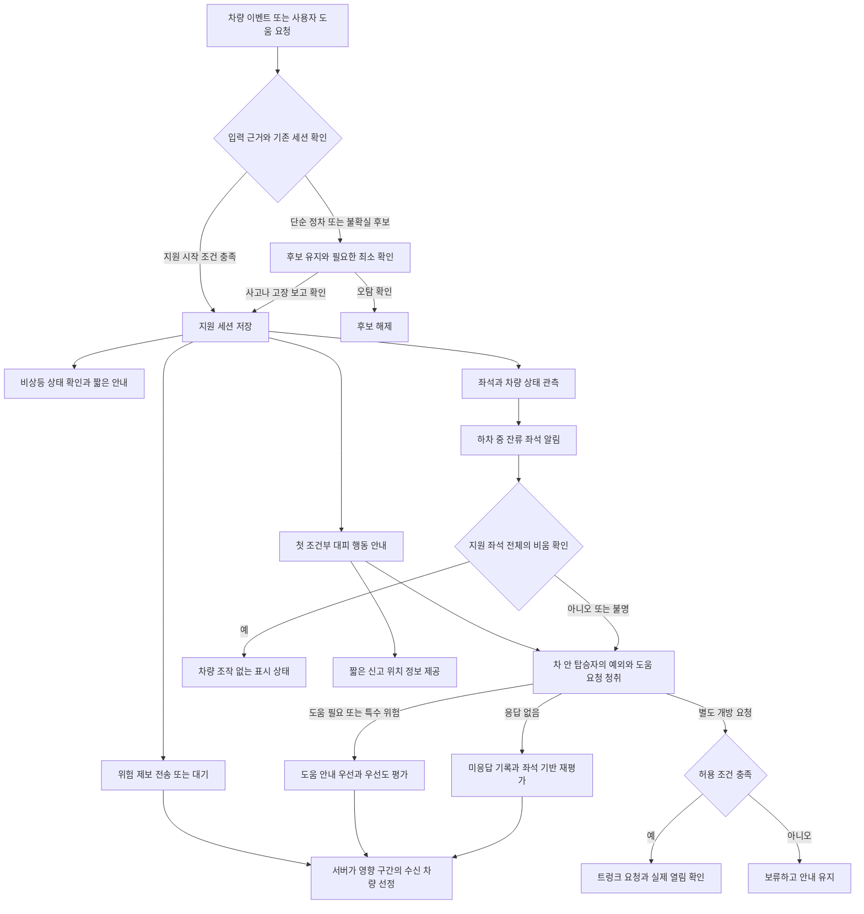
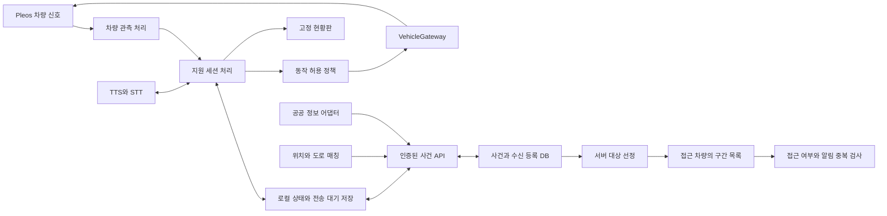
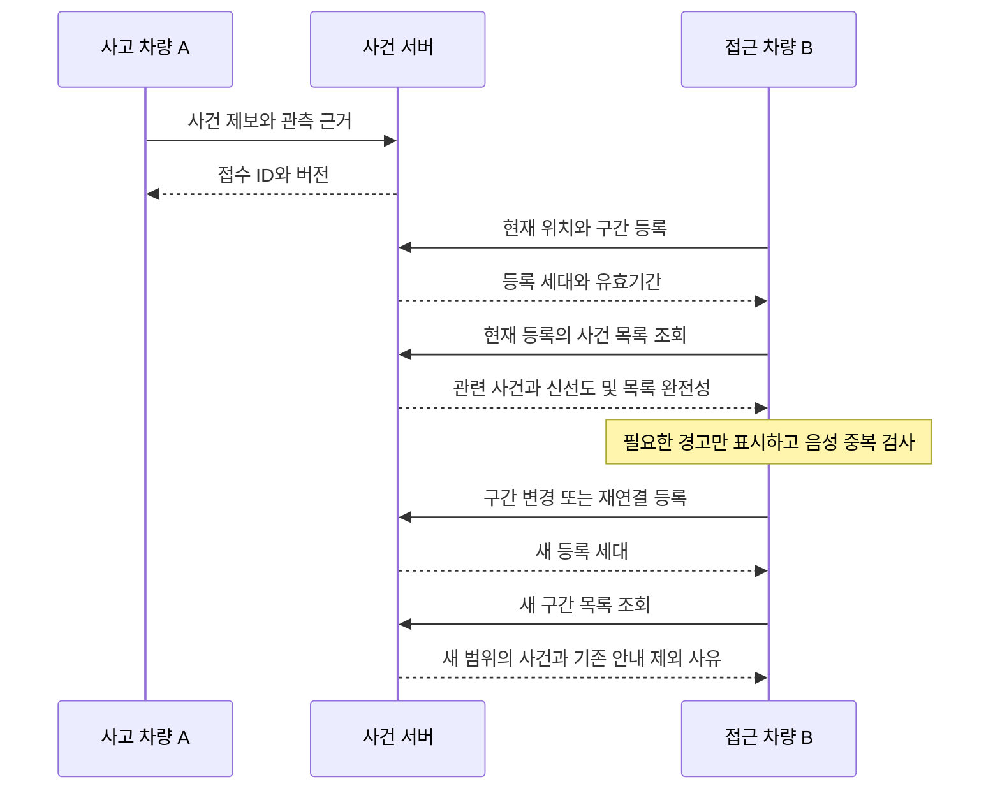

# 세이프티스탭 서비스 설계·후속 개발 계획 — 검토용

> 후속 실행 기준: [Phase별 실행 계획 1.3](safetystep-execution-plan.md). 아래 1.1은 설계·시험의 검토 경위로 보존한다. 작업 순서·이번 범위·시험 비적용 여부가 충돌하면 1.3을 따른다.

작성일: 2026-11-17 · 문서 버전: 검토 초안 1.1 — 목적 지표·행동 우선 구조 반영

기준 구현: SafetyStep 0.5, main 병합 커밋 `78b0fddac8f41529747825d7c3b7759acbcd1206`

저장소: [A-ITM/SafetyStep](https://github.com/A-ITM/SafetyStep)

이 문서는 기획서, 팀의 위험 전파·종료 의견, 후속 논의, 현재 코드를 대조한 설계안이다. 기존 대화를 읽지 않은 검토자도 문제 정의와 구현 차이를 이해하고 수정 의견을 남길 수 있도록 작성했다. **구현 완료 보고서가 아니다. 4절 이후의 상태·API·분기·검수 규칙은 별도 표시가 없으면 후속 개발 제안이다.**

개인정보·참가자 기본 정보·동의 내용은 포함하지 않는다. 코드 변경, 클라우드 배포, 새로운 차량 제어 시험은 이번 문서 작성 범위에 포함하지 않았다.

이번 개정의 판단 기준은 **이동 가능한 탑승자의 위험 장소 체류를 줄이고, 접근 차량이 사고 지점에 도달하기 전에 경고를 전달하는가**이다. 1.0의 상태 분리·오류 방지 설계를 유지하면서 첫 행동 안내, 경고 리드타임, 공공 정보, 효과 계측을 개발의 앞 단계로 옮겼다. 변경 의견 12개에 대한 반영 위치와 제한은 19절에 기록했다. 기획서의 통계를 근거로 모든 탑승자가 이동 가능하다고 가정하거나, 무응답을 이동 가능으로 바꾸지는 않는다.

## 1. 검토 요청과 읽는 순서

먼저 확인할 질문은 다음 다섯 가지다.

1. 질문·제어 확인을 기다리지 않고 첫 행동 안내가 목표 시간 안에 나오는가? 뒤차 경고가 목표 리드타임을 확보하는가?
2. 무응답·음성 오류·이동 불가·동승자 잔류·센서 미확인을 서로 다르게 처리하는가?
3. 현재 배포 가능한 비상등 확인·안내가 즉시 작동하며, 선택적인 트렁크 제어가 대피를 지연하지 않는가?
4. 서버가 필요한 차량에만 사건을 보내고, 진입·이탈·재연결·정보 만료를 정확히 처리하는가?
5. 누가 어떤 근거로 사건을 끝낼 수 있으며, 잘못된 종료가 다른 지원까지 없애지 않는가?

| 검토 관점 | 우선 읽을 부분 | 요청할 의견 |
| --- | --- | --- |
| 서비스·안전·UX | 2, 4~9, 14, 16절 | 누락된 상황, 부적절한 안내·자동 동작, 사용자가 오해할 표시 |
| Android·Pleos·음성 | 3~10, 14~16절 | 실행 가능성, 신호 근거, 중단·복구, 제어 중복 위험 |
| 백엔드·위치·전파 | 10~14, 16절 | 구간 선정, 동기화, 권한, 신선도·종료 계약 |
| 개발 운영·QA | 3, 14~17절 | 범위·우선순위·검수 기준·의존성 |

문서의 표현은 구분해서 읽는다.

- **합의 방향**: 지금까지 사용자가 선택하거나 팀 의견으로 제시한 요구. 기술적으로 입증되었다는 뜻은 아니다.
- **현재 확인**: 0.5 코드·검수 기록에 근거한 에뮬레이터 또는 로컬 시험 결과.
- **설계 제안**: 이번에 구체화한 처리 규칙. 팀 검토 후 확정한다.
- **결정 필요**: 지원·정책·근거가 부족해 구현이나 실제 적용을 확정할 수 없는 부분.

## 2. 문제 정의와 합의된 서비스 방향

### 2.1 해결하려는 문제

고속도로 사고·고장 후 차량이 멈추면 탑승자의 안전 확보와 뒤따르는 차량의 위험 인지가 함께 필요하다. 사고 직후에는 당황하거나 다쳐 안내를 찾아 읽고 여러 버튼을 누르기 어렵다. 응답할 수 없는 탑승자에게는 응답해야 시작되는 서비스도 충분하지 않다.

세이프티스탭의 역할은 **차량이 먼저 가능한 안전 행동을 짧게 안내하고, 도움 요청·이동 불가 같은 예외를 들으면서 접근 차량에 위험을 일찍 전달하는 것**이다. 역할·응답·이동 가능 질문을 모두 통과해야 안내를 시작하는 구조를 없앤다. 음성 입력은 예외와 정정을 반영하는 데 사용하며 의식·부상 정도를 진단하지 않는다.

비트박스는 비상등·트렁크·밖으로 이동·스마트폰 신고를 기억하도록 돕는 기본 틀이다. 공식 안내의 일반 원칙을 참고하되, 이것이 모든 충돌에서 트렁크 자동 개방을 허용하거나 센서만으로 안전한 대피 경로를 판단할 근거는 아니다. 분기별 자동 제어·구체적 안내 문장은 제조사·안전 전문가의 검토가 필요하다. [정책브리핑의 한국도로공사 비트박스 안내](https://www.korea.kr/news/policyNewsView.do?newsId=148931463)

### 2.2 추적할 핵심 요구사항

| ID | 요구사항 — 이번 개정안 포함 |
| --- | --- |
| R01 | 첫 MVP는 고속도로 사고·고장 후 정차에 집중한다. 단순 정차를 사고로 확정하지 않는다. |
| R02 | 정상 사고 대응은 첫 행동 안내부터 시작한다. 역할·응답 질문이나 다음·완료 버튼을 선행 조건으로 두지 않는다. |
| R03 | 첫 행동 안내, 도움 요청 청취, 비상등 확인, 좌석 관측, 위험 정보 전송을 병행한다. 제어·네트워크 실패가 안내를 지연하지 않는다. |
| R04 | 무응답은 의식불명이 아니며, STT 오류는 무응답이 아니다. 도움 요청과 늦은 응답을 반영한다. |
| R05 | 비상등 상태를 읽어 꺼짐/미확인이면 즉시 짧게 안내하고, 켜짐은 관측으로 확인한다. 지원이 검증된 환경만 자동 ON을 추가한다. 트렁크는 별도 요청·안전 조건을 충족할 때의 선택 기능이다. |
| R06 | 명령 접수와 실제 동작을 구분한다. 요청·시간 경과·버튼 터치만으로 체크를 완료하지 않는다. |
| R07 | 좌석 관측으로 잔류 승객 확인 안내와 경고 우선도 판단을 지원한다. 하차 중 확인할 기회를 제공하되 외부에서 들린다고 가정하지 않는다. 좌석 비움은 안전지대 도착이 아니다. |
| R08 | 기존 차량 상태·내비게이션 옆의 앱 패널에 행동 안내를 최우선으로 두고 잔류 좌석·신고 위치를 보조 표시한다. 라이트·다크 모두 지원한다. |
| R09 | 백엔드는 사건 영향 구간과 차량의 현재 구간·방향을 대조해 필요한 차량에만 정보를 보낸다. |
| R10 | 나중 진입·재연결 차량도 현재 구간의 사건을 받는다. 이탈은 그 차량의 안내만 해제한다. |
| R11 | 통신 단절·정보 만료·전원 하차는 사건 종료가 아니다. 종료는 사건별 권한과 근거로 판단한다. |
| R12 | 실제 SDK 관측, 운영자 재현 입력, 미지원 기능을 구분한다. 영상은 로그·기능 검증을 보완한다. |
| R13 | 지원 시작부터 첫 조건부 대피 행동 문장의 음성 출력 완료까지 N초 이내여야 한다. 정상 지원 조건에서 질문·제어 응답 대기를 포함해 측정한다. 초기 실험 목표 N=8초, 발화 시작 2초 이내를 제안하며 D13에서 고정한다. |
| R14 | 접근 차량이 사고 지점에 도달하기 Y초 전까지 첫 경고를 수신하고 핵심 경고 음성을 출력해야 한다. 초기 실험 목표 Y=10초를 제안하며 D14에서 지연 예산·시험 조건과 함께 고정한다. |

N·Y는 실도로 안전 기준이 아니라 **첫 구현부터 검증할 공학적 목표 초안**이다. 사전 파일럿으로 문장 길이·SDK 지연을 확인한 뒤 본 평가 전에 값을 고정한다. 결과를 본 뒤 기준을 완화해 통과시키지 않는다. 음성 시작 로그만으로 내용을 전달했다고 계산하지 않고, 핵심 행동/경고 문장의 출력 완료도 기록한다.

R13의 기준 시점은 지원 시작 이벤트를 앱이 받은 시점이다. 사고 신호 발생→앱 수신·기동 지연도 별도로 기록해 자동 기동의 지연을 숨기지 않는다. 알려진 이동 불가·특수 위험, 미정차, 통화·출력 불가 등은 별도 경로와 건수로 보고한다. 제외 사례를 정상 성공으로 계산하지 않는다.

R14는 서버 ACK가 아니라 수신 차량의 결과다. 원천 정보가 늦게 올라오거나 이미 가까이 접근한 차량은 목표를 물리적으로 못 맞출 수 있다. 그러한 사례도 전체 위험 접근 건수의 지연/누락으로 남기며, 12.5절에서 전송 시스템 성능과 원천 정보의 한계를 따로 집계한다.

### 2.3 문서 간 차이를 이렇게 정리한다

접수양식의 ‘단계별 지원’은 행동을 이해시키는 틀로 해석하고 화면이나 질문의 통과 순서로 만들지 않는다. 이번 검토 의견을 반영해 **행동 우선 안내를 기본안으로, 트렁크는 요청형 선택 기능으로 변경**한다. 0.5의 전방 자동 개방은 과거 기술 시험 결과로 보존하며 다음 제품 흐름의 필수 기능으로 유지하지 않는다. 비상등은 실제 배포 가능한 확인·안내 경로를 먼저 완성한다. 이는 이전 자동 제어 우선 논의에 대한 이번 수정안이다.

기획서에는 음성 의미 분류·화면 전환을 통합할 예정이라고 적혀 있지만 0.5에는 제한된 표현의 분류와 자동 흐름이 구현되어 있다. 반대로 공공 API·Supabase·사고 자동 기동은 기획에 있어도 운영 구현 완료로 볼 수 없다. 본 문서는 최신 구현 사실과 목표를 분리한다.

### 2.4 범위

| 다음 개발의 범위 | 후속 협의·별도 실증 범위 |
| --- | --- |
| 응답·도움 필요 확인, 좌석별 관측, 조건부 차량 제어, 중단·복구 | 의식·부상 진단, 심박·호흡 기반 판단 |
| 자체 앱 차량 사이의 구간별 위험 정보 전달 | 다른 내비게이션 전체에 전파, 공공 시스템에 자체 사건 직접 등록 |
| 공공 돌발정보 1종을 평상시 기본 경고원으로 연동 | 여러 기관 통합 운영과 공식 사고 종료 확인 연계 |
| 실제 관측에 따른 상태 표시, 가능한 도움 요청 수단 안내 | 긴급기관 자동 신고·구조 접수·출동 확약 |
| 최소 도로 판정·보조 시작 오탐 검수, 고정 안내 비교 모드·목적 지표 계측 | 실험만으로 실제 사고 감소율을 입증하는 주장 |
| 에뮬레이터·정차 환경·통제된 평가 | 실도로 안전성 검증과 실차 자동 제어 배포 |

## 3. 현재 구현과 다음 설계 사이의 차이

기준은 0.5 코드와 2026-11-15 검수 기록이다. 이번 작성 중 시험을 다시 실행한 결과는 아니다. [기준 README][S1], [0.5 검수 기록][S2]

| 항목 | 현재 확인 | 남은 설계·검증 |
| --- | --- | --- |
| 자동 흐름 | 외부 사고 이벤트 후 정상 흐름 앱 터치 0회 | 실제 사고 신호와 앱 비전면·종료 상태 시작 |
| 비상등 | SDK 직접 쓰기는 800001 권한 오류. 명시 선택한 debug 콘솔 어댑터로 ON 요청 후 실제 점멸 관측 | 배포 권한·공식 제어 경로·차종별 지원 |
| 트렁크 | 전방 조건부 실제 SDK 개방·열림 확인, 후방 보류 | 충돌 방향·손상·후방 공간의 신뢰 가능한 입력 |
| 음성 | 실제 Pleos TTS/STT, 노트북 마이크 단독 시험, 합성 PCM 연속 흐름 | 실제 발화·소음·동승자·모순·중단·늦은 응답 평가 |
| 좌석 | 실제 Vehicle Service 값으로 탑승·비움·미확인 처리 | 차종별 지원 좌석 전체성, 물체·카시트, 누락·흔들림 |
| 에어백·Gleo | 에어백 속성 현재 미지원. Gleo 계약·일부 시험 호출 확인 | 에어백 이벤트·콜드 스타트·마이크에서 Gleo 호출까지 연속 검증 |
| 위험 전파 | 로컬 HTTP로 사건 교환, 앱에서 도로·방향·거리 필터 | 서버의 대상 선정·실위치 매칭·인증·영속 저장 |
| 사건 수명 | 생성 후 180초 TTL, 활성 사건 갱신 없음 | 관측 갱신·신선도·수신 등록 유효기간·종료 권한 분리 |
| 영상 | 후방·전방 장면과 음성 편집본 | 실시간 대화 지연·실차 적용의 증거로 사용할 수 없음 |

### 코드 검토에서 우선 보완할 지점

| ID | 관찰한 코드 | 영향과 수정 방향 |
| --- | --- | --- |
| G01 | `setForeground(false)`가 음성·차량 관측·네트워크 루프를 중단한다. | 화면 이탈과 사고 지원 종료를 분리해야 한다. 백그라운드 실행 권한은 별도 검증한다. |
| G02 | `SupportPolicy.screen()`은 도로 사건이 RESOLVED이면 DRIVE를 우선 반환한다. | 도로 사건 종료가 아직 필요한 탑승자 지원 화면을 없애지 않도록 상태 의존을 끊는다. |
| G03 | `Incident`의 응답자·이동 가능 상태가 각 1개다. | 동승자 응답으로 운전자까지 확인됐다고 해석하지 않도록 사람·대상·보고 범위를 나눈다. |
| G04 | `acceptSpeech()`는 RESPONSE/MOBILITY 화면에서만 처리한다. | 도움·대피 안내 이후의 새로운 도움 요청·정정도 사건 단위로 받아야 한다. |
| G05 | 서버 GET이 저장된 사건 전체를 반환하며, 메모리 Map과 시험용 A/B 신원을 쓴다. | 수신 차량별 서버 필터·인증·DB가 필요하다. 현재 경고 제외 검사는 전송 차단 검사가 아니다. |
| G06 | 활성 사건을 갱신할 수 없고 생성 시각·위치·만료 시각이 고정이다. | 오래 지속되거나 위치가 정정된 사건을 버전으로 갱신하는 계약이 필요하다. |
| G07 | 제어 시도 선기록으로 중복을 막지만 기록 직후 종료되면 실제 전송 여부가 불명일 수 있다. | 복귀 시 관측부터 하고 결과 불명을 보존한다. ‘반드시 한 번 실행’을 보장한다고 쓰지 않는다. |
| G08 | 현재 정상 흐름이 응답·이동 가능 확인 이후 대피 안내로 진행된다. | 첫 조건부 행동 안내를 먼저 내고, 예외 청취·잔류 알림·전파는 병행한다. R13 지연을 계측한다. |
| G09 | 모의 고정 위치와 경고 거리 필터는 있으나 원천부터 음성 출력까지의 시간 예산·실주행 경고 효과 계측이 없다. | R14 지연 예산과 실제 주행 UX 전달, 감속 관측·제한적 재경고 시험을 추가한다. |

근거: [실행·음성 코드][S3], [지원 정책][S4], [사건·수신 정책][S5], [로컬 서버][S6], [저장 코드][S7]. 이 표는 설계상 보완점이며 이번에 코드를 수정했다는 의미는 아니다.

## 4. 단일 진행 단계 대신 독립적인 상태를 관리한다

### 4.1 상태 모델

| 상태 축 | 제안 값·의미 | 다른 상태로 대신 판단하면 안 되는 것 |
| --- | --- | --- |
| 지원 세션 | IDLE / CANDIDATE / ACTIVE / PASSIVE / DISMISSED | 도로 사건 종료 = 지원 종료 |
| 응답 관측 | NOT_ASKED / LISTENING / HEARD / NO_RESPONSE / UNAVAILABLE / INTERRUPTED | 무음 = 의식불명, 오류 = 무응답 |
| 발화의 대상·역할 | 운전자 / 동승자 / 불명, 본인 보고 / 타인 보고 | 동승자 발화 = 운전자 응답 |
| 이동·도움 | UNKNOWN / SELF_REPORTED_CAN_MOVE / HELP_NEEDED | ‘네’ 한마디 = 이동 가능, 말 가능 = 신체적으로 안전 |
| 좌석 관측 | 좌석별 OCCUPIED / EMPTY / UNKNOWN / UNSUPPORTED | 벨트 해제·문 열림 = 하차, 좌석 비움 = 안전지대 도착 |
| 차량 동작 | NOT_REQUESTED / BLOCKED / REQUESTING / OBSERVED / FAILED / RESULT_UNKNOWN | ACK = 실제 켜짐·열림 |
| 도움 연결 | NOT_REQUESTED / OFFERED / ATTEMPTING / CONNECTED / FAILED / UNKNOWN | 통화 연결 = 구조 접수·출동 |
| 도로 사건 | ACTIVE / RESOLVED / RETRACTED | 하차·전송 실패·유효기간 경과 = 위험 해소 |
| 정보 신선도 | FRESH / STALE / UNKNOWN | 오래된 ACTIVE = 최신 위험 확정 |
| 내 차량의 경고 | HIDDEN / VISUAL / SPOKEN / STATUS_UNKNOWN | 안내 해제 = 서버 사건 종료 |
| 공유 경고 우선도 | STANDARD / EARLY_CAUTION, 근거 시각·유효기간 | 의학적 중증도·익명 정보·구조 요청으로 간주 금지 |
| 수신 후 차량 변화 | DECEL_OBSERVED / NO_CLEAR_CHANGE / UNAVAILABLE | 감속 = 경고를 들었음, 브레이크 없음 = 졸음 확정 |

`PASSIVE`는 관측 좌석 비움 이후 차량 조작을 요구하지 않는 표시 상태다. 도움 필요 이력이나 도로 사건을 지우는 완료 상태가 아니다. `RETRACTED`는 오등록이 확인되어 제보를 철회한 상태로, 실제 위험이 있었고 해소된 `RESOLVED`와 구분한다.

`SupportSession`은 탑승자 지원의 단위, `Incident`는 공유 도로 위험의 단위다. 한 지원 세션이 공유 사건을 가질 수도 있고, 위치·동의·통신 문제로 아직 공유 사건이 없을 수도 있다. 받은 타 차량 사건은 수신 경고에만 들어가며 내 차량의 사고 지원 세션을 자동 생성하지 않는다.

### 4.2 모든 입력에 붙일 정보

값만 저장하지 않고 `source`, `observedAt`, `receivedAt`, 지원 여부, 품질 상태를 함께 기록한다. 이벤트·질문·명령에는 각각 ID를 붙인다. 로컬 경과 시간은 단조 증가 시계로 재고, 재부팅 뒤에는 이전 경과 시간과 조건을 그대로 신뢰하지 않는다. 서버 수신 시각을 실제 관측 시각으로 덮어쓰지 않는다.

운영자 입력은 `TEST_OPERATOR`, 사용자의 말은 `USER_REPORT`, 실제 SDK 관측은 `VEHICLE_SDK`로 분리한다. STT 문장이나 LLM 해석이 차량 센서값으로 바뀌어 저장되지 않도록 한다.

### 4.3 동시에 들어오는 입력과 상태 전환

세션별 입력은 한 처리 경로에서 순서대로 적용하고 상태 revision을 증가시킨다. 관측값은 속성별 시각·출처를 비교해 오래된 값으로 덮어쓰지 않는다. 비동기 작업은 시작 당시의 sessionId·revision·작업 ID를 가지고 돌아오며, 적용 전에 현재 상태와 다시 대조한다.

| 경합 | 적용 원칙 |
| --- | --- |
| 개방 준비 중 HELP_NEEDED 또는 새 충격 | 새로운 제약을 먼저 반영해 아직 실행되지 않은 개방 자격 취소 |
| 이전 질문 결과와 새 질문 결과 | 현재 질문에 대한 결과만 적용. 새 도움 요청은 별도 사건 입력으로 수용 |
| ‘내렸어요’라는 발화와 좌석 점유 관측 | 자기 보고와 센서 관측을 함께 보존. 발화로 센서값을 EMPTY로 덮어쓰지 않음 |
| 좌석 비움과 기존 도움 필요 | IVI 조작을 요구하지 않는 표시로 전환하되 도움 필요 이력·연결 상태는 유지 |
| 도로 사건 종료와 로컬 도움 필요 | 도로 축만 종료. 지원 세션은 별도 판단 |
| 위치 구간 변경과 이전 목록 응답 | 새 등록 세대가 우선. 이전 범위 응답으로 경고를 되살리지 않음 |
| 사용자 직접 제어와 앱의 과거 요청 결과 | 현재 실제 관측을 우선 표시. 과거 성공으로 현재 켜짐/열림을 고정하지 않음 |

일반적인 읽기 후 제어 호출 사이에도 차량 상태가 바뀔 수 있다. 앱의 재확인은 이 간격을 줄이는 장치이며 하드웨어 차원의 원자적 안전 보장은 아니다. SDK/제어기가 제공하는 자체 인터록과 명령 취소·거절 조건을 D02에서 확인해야 한다.

## 5. 사고 입력과 전체 흐름



첫 조건부 대피 안내는 정차가 확인된 일반 사고·고장 경로의 기본값이다. 이미 이동 불가·화재 등 예외가 알려졌으면 적절한 도움 안내로 우선 분기한다. ‘응답 없음’이 이동 가능을 뜻하지는 않으며, 응답을 기다리지 않고 일반 행동 정보를 먼저 제공한다는 뜻이다. 그림의 병렬 가지에서 차량 조회·비상등 요청·서버 ACK가 첫 안내를 막지 않는다. 화면은 위 노드를 하나씩 넘기지 않는다.

### 5.1 시작 분기

| 입력·상황 | 제안 처리 | 금지·주의 |
| --- | --- | --- |
| 지원되는 신규 사고 이벤트 + 정차 관측 | 지원 활성화, 첫 행동 안내·비상등 확인·예외 청취·전파 병행 | 에어백만을 유일한 시작 조건으로 삼지 않음 |
| 운전자·동승자의 사고/고장 도움 요청 | 지원 세션 생성, 위치·정차·도움 상태 별도 확인 | 목소리만으로 방향·손상·후방 공간 확정 금지 |
| 급감속·장시간 정차만 있음 | 최소 도로 판정으로 본선/휴게소·졸음쉼터·요금소/불명을 구분하고 CANDIDATE 평가. 필요한 도움 확인만 수행 | 정체를 본선 정차만으로 사고로 확정하지 않음. 후보 발생 자체의 오탐률도 측정 |
| 사고 입력은 있으나 움직임·정차 상태 불명 | 사건 근거는 보존, 주행 중 UX 준수, 트렁크·하차 유도 보류 | 이동 중 세부 대화나 화면 조작 강요 금지 |
| 앱 시작부터 에어백 값 true | 저장 사건·이벤트 시각과 대조해 복구 여부 판단 | 과거 true를 무조건 신규 사고로 판정 금지 |
| 동일 입력 중복·회전·테마 변경 | 같은 세션과 명령 기록 재사용 | 새 세션·질문·명령 중복 생성 금지 |
| 활성 세션 중 별도 새 충격 | 새 관측 추가, 후방 공간 등 기존 허용 조건 즉시 무효화, 도움 상태 재평가 | 기존 사건이 있다는 이유로 무조건 무시하지 않음 |
| 사용자가 ‘사고 아니에요’라고 정정 | 후보 단계면 해제. 공유된 제보라면 철회 검토를 별도 기록 | 사용자 정정만으로 공공 사건·다른 제보 삭제 금지 |

‘입력 근거 확인’은 실제 사고 확진이 아니다. 공공 확인, 차량 신호 기반, 사용자 제보 등 출처의 신뢰 수준을 보존한다. **로컬 지원을 시작할 수 있는 조건과 도로 위치를 확정해 공유할 수 있는 조건은 다르다.** 위치가 불명이어도 로컬 지원은 가능하지만 전체 지역에 사건을 퍼뜨리지 않는다.

### 5.2 자동 시작의 플랫폼 의존성

전면 / 다른 앱 뒤 / 화면 재생성 / OS 프로세스 종료 / 재부팅 / 사용자 강제 중지를 나누어, 사건 수신·저장·화면 표시·TTS·마이크를 각각 시험한다. ADB가 Activity를 실행한 결과를 배포 앱의 자동 기동 증거로 쓰지 않는다.

Android는 백그라운드 서비스 시작과 Activity 시작을 제한하며, 마이크의 사용 중 권한에도 조건이 있다. 서비스 클래스를 추가하는 것만으로 해결됐다고 판단하지 않는다. [서비스 시작 제한](https://developer.android.com/develop/background-work/services/fgs/restrictions-bg-start), [Activity 시작 제한](https://developer.android.com/guide/components/activities/secure-bal)

Gleo 공식 인터페이스는 사용자 음성 명령과 앱의 Action·Callback 연동을 설명한다. 이것만으로 사고 발생 시 Gleo가 선제 호출·마이크 사용·종료 앱 기동을 보장한다고 추론하지 않는다. 앱의 선제 질문은 직접 TTS/STT 경로로 설계하고, Gleo는 지원 시작·상태 확인의 별도 진입점으로 검증한다. [Gleo Interface](https://document.pleos.ai/docs/pleos-only/app-integration-guide/guide/core-concepts)

지원되지 않는 실행 상태는 지원표에 명시한다. 수동 시작을 제공하더라도 ‘완전 자동 대응 완료’로 표시하지 않는다.

## 6. 행동 우선 안내와 예외 분기

### 6.1 대화 규칙

정차가 확인된 일반 경로에서는 “말씀하실 수 있나요?” → 역할 → 이동 가능 여부의 선행 질문을 없앤다. 첫 발화에서 행동과 도움 요청 방법을 전달하고, 질문은 예외를 명확히 할 때만 한 가지씩 한다. 초기 문장안은 다음과 같으며, 실제 길이·이해도·안전 문구를 파일럿에서 검수한다.

> “움직일 수 있고 주변이 안전하면 차량에서 떨어진 안전한 곳으로 이동하세요. 도움이 필요하면 ‘도와줘’라고 말하세요.”

비상등 문장은 최신 관측에 따라 짧게 붙이거나 별도 출력한다. 켜짐을 확인하지 못했는데 “비상등이 켜졌습니다”라고 말하지 않는다. 비상등·신고 위치·선택 질문 때문에 첫 행동 문장의 출력이 R13을 넘지 않도록 음성 우선순위를 둔다. 가드레일 유무·안전한 출구를 확인하지 못한 상황에 특정 방향으로 무조건 나가도록 지시하지 않는다.

- TTS 종료와 청취 준비 성공 뒤에 응답 시간을 센다. 마이크 준비 실패 시간을 무응답 시간에 포함하지 않는다.
- `utteranceId`, `questionId`, `sessionId`를 대조해 이전 질문·이전 세션의 지연 콜백을 무시한다.
- 첫 행동 안내 뒤 유효 청취 창에서 도움 요청·이동 불가·정정을 받는다. 별도 질문 없이 받은 ‘네’는 안내를 계속하기 위한 통과 조건이 아니다. 무응답인데 잔류 점유가 계속되면 “도움이 필요하면 말씀해 주세요”처럼 재확인 1회부터 평가한다. 안내를 처음 내보내기 위해 이 시간을 기다리지 않는다.
- 도움 요청·이동 불가가 들어오면 현재 질문 순서보다 우선한다. 긴 역할 확인 때문에 도움 경로를 지연하지 않는다.
- 대피 안내 이후 청취 대상은 **차 안에 남은 탑승자**다. 차 밖의 사람에게 차 마이크·스피커가 도달한다고 가정하지 않는다. 발화 도중 끼어드는 도움 요청을 받을 수 있는지 먼저 시험하고, 미지원이면 첫 문장을 짧게 나누고 종료 직후 청취한다. 전이 중 발화 누락도 측정한다.
- 오디오 우선순위는 이미 접수된 긴급 도움/특수 위험 안내, 아직 전달되지 않은 첫 행동 안내, 잔류 승객 알림, 짧은 신고 위치, 선택적 트렁크 질문 순이다. 통화·플랫폼 제한은 별도로 준수한다. 같은 음성 출력 큐에서 서로 기다리는 시간도 R13에 포함한다.
- 음성 생성·인식 또는 LLM의 해석은 제어 의도를 제안할 수 있지만 차량 제어 정책을 우회할 수 없다.

### 6.2 분기표

| ID | 관측·발화 | 기록·다음 동작 | 잘못된 해석 방지 |
| --- | --- | --- | --- |
| B01 | 자발적인 “네, 들려요” | 응답 관측만 추가. 역할·이동 질문을 이어 붙이지 않음 | 응답만으로 이동 가능·운전자 정상 확정 금지 |
| B02 | 자발적인 “저는 운전자예요. 움직일 수 있어요” | 본인 보고를 기록. 이미 시작한 안내와 관측 유지 | 첫 안내의 필수 입력이나 다른 탑승자 상태로 확대 금지 |
| B03 | “못 움직여요 / 도와주세요” | HELP_NEEDED, 도움·신고 도우미 우선, 개방 보류, 공유 우선도 평가 | 일반 이동 안내를 반복하거나 도움 접수를 꾸미지 않음 |
| B04 | “동승자인데 운전자가 대답이 없어요” | 동승자 응답 + 운전자 미응답의 타인 보고. 운전자 상태 미확인 유지 | 전원 응답 확인 처리 금지 |
| B05 | “아니, 못 움직여요 / 잘 모르겠어요” | 불가·불확실. 명확하지 않으면 UNKNOWN 또는 HELP_NEEDED | 긍정 단어 일부만 추출해 CAN_MOVE 처리 금지 |
| B06 | 첫 안내 뒤 유효 청취가 끝났지만 무음 | NO_RESPONSE. 최신 잔류 점유 등과 함께 EARLY_CAUTION 검토, 재확인은 제한. 전파는 첫 안내부터 이미 시작 | 무음만으로 의식불명·대피 실패·신고 완료 확정 금지 |
| B07 | STT 오류·마이크 거절·TTS 실패 | UNAVAILABLE 및 원인 분리. 다른 지원은 유지 | NO_RESPONSE와 합치지 않음 |
| B08 | 통화·내비 안내·오디오 포커스 중단 | INTERRUPTED. 질문·시간 측정 정지, 복귀 시 현재 상태로 재평가 | 통화 시간을 무응답으로 세지 않음 |
| B09 | 타임아웃 뒤 늦게 도움 요청 | 같은 활성 세션의 현재 발화면 수용, 도움 우선 상태로 갱신 | 화면 단계가 지났다는 이유로 버리지 않음 |
| B10 | 여러 사람 동시 발화·대상 불명 | 도움 표현이 있으면 먼저 도움 경로. 대상 확인은 필요한 경우만 | 역할 확인을 위해 첫 대피 안내나 도움을 지연하지 않음 |
| B11 | 먼저 “이동 가능”, 뒤에 “도와주세요” | 최신 도움 요청 우선. 실행 전 제어 자격 취소 | 이전 CAN_MOVE로 대기 명령 실행 금지 |
| B12 | “도움 필요” 뒤 “이제 괜찮아요” | 동일 대상의 의미를 짧게 재확인한 뒤 변경 | 한마디로 기존 도움 요청·다른 탑승자 문제까지 삭제 금지 |
| B13 | 화재·연기·침수·전복 등 보고 | 일반 질문 반복을 줄이고 별도 긴급 안내 정책 적용 대상으로 분리, 트렁크 자동 보류 | 검토되지 않은 일괄 탈출 방향·구조 행동을 생성하지 않음 |

B01~B13은 들어올 수 있는 입력을 정리한 시험 분류이며 순서대로 수행할 대화 단계가 아니다. 역할은 자발적 발화나 도움 대상 구분에 필요할 때만 확인한다. B13의 상세 구조 절차는 별도 검토하며 일반 탈출 지시를 생성하지 않는다. 전원 무응답일 때도 관측·전파를 지속하고 10.4절의 조건으로 경고 우선도를 갱신한다. 이것은 외부 구조 접수를 대신하지 않는다.

## 7. 좌석과 하차 상태

좌석 관측의 목적은 **잔류 탑승자를 놓치지 않는 짧은 알림과, 필요한 경우 뒤차 경고를 더 앞당기는 판단**이다. 좌석도는 그 판단을 설명하는 보조 표시다. 대피 뒤 아무도 보지 않는 화면을 완성하는 것을 효과 지표로 삼지 않는다.

기본 차량 신호는 사람의 안전을 직접 관측하지 않는다. 좌석 점유가 물체인지 사람인지, 벨트 해제가 하차인지, 빈 좌석의 사람이 안전지대에 도착했는지 구분할 수 있다고 가정하지 않는다.

1. 차종의 실제 좌석 구성과 API가 지원하는 좌석 집합을 먼저 식별한다. 지원 좌석이 한 개뿐이면 ‘전원 하차’라고 표시할 수 없다.
2. 사건 전후 탑승 관측의 기준 집합을 저장한다. 처음부터 빈 좌석과 이번 사건에서 점유→비움이 된 좌석을 구분한다.
3. 각 좌석은 탑승·비움·미확인·미지원으로 표시한다. 누락된 값과 오래된 값은 비움으로 바꾸지 않는다.
4. 문·벨트는 변화의 보조 근거다. 문이 열려도 점유가 남아 있으면 탑승 표시를 유지한다.
5. 운전석 하차 징후(문 변화·점유 변화)가 있고 다른 좌석의 신선한 점유가 남으면 한 번 짧게 알린다. 하차 전/문이 열린 시점에 기회를 확보하되 비어 있다는 확정 전까지 실제 하차로 단정하지 않는다. 예: “뒷좌석을 확인해 주세요. 이동이 어려우면 도움을 요청하세요.” 사용성 시험에서 실제 동승자가 함께 있는 상황에는 “뒷좌석 승객도 함께 대피해 주세요”를 비교한다. 센서 점유만으로 사람이 있다고 단정하지 않는다.
6. 기대 좌석 전체가 지원되고 최신 비움 관측이 일정 시간 유지된 경우에만 ‘좌석 비움 확인’으로 표시한다. 현행 3초는 실험값이다.
7. 비움 후 값이 다시 점유·불명으로 바뀌면 표시도 갱신한다. 완료 상태를 영구 고정하지 않는다.
8. 좌석이 모두 비어도 도움 요청 이력은 남고 도로 사건은 계속된다. 차량으로 돌아와 완료·신고 버튼을 누르게 하지 않는다.

관측 좌석 전체성·동일성·신선도·점유 기준선 검증을 추가한다. 현재 `CabinClearGate`는 관측된 좌석 집합을 기준으로 하므로, 차종의 실제 전체 좌석 지원을 증명하는 단계가 따로 필요하다. [현재 좌석 정책][S8]

잔류 알림은 첫 행동 안내 후, 운전자에게 아직 들릴 수 있는 하차 시점에 배치한다. 이미 차 밖에 있는 운전자에게 다시 차로 돌아오라고 지시하지 않는다. 차 안에 남은 사람에게는 도움 요청 청취를 유지한다. 스피커 도달·이해 여부는 시험 참가자 관측으로 확인하며 음성 재생 로그만으로 ‘알림 전달 성공’으로 삼지 않는다. 잔류가 해소되지 않거나 도움 요청이 있으면 10.4절의 우선도 정책으로 연결한다.

## 8. 비상등·트렁크 제어

### 8.1 공통 실행 규칙

차량 제어는 UI 전환의 부수 효과가 아니라 별도 제어 처리부에서 실행한다. 사건·동작별 식별자와 시도 기록을 먼저 저장하고, 명령 직전 최신 조건을 다시 검사한다. 실제 제어는 기존 `VehicleGateway` 경계를 유지한다.

| 단계 | 의미 |
| --- | --- |
| 자격 확인 | 지원·권한·신호 최신성·차량 상태·동작별 금지 조건 확인 |
| 시도 기록 | 세션/사건 ID, 동작, 근거, 시도 ID, 시각 영속화 |
| 요청 | 실제 SDK 또는 명시한 시험 어댑터에 명령 |
| 관측 | 명령 응답과 별도로 실제 상태 재조회 |
| 결과 | OBSERVED / FAILED / RESULT_UNKNOWN / BLOCKED 기록 |

요청 뒤 프로세스가 죽으면 재시작 후 실제 상태부터 조회한다. 요청 여부가 불명인 상태에서 같은 개방 명령을 자동 반복하지 않는다. 성공했더라도 이후 외부에서 끄거나 닫았다면 현재 관측을 반영하고 자동 재제어하지 않는다. 사용자의 직접 제어와 싸우는 루프를 만들지 않는다.

동작 실행 후 도움 요청·새 충격·이동 등 조건이 바뀌어도 역방향 명령으로 자동 복구하지 않는다. 트렁크 닫힘 또한 별도 안전 조건이 필요한 제어다. 조건 변경 전에 이미 시작된 기계적 동작의 중단 가능 여부는 제조사 계약 확인 대상이다.

### 8.2 비상등

**현재 배포 경로의 1순위는 읽기→꺼짐/미확인 안내→실제 켜짐 관측이다.** SDK 쓰기 권한이 확인되지 않은 환경에서는 실패할 명령을 먼저 보내고 기다리지 않는다. 꺼짐이면 “비상등을 켜 주세요”, 읽기 불가이면 “비상등을 확인해 주세요”를 짧게 안내한다. 이미 켜져 있으면 중복 안내·명령 없이 관측을 반영한다. 이 안내도 첫 행동 안내의 시간 예산 안에서 배치한다.

자동 ON은 공식 권한·지원이 검증된 환경에만 추가한다. 가능하면 첫 안내와 병행하되 거절·시간 초과를 기다리느라 안내를 막지 않는다. 실제 점등은 계속 관측한다. debug 콘솔 어댑터는 기술 시험용이며 배포 앱의 자동 점등 경로로 간주하지 않는다. ‘지원 환경의 자동 요청 1회’와 ‘배포 기본 경로의 즉시 확인 안내’를 별도 시험한다.

비상등 켜짐 확인은 해당 플랫폼의 신호 의미와 관측 주기에 맞춰 구현한다. 0.5에서 사용한 점멸 위상 관측 방식을 모든 차종의 보장된 SDK 계약으로 일반화하지 않는다. 사건 종료나 좌석 비움으로 비상등 OFF를 자동 요청하지 않는다.

### 8.3 트렁크는 요청형 선택 기능 — P2

대피 안내를 먼저 제공하고, 실제로 제어 가능한 지원 환경이며 상위 안내가 없을 때만 “트렁크도 열까요?”를 한 번 제안할 수 있다. 별도 명시 요청도 받는다. **응답이 없으면 생략하며, 이 질문의 응답·제어·확인 때문에 대피·신고 정보를 기다리게 하지 않는다.** 지원·조건이 처음부터 부족하면 제안 자체를 생략한다. 해당 요청에 대한 ‘네’와 다른 안내에 대한 ‘네’를 questionId로 구분한다.

| 조건 | 요청형 처리 |
| --- | --- |
| 명시적인 개방 요청 + 최신 P·정지 + 지원·권한 + 제조사 허용 조건과 필요한 주변/손상 근거 + 하차 전 | 명령 직전 재확인 후 요청에 대응하는 1회 명령, 실제 열림 확인 |
| 후방 충돌·후방 손상 가능성 | 보류 |
| 충돌 방향·손상 여부 또는 요구되는 안전 근거 불명 | 보류. 전방 사고라는 말만으로 허용하지 않음 |
| 이동 중·기어/속도 불명·후방 공간 불명·오래된 확인 | 보류 |
| 도움 필요·긴급 통화 중·하차 관측 이후 | 선택 질문 생략·개방 보류. 도움·이동 안내 유지 |
| 무응답·거절·모호한 대답 | 요청 미성립으로 생략. 재질문하지 않음 |
| 이미 열려 있음 | 새 명령 없이 관측 상태 표시 |
| 요청했지만 열림 확인 실패 | 결과 불명/실패, 자동 재요청 없이 다른 지원 유지 |

사용자의 “응”은 **개방 의사**이며 후방 공간·손상 없음의 증거가 아니다. `openConsent`와 `rearAreaEvidence`를 분리한다. 사용자가 명시적으로 주변 상태를 보고하더라도 USER_REPORT로 기록하고, 이를 어떤 조건에서 받아들일지는 제조사 제어 계약·안전 검토로 정한다. 존재하지 않는 센서를 동의 한마디로 대체하지 않는다. **현재 영상의 rearClear는 운영자 재현 입력이며 실제 센서 판별이 아니다.**

사고 직후 차 뒤로 가서 확인하거나 차량에 다시 돌아오도록 요구하지 않는다. 필요한 근거가 없는 실제 환경에서는 요청을 받아도 보류하며, 의미 없는 선택 질문을 노출하지 않는다. 이 제약을 해소할 근거가 없다면 해당 차종에서 기능을 제외한다. 0.5 자동 개방은 회귀 가능한 과거 시험으로 남기고, 다음 MVP는 트렁크 없이도 목적 지표를 통과해야 한다.

## 9. 앱 화면·운영 콘솔·음성의 역할

앱은 기존 차량 상태와 내비게이션 옆의 고정 패널을 유지한다. 가장 큰 영역은 지금 필요한 행동·도움 안내에 사용하고, 잔류 좌석 알림과 신고 위치를 그 아래에 둔다. 좌석도·비트박스는 작은 보조 현황으로 유지하며 경고를 밀어내지 않는다. 세부 비율은 현재 디자인 시스템을 기준으로 양쪽 테마와 실제 패널 폭에서 검수한다.

| 정보 | 앱 표현 원칙 | 운영 콘솔 |
| --- | --- | --- |
| 평상시 | “안전운전 하세요”처럼 자연스러운 안내 | “사고 이벤트 없음”, 기어·속도·입력 시각 |
| 비상등 | 켜짐 / 켜는 중 / 상태 확인 필요 | API·어댑터·요청 수·오류·실제 관측값 |
| 트렁크 | 열림 / 후방 충돌로 열지 않음 / 열기 보류 | 보류 조건·근거 시각·명령과 관측 |
| 좌석 | 운전석·동승석별 탑승 / 비움 / 확인 필요 | 지원 집합·원시값·관측 시각 |
| 밖으로 이동 | ‘좌석 비움 확인’처럼 관측 사실에만 체크 | 안전지대 도착은 관측하지 않았다는 모델 상태 |
| 신고 도우미·도움 요청 | 노선·방향·대략 위치와 목적별 연락처. 통화 시도·연결은 관측한 범위만 표시 | 위치 근거·정확도·연락처 검증일·실제 연결 상태 |
| 위험 정보 | 짧은 전방 위험 안내, 오래되면 상태 확인 필요 | 사건 ID·구간·버전·마지막 확인·전송 ACK |

모든 항목이 초록 체크가 되는 화면을 목표로 하지 않는다. 트렁크 보류·신고 여부 불명도 정상적인 결과다. 의미가 서로 다른 ‘작업 완료’와 ‘좌석 비움 관측’에 같은 완료 표현을 쓰지 않도록 라벨을 검수한다. 사용자가 읽지 않아도 되는 SDK·시연·판정 설명은 운영 콘솔과 검수 기록으로 보낸다.

남겨둘 보조 조작은 도움 요청, 잘못된 상황 정정, 음성 재시도 등이다. 주행 중에는 플랫폼 UX 제한에 맞게 최소화한다. 모든 관측 좌석이 비워지면 IVI 긴급전화·완료 버튼을 주요 행동으로 남기지 않는다. 휴대전화 인계는 사전 연결과 실제 지원이 확인된 후속 기능이며, 아직 전달되지 않은 알림을 ‘전송 완료’로 표시하지 않는다.

### 9.1 통화 기능 없이도 작동하는 신고 도우미

지원 시작 때 확인 가능한 노선·방향·대략 위치를 짧은 문장과 카드로 만든다. **첫 행동 안내 뒤 하차 전에 들려줄 기회를 갖되, 위치를 알아내거나 다 듣기 위해 차 안에 머물도록 요구하지 않는다.** 잔류·도움 요청 안내가 있으면 그 안내가 우선이다. 위치가 늦게 확인되면 화면부터 갱신하고 차 밖 전달을 가정한 음성 반복은 하지 않는다.

문장 예시는 “신고 위치는 ○○고속도로 ○○방향, ○○나들목 부근입니다”다. 방향·위치가 불명이면 해당 내용을 빼거나 불명임을 짧게 밝히고 임의의 km·방향을 만들지 않는다. 세션 생성 당시 사고 위치와 이후 차량의 현재 위치를 혼동하지 않는다. 좌표→노선·방향·시설명 변환은 최소 도로 판정 기능의 산출물로 연결한다.

부상·구조 도움이 필요하면 119를, 견인·고속도로 지원이 필요하면 해당 도로 운영기관의 연락처를 안내한다. 한국도로공사 구간의 지원 연락처는 1588-2504를 사용하되 대상·운영 구간·견인 범위를 확인하고, 모든 도로에서 무료 견인을 보장하는 표현은 쓰지 않는다. [행정안전부의 사고·부상 시 119 안내](https://www.safetv.go.kr/base/video/view?idx=1030&playlistManagementIdx=&searchCategory=), [한국도로공사 콜센터·긴급견인 안내](https://www.korea.kr/news/customizedNewsView.do?newsId=148946435)

통화 버튼/API가 제한돼도 위치·연락처 카드는 남는다. 화면을 기억했거나 밖에서 들었다고 가정하지 않고, 모의 실험에서 위치를 다시 말할 수 있는지 확인한다. 실제 긴급번호로 시험 전화를 걸지 않는다. 휴대전화 인계는 후속이지만 신고 정보 구성·읽기·표시·평가는 0.6 개발 범위다.

## 10. 구성 요소와 데이터 책임



### 10.1 앱과 서버의 경계

- 차량 관측·응답 판단·로컬 지원·제어 조건은 앱에서 수행한다. 서버 연결 실패가 이들을 기다리게 하지 않는다.
- 화면은 상태를 구독한다. `PrototypeViewModel`에 모인 세션·음성·차량 동작·전송을 각각 분리한다. 구체 클래스 수보다 책임과 시험 경계를 먼저 확정한다.
- 서버는 공유 사건, 도로 영향 범위, 수신 등록, 인증·권한, 종료 근거를 관리한다. 서버에서 차의 트렁크·비상등을 원격 조작하는 기능은 만들지 않는다.
- Supabase Auth·Postgres·Edge Functions로 인증·저장·짧은 API 요청을 구성하는 안을 우선한다. Realtime은 12절의 동기화 계약을 검증한 후 추가한다.

### 10.2 최소 데이터 계약 초안

필드는 개념 설계다. 다음 단계에서 타입·필수값·허용 범위·보관 기간을 JSON Schema와 DB migration으로 확정한다.

| 객체 | 핵심 필드 | 책임·유의점 |
| --- | --- | --- |
| 로컬 지원 세션 | sessionId, triggerEvidence, occupantReports, seatObservations, assistanceState | 응답 대상과 좌석을 불명 상태까지 보존. 도로 사건과 독립 |
| 로컬 제어 시도 | attemptId, sessionId, action, decisionEvidence, requestedAt, readback, outcome | 재시작 복구와 중복 방지. 차량 상태에 대한 원격 명령 권한 없음 |
| 공유 사건 | incidentId, version, lifecycle, sourceType, sourceEventId, occurredAt, evidenceObservedAt, serverReceivedAt, freshUntil, location, publicationState, warningPriority, priorityPolicyVersion, priorityFreshUntil | 서버가 버전·공유 상태 관리. 원음·생체 원자료·좌석별 값·사용자 계정 정보는 수신 차량 payload에서 제외. 파생 우선도도 보호 대상 |
| 도로 위치 | roadNetworkVersion, directedSegmentId, offset, heading, accuracy, matchQuality | SDK 위치와 별도의 도로 매칭 결과. 좌표만으로 차로를 확정하지 않음 |
| 영향 범위 | incidentId, impactVersion, directedSegmentId, fromOffset, toOffset, impactReason, warningPolicyVersion | 우선도·속도 범위·지연 예산에 맞춘 접근 구간. 변경 시 기존/새 범위 모두 재평가 |
| 수신 등록 | pseudonymousSessionId, membershipGeneration, locationObservation, registeredAt, leaseUntil | 최신 유효 등록만 전파 대상. 수신 등록 갱신은 사건 신선도 갱신이 아님 |
| 종료·철회 근거 | incidentId, expectedVersion, authority, evidenceType, evidenceObservedAt, reason, outcome | 생성자 요청과 승인 분리. 승인 거절·충돌도 기록 |
| 조회 결과 | requestSeq, membershipGeneration, roadNetworkVersion, snapshotId, serverNow, coverage, activeItems, uncertainItems, removals | 빈 목록·불완전 응답·미확인 정보를 구분 |

`occurredAt`은 추정 발생 시각, `evidenceObservedAt`은 위험을 실제로 마지막 확인한 시각, `serverReceivedAt`은 서버 접수 시각이다. 재전송·폴링만으로 `evidenceObservedAt`을 새로 만들지 않는다. 장기 정차는 새 관측 근거가 있을 때만 신선도를 갱신한다.

서버는 미래 시각·과도하게 오래된 관측·비정상 위치를 검증하고 보류/거절 사유를 반환한다. 수신 앱은 `serverNow`와 남은 유효시간, 전송 지연을 고려해 로컬 경과 시간으로 만료를 계산한다. 휴대기기 시계 변경만으로 오래된 사건이 신선해지지 않게 한다. 허용 시계 오차와 시간 품질 기준은 시험 설정에 포함한다.

원천 사건 ID에는 제공기관 namespace를 붙여 충돌을 방지한다. 같은 사고가 공공 정보와 앱 제보에 중복될 때는 원천 레코드를 유지하고 ‘연관 후보’로 묶는다. 단순 거리·시각 근접만으로 자동 병합·동시 종료하지 않는다.

### 10.3 권한·저장·운영

시험용 `prototype-vehicle-A/B`는 실제 인증이 아니다. 사용자/설치 인증과 단기 수신 세션을 연결하고, 제보자·기관 어댑터·시험 관리자 권한을 분리한다. 일반 차량은 사건 버전·공공 출처·RESOLVED 상태를 마음대로 지정할 수 없다. 인증은 위치의 진실성을 보장하지 않으므로 위치 이상 이동·속도·빈번한 제보 등의 검사는 별도다.

모바일에는 publishable 설정만 두고 서비스 키·기관 API 비밀키를 넣지 않는다. 사건 원본 테이블을 모든 인증 사용자에게 SELECT 가능하게 연 뒤 앱에서 필터하지 않는다. 기본 테이블 접근을 제한하고, 인증된 API/RPC가 요청자의 유효 수신 등록으로 조회 범위를 결정하도록 한다. RLS, 함수 권한, 관리자 우회 경로까지 각각 검수한다. [Supabase RLS](https://supabase.com/docs/guides/database/postgres/row-level-security)

구간·방향·활성 상태·원천 ID·수신 세션의 조회/조인에 필요한 인덱스를 설계하고 실제 질의 계획으로 확인한다. 사건 갱신·버전 증가·종료 근거 저장은 짧은 트랜잭션으로 묶고, 외부 공공 API 호출은 트랜잭션 밖에서 수행한다. 동시 갱신은 expectedVersion 검사로 충돌을 드러낸다.

이동 궤적 전체를 기본 수집하지 않는다. 수신 등록에 필요한 최신 위치·구간과 사건 증거만 목적에 맞게 보관한다. 원음 저장은 기본 비활성, 시험 참가자 음성은 동의한 평가에 한정한다. 위치 공유 동의·철회·보관·삭제와 사고 기록 보존의 관계는 배포 전 확정한다. 개발 입력과 운영 입력은 인증·데이터 영역을 분리하고, 운영 앱에 임의 사건 주입용 debug 경로를 노출하지 않는다.

### 10.4 무응답·잔류 관측을 경고 우선도로 연결

다음은 **의학적 위험 등급이 아닌 경고 시점을 조정하는 정책 초안**이다. ‘대피 미확인’을 모든 상황에 무조건 부여하면 모든 사건이 같은 등급이 되므로, 기준과 품질을 구분한다. 일반 경고는 최초 사건부터 전송하며 예외 판정을 기다리지 않는다.

| 로컬 근거 | 제안 우선도 | 공유·해제 규칙 |
| --- | --- | --- |
| 일반 사고/고장, 공공 정보만 있음, 탑승 정보 불명 | STANDARD | 기본 Y를 충족하도록 경고. 이 등급은 낮은 위험이나 대피 성공을 뜻하지 않음 |
| 명시적인 도움 요청·이동 불가 보고 | EARLY_CAUTION | 출처·시각·정책 버전에 따라 조기 경고. 정확한 발화·부상·인원은 공유하지 않음 |
| 첫 안내 후 유효 청취 무응답 + 최신 점유가 계속됨 | EARLY_CAUTION | ‘잔류 가능성으로 더 일찍 주의’라는 내부 판단. 의식불명·실패 확정 아님 |
| 운전석 하차 변화 뒤 다른 좌석의 신선한 점유 지속 | EARLY_CAUTION | 잔류 알림과 병행. 지원 좌석·시각·센서 한계를 내부 기록 |
| 마이크 오류만 있음, 모든 좌석 센서 미지원 | STANDARD + 내부 정보 부족 | 오류를 무응답·잔류의 증거로 바꾸지 않음. 누락 가능성 별도 평가 |

제안 초기 실험값은 STANDARD의 Y=10초, EARLY_CAUTION의 Y=15초다. 우선도 상향 때 서버 영향 구간과 클라이언트 음성 기준을 함께 넓힌다. 12.5절 식으로 거리를 계산하며 기계적으로 반경만 늘리지 않는다. D15에서 오경보·누락·민감정보 추론·거리/예산을 검토하고 확정한다.

수신 차량에는 `warningPriority`와 그 유효기간·정책 버전만 최소 전달하고, “운전자 무응답”, “부상자 있음”, 좌석·인원·원문은 노출하지 않는 안을 기본으로 한다. **파생 등급도 위치·사건과 결합하면 개인정보나 민감한 상태를 추론하게 할 수 있으므로 ‘개인정보 없는 등급’이라고 단정하지 않는다.** 목적·동의·권한·보관 범위를 D11/D15에 포함한다. 서버는 인증된 제보 출처·버전·허용 등급·유효기간을 검사하고 임의 거리 확대 요청을 허용하지 않는다.

우선도 근거가 만료되면 그대로 영구 연장하지 않고 내부 상태를 미확인으로 표시한다. 이미 경고한 차량의 경고를 갑자기 ‘안전’으로 바꾸지 않는다. 새 차량에 적용할 제한된 유예·기본값은 D07/D15에서 정하고 시험 설정에 고정한다. 좌석 비움이나 우선도 하향은 사건 종료가 아니며 명시적 도움 필요 보고를 센서 하나로 삭제하지 않는다.

## 11. 서버가 어느 차량에 사건을 보낼 것인가

### 11.1 구간 등록

차량은 최초 연결·재연결·구간/방향 변경 시 등록한다. 같은 구간에서도 유효기간과 위치 신선도를 유지할 갱신이 필요하다. 구간 변경 때만 등록하면 긴 구간에서 등록이 만료되거나 거리 판단이 오래될 수 있다.

차량은 위치·진행 방향·관측 시각·정확도와 구간 매칭 후보를 전달한다. 서버는 사용하는 도로망 버전, 연결 관계, 위치 범위, 방향의 일관성을 검증한 뒤 수신 범위를 확정한다. SDK가 고속도로 구간 ID·진입/이탈을 직접 준다고 가정하지 않는다.

정차 차량의 순간 heading만으로 방향을 뒤집지 않는다. 최근 유효 주행 이력과 도로 연결을 보조 근거로 쓰고, 정확도가 부족하면 MATCH_UNCERTAIN으로 둔다. 터널·나들목·평행도로·고가/하부도로에서 불확실성을 숨기지 않는다. 경계 흔들림 완화에 필요한 유지 시간·거리도 실험 후 정한다.

### 11.2 영향 범위 계산

사고 좌표 주위의 원형 반경만 쓰지 않는다. 사건이 위치한 **방향 있는 도로 구간**에서 접근 방향의 상류 구간들을 따라 영향 범위를 만든다. 같은 도로명이라도 반대 차로는 제외하고, 합류 램프는 실제로 사건 지점에 연결되는 방향인지 확인한다. 사건을 이미 지나친 차량은 제외한다.

```text
차량에 공유 가능한 사건 =
  인증 및 유효 수신 등록
  AND 도로망 버전·위치 매칭 유효
  AND 사건의 영향 구간·방향·구간 내 범위에 현재 위치가 포함됨
  AND 사건의 공유 정책상 전송 가능
  AND 시험/운영 환경 일치
```

공유 범위와 음성 경고 범위는 구분한다. 서버는 필요한 접근 구간의 사건만 제공하고, 차량은 자기 위치·속도·경고 이력으로 실제 음성 시점을 결정한다. 이것은 전체 사건을 받은 뒤 숨기는 현행 구조와 다르다.

영향 거리는 R14의 Y와 전송·음성 지연 예산에서 역산한다. 0.5의 `속도 × 20초, 200~1,000m`는 모의 도로 실험값이며 고정 상한 때문에 목표 리드타임을 못 맞추면 재설계해야 한다. 시속 100km는 약 27.78m/s이므로 30초 폴링 동안 약 833m를 이동하고 기존 20초 경고 거리 약 556m를 통째로 지나칠 수 있다. 폴링을 단순 운영 설정값으로 남기지 않는다.

기본 계산과 한계는 12.5절을 따른다. 곡선·시야·날씨 보정은 별도 검토하며, 초기에는 버전이 고정된 시험 도로·속도 범위에서 평가한다. Phase 2에서 본선/휴게소 등의 최소 도로 판정을 먼저 만들고 Phase 3의 공공 기본 경고에 필요한 노선·방향 매칭까지 연결한다. 복잡한 램프·터널 등 품질 확대는 Phase 4다.

### 11.3 매칭 불확실성과 전송 보장의 경계

위치·방향을 못 정하면 임의로 인접 도로 전체에 정밀 사고 정보를 보내지 않는다. 신규 정밀 경고를 보류하고 수신 범위 확인 중으로 기록한다. 기존에 받은 관련 경고는 곧바로 ‘위험 없음’으로 바꾸지 않고 최신 상태 미확인으로 관리한다. 이 보수적 처리로 생길 수 있는 경고 누락도 별도 측정한다.

‘영향 범위 밖 전송 0건’의 검수 기준은 **서버가 수락한 최신 유효 위치·등록과 시험 도로의 영향 범위**다. GPS 오차·위치 전송 지연이 있는 실도로의 실제 위치까지 0건을 보장하는 문구로 쓰지 않는다. 구간 갱신 지연과 오래된 등록으로 인한 잘못된 수신을 별도 지표로 삼는다.

## 12. 전달·진입·이탈·재연결 계약

### 12.1 첫 구현은 구간별 전체 스냅샷

0.7의 첫 전달 방식은 **인증된 구간 등록 + 서버에서 필터한 현재 목록의 HTTP 조회**를 제안한다. ‘전체 스냅샷’은 요청 차량의 허용 구간 전체이지 전국 사건 전체가 아니다. 매번 현재 상태를 받을 수 있어 유실된 실시간 메시지에 복구를 의존하지 않는다. 폴링 상한은 12.5절의 지연 예산에서 도출하고 초과 시 성능 실패로 기록한다. 초기 실험안은 최대 2초이며 부하 때문에 늘려야 한다면 범위·전달 구조·R14 달성 가능성을 함께 재검토한다.



API 이름은 초안이며, 최소 동작은 다음과 같다.

| API 책임 | 입력 | 서버 처리·응답 |
| --- | --- | --- |
| 수신 등록 갱신 | 인증, 위치·구간 근거, 이전 등록 세대 | 오래된 갱신 거절, 새 membershipGeneration·leaseUntil 반환 |
| 사건 제보 | clientEventId, idempotencyKey, 관측 근거·위치 | 신뢰도·위치·권한 확인, 접수/보류 사유, incidentId·version 반환 |
| 사건 관측 갱신 | incidentId, expectedVersion, 새 증거 | 같은 관측 재시도로 신선도를 늘리지 않음, 충돌 시 409와 최신 버전 확인 경로 |
| 구간 목록 조회 | membershipGeneration, requestSeq, 제한된 knownIncidentIds | 서버가 범위 결정, activeItems·uncertainItems·removals·coverage 반환 |
| 종료/철회 요청 | incidentId, expectedVersion, 사유·근거 | 요청 접수와 승인 분리. 일반 앱이 종료 상태 직접 쓰지 못함 |

동일 idempotencyKey·동일 요청은 같은 결과를 반환한다. 같은 키에 다른 내용은 충돌로 거절한다. 오프라인 대기열의 사건을 재전송할 때 새 사건 ID를 만들지 않는다. 오래된 제보는 최신 관측 없이 발생 시각만 현재로 바꿔 보내지 않는다.

### 12.2 스냅샷의 완전성과 순서

1. 서버는 등록 세대와 사건 목록을 일관된 DB 읽기로 평가한다. 등록 변경과 경합한 요청은 기존 세대 응답으로 식별되거나 재조회 요청으로 거절되어야 한다.
2. 클라이언트는 현재 `membershipGeneration`과 맞고, 이미 적용한 것보다 최신 `requestSeq`인 응답만 적용한다. 구간을 바꾼 뒤 늦게 온 이전 구간 응답을 버린다.
3. 이벤트별 `version`은 별도로 비교한다. 오래된 ACTIVE가 최신 RESOLVED/RETRACTED를 되살리지 못한다. `snapshotId`와 사건 버전을 같은 숫자로 취급하지 않는다.
4. `coverage=COMPLETE`일 때만 해당 범위 목록의 부재를 해석한다. timeout·부분 응답·잘린 페이지는 빈 정상 목록이 아니다. 첫 MVP는 제한된 시험 범위에서 한 응답의 완전성을 보장하고, 페이지가 필요해지면 고정 스냅샷 토큰과 모든 페이지 수신 후 교체를 구현한다.
5. `activeItems`는 신선한 활성 사건, `uncertainItems`는 공유 정책상 아직 유지 중이나 오래되거나 확인이 끊긴 사건이다. 둘이 모두 비어야 ‘현재 표시할 사건 목록 없음’이다.
6. 이전에 받았던 사건이 빠졌다면 `removals`로 OUT_OF_SCOPE / RESOLVED / RETRACTED / NO_LONGER_PUBLISHED를 구분한다. 제거 사유가 없으면 해당 사건을 종료로 추정하지 않고 재조회·미확인으로 처리한다.
7. `removals`는 서버가 그 수신 세션에 전달했음을 확인한 ID의 최소 상태 메타데이터만 제공한다. 임의 knownIncidentIds로 다른 지역 사건의 존재를 조회할 수 없게 한다. 범위 밖 사건의 새 위치·상세 정보를 포함하지 않는다.
8. 서버 재시작 후 사건·버전·전달 이력·종료 근거가 복원되어야 한다. 환경 초기화로 세대가 바뀌면 전체 동기화를 다시 한다. 초기화된 빈 DB를 위험 해소로 해석하지 않는다.

`requestSeq`를 쓰더라도 더 큰 번호의 요청이 먼저 서버에서 처리되고 작은 번호가 나중에 처리될 수 있다. 클라이언트는 구간별 조회를 원칙적으로 한 번에 하나만 실행하고, 취소·재시도·지연 응답에는 위 세대·번호 검사를 적용한다. 스냅샷에 없는 사건을 삭제하는 판단은 각 항목의 버전 비교와 제거 사유까지 통과해야 한다.

HTTP 방식에서도 두 조회 사이에 일어난 일을 모두 실시간 전달하는 것은 아니다. 활성 상태가 이어지는 사건은 다음 성공 조회에 반영되어야 하며, 발생부터 화면/음성까지의 지연을 측정한다. 짧게 발생했다 사라진 이벤트의 이력 보장이 필요하면 별도 변경 로그 계약이 필요하다.

### 12.3 Realtime을 추가할 때의 조건

초기 추가안은 관련 차량에 ‘목록 변경’ 신호를 주고 인증된 스냅샷을 다시 받게 하는 방식이다. 실시간 연결을 영속 사건 저장소나 전달 완료 증거로 쓰지 않는다.

사건 상세를 직접 스트리밍한다면 등록 세대·이벤트 버전·서버 변경 커서, 스냅샷 기준 이후 재생, 중복·역순 처리, 유실 감지와 재동기화를 별도로 구현해야 한다. 단순 증가 번호 발급만으로 DB 커밋 순서가 보장된다고 가정하지 않는다.

Supabase의 private channel과 RLS는 Broadcast/Presence 접근 제어 수단이지만, 구간 변경 시 기존 연결의 권한 회수가 즉시 보장된다고 가정해서는 안 된다. 서버 측 전송 자격 확인과 등록 만료·구독 폐기를 검증한다. 검증 전에는 구간 채널에 상세 사고 정보를 바로 방송하지 않는다. [Supabase Realtime Authorization](https://supabase.com/docs/guides/realtime/authorization)

### 12.4 상황별 수신 동작

| 상황 | 서버 | 수신 차량 |
| --- | --- | --- |
| 새 사건 | 영향 범위 계산, 관련 등록에서 조회 가능하게 반영 | 조건 충족 시 첫 경고 |
| 나중에 진입 | 새 등록 기준 최신 목록 | 기존 사건도 수신·경고 |
| 구간 이탈·방향 변경 | 이전 등록 폐기, 새 범위 적용 | 그 차량의 범위 밖 경고만 내림 |
| 위치 관측 오래됨·등록 만료 | 신규 상세 전송 자격 중지 | 최신 상태 미확인, 재등록 필요 |
| 일시 통신 단절 | 사건 자체 유지 | 기존 경고를 최신 확인으로 가장하지 않음. 음성 반복 없이 마지막 확인 상태 표시 |
| 재연결 | 새 등록과 완전한 목록 제공 | 캐시와 버전·종료·제외 사유 대조 |
| 완전한 빈 목록 | 현재 범위의 표시 대상 없음 | ‘도로가 안전함’이나 모든 사건 종료로 표현하지 않음 |
| 두 사건 중 하나 종료 | 해당 ID만 종료 갱신 | 나머지 사건 표시·필요 경고 유지 |
| 도움 요청·잔류 가능성으로 우선도 상향 | 정책 버전으로 영향 범위 확대, 관련 차량에 최신 등급 제공 | 더 이른 기준으로 첫 경고. 이미 경고했다면 일반 갱신 반복 대신 아래 재경고 정책 적용 |

기본 중복 규칙은 incidentId와 접근 회차별 첫 경고 1회다. 일반 갱신·재연결·테마 변경으로 반복하지 않는다. 다만 경고 이후에도 거리가 줄고 유효한 차량 관측에서 뚜렷한 감속이 없으면 **1회만 재경고하는 예외**를 추가한다. 우선도 상향과 무감속이 동시에 발생해도 재경고 횟수를 각각 더하지 않는다.

속도 시계열·브레이크 입력은 ‘반응을 보였을 가능성’의 보조 관측이다. 브레이크 입력 하나나 감속만으로 경고를 들었다고 판정하지 않고, 입력이 없다는 이유로 졸음·전방 주시태만이라고 진단하지 않는다. 경고 전부터 감속 중, 충분히 저속, 위험 지점 통과·구간 이탈, 오래된 사건, 위치/속도 불명, 높은 우선순위 통화·사고 지원 중인 경우를 별도로 처리한다.

재경고는 관측 창, 최소 감속 변화, 추가 접근 거리/시간, 최소 음성 간격을 정책값으로 고정한 뒤 검수한다. 속도 등 입력이 없으면 ‘반응 없음’으로 분류하지 않는다. 해당 경우의 거리 기반 추가 알림은 별도 정책 결정이며 이번 반응 기반 시험 성공에 포함하지 않는다. 짧은 주의·감속 안내만 사용하고 급제동이나 자동 제동을 지시·실행하지 않는다. 실제 이해 여부는 참가자 평가로 확인한다.

나갔다 다시 접근한 경우의 접근 회차와 이력 보관 기간은 별도로 정의한다. 여러 사건은 무조건 하나로 합치지 않고 가까운 유효 위험을 우선하며, 다른 사건의 음성 때문에 첫 경고가 R14를 넘으면 지연으로 기록한다.

접근 차량 경고는 내 차량의 사고 대응보다 낮은 안내 우선순위를 가진다. 경고 수신만으로 내 차량의 트렁크·브레이크·비상등을 자동 제어하지 않는다.

### 12.5 경고 리드타임에서 역산한 지연 예산 — D14

기준 시각은 `t0 실제 사건/시험 입력`, `t1 원천 관측`, `t2 원천 공개`, `t3 우리 서버 접수`, `t4 수신 범위에 반영`, `t5 차량 수신`, `t6 핵심 경고 음성 출력 완료`, `t7 사고 지점 도달`로 나눈다. 자체 앱에서는 원천 공개 단계가 생략될 수 있다. 공공 정보는 t0·t1을 제공하지 않을 수 있으며, 그 경우 원천 지연을 0으로 채우지 않고 ‘측정 불가’와 확인 가능한 구간만 기록한다.

```text
전체 지연 L_total = 원천 감지·공개 지연 + 수집/업로드 대기·전송
                 + 서버 처리 + 구간 등록/매칭 지연
                 + 수신 폴링 대기 + 다운로드 + 오디오 대기·핵심 문장 출력

실제 수신 리드타임 = t7 - t5
실제 음성 리드타임 = t7 - t6             목표: 두 값 모두 Y 이상
정속 시험의 최소 선행거리 D_required >= v × (Y + L_budget)
폴링 상한 P_max <= D_available / v - Y - L_other - M
```

`v`는 m/s, `M`은 시간 여유다. `L_budget`에는 M을 포함한다. 실제 주행의 가감속·지도 오차·위치 갱신 지연은 별도 보수 여유와 시뮬레이션으로 평가한다. 실제 통과 시각은 모의 주행 궤적의 기준값으로 측정하고 추정 ETA만으로 합격시키지 않는다. v=0에서는 나눗셈 기반 ETA를 쓰지 않는다.

전체 예산을 사용할 때 D_available은 사건 입력 시점의 남은 거리다. 이미 서버에 공개된 사건을 구간 진입 시 조회하는 경우에는 **그 시점부터 남은 지연 예산**으로 거리·폴링 상한을 계산한다. 이미 지난 원천 지연을 현재 거리에서 다시 빼지 않는다. 다만 전체 효과 보고에서는 원천 지연 때문에 놓친 이전 접근 차량을 여전히 포함한다.

아래는 **자체 앱 사건·통제된 온라인 정속 시험의 초기 배분안**이며 측정 결과나 보장값이 아니다. D14에서 환경·속도·부하와 함께 고정한다.

| 항목 | 초기 상한안 |
| --- | --- |
| 사건 감지·앱 입력 처리 | 1.0초 |
| 제보 업로드 | 1.0초 |
| 서버 검증·범위 반영 | 0.5초 |
| 구간 등록·매칭 반영 | 1.0초 |
| 수신 폴링의 최악 대기 | 2.0초 |
| 목록 다운로드·적용 | 0.5초 |
| 음성 대기와 짧은 핵심 경고 출력 | 3.0초 |
| 기타 변동 여유 M | 1.0초 |
| 합계 L_budget | 10.0초 |

100km/h·Y=10초·L_budget=10초라면 최소 약 556m가 필요하다. 조기 주의 Y=15초이면 약 694m다. 이 계산은 정속·해당 예산을 충족할 때의 공학적 하한이며 안전거리 권고가 아니다. 상한을 넘긴 지연·연결 끊김은 그대로 실패/누락으로 계측한다. 각 단계 p95를 더해 전체 p95라고 하지 않고 종단 분포를 직접 측정한다.

공공 정보에서는 원천 감지·공개 지연과 제공 API 갱신 주기, 우리 수집 폴링 대기를 별도 넣는다. 기관별로 CCTV·순찰·제보 등 어떤 경로를 거치는지 계약·데이터로 확인하며 모든 원천의 지연이 같다고 가정하지 않는다. 공급자가 원천 시각을 주지 않으면 ‘우리 서버 최초 확인 이후 지연’만 측정 가능하다고 표시한다. 공개가 사고 지점 통과 뒤라면 이미 접근한 차량의 R14는 달성할 수 없다.

경고 품질 보고는 두 분모를 함께 둔다. ① 시험 구간의 전체 위험 접근 건수 대비 조기 경고·늦은 경고·미경고, ② 충분히 이른 시점에 유효 정보와 위치가 있었던 건수 대비 시스템의 전달 목표 달성률이다. 늦게 생성된 사건·늦은 진입·공공 원천 지연을 ②에서 분리하더라도 ①에서 빼지 않는다. 못 맞춘 목표를 ‘관측만 됐으니 통과’로 처리하지 않는다.

## 13. 신선도·사건 갱신·종료

### 13.1 서로 다른 네 가지 시간

| 시간 | 만료 의미 | 만료로 하지 않는 일 |
| --- | --- | --- |
| 차량 신호 유효시간 | 현재 제어 조건으로 쓸 수 없음 | 정상 값·정지·비움 추정 |
| 수신 등록 lease | 해당 차량의 전파 자격 재확인 필요 | 사건 종료 |
| 사건 관측 freshUntil | 위험의 최신 상태 미확인 | RESOLVED 전환 |
| 보관·게시 기간 | 정책상 저장·노출 범위 변경 | 위험 해소 확인으로 기록 |

네트워크 heartbeat가 왔다는 사실은 사고 현장을 다시 관측했다는 근거가 아니다. 차량 이동·전원 하차도 사고 지점의 파편·다른 정차 차량이 사라졌다는 근거가 아니다.

### 13.2 사건 상태와 신선도 조합

| 도로 사건 상태 | 신선도 | 의미·표시 |
| --- | --- | --- |
| ACTIVE | FRESH | 최근 근거가 있는 위험. 영향 범위와 경고 조건에 따라 전달 |
| ACTIVE | STALE/UNKNOWN | 위험 해소를 확인하지 못했고 최근성도 부족. 최신 확정 위험과 구별해 표시, 자동 음성 반복 금지 |
| RESOLVED | 해당 없음 | 권한 있는 종료 근거가 수락됨. 해당 경고만 해제 |
| RETRACTED | 해당 없음 | 오등록·부정확한 제보의 철회가 승인됨. 위험 해소와 다른 사유로 안내 제외 |

오래된 사건을 영원히 같은 강도의 경고로 노출하는 것도 적절하지 않다. **불명 사건의 화면 유지 시간·신규 차량에 전달할 범위·게시 중단 조건은 D07에서 결정한다.** 게시를 중단해도 NO_LONGER_PUBLISHED이며 RESOLVED가 아니다. 초기 통제 시험은 불명 사건을 유지하고 명시적 종료·철회까지 확인하는 구성으로 검증한다. 이 결정을 미룬 채 실도로 운영을 시작하지 않는다.

### 13.3 종료·철회 권한

| 원천·행위 | 제안 정책 |
| --- | --- |
| 공공 기관 사건 | 제공기관 계약에서 종료를 뜻하는 유효 갱신을 원천 ID·시각/버전과 함께 확인한 경우 종료 |
| 공공 목록에서 사라짐 | API 실패·페이지 누락·조회 범위 변경·일시 누락과 구분. 제공기관이 완전 목록의 부재를 종료로 정의한 계약이 검증되지 않으면 종료하지 않음 |
| 앱 생성 사건의 ‘괜찮아졌어요’ | 본인의 도움 상태 변경과 도로 위험 해소 요청 분리. 제보자만으로 모든 도로 위험 해소를 확정하지 않음 |
| 생성자의 오등록 정정 | 미공유 후보는 로컬 해제. 공유 제보는 철회 요청과 승인 기록. 다른 원천의 사건은 유지 |
| 시험 관리자 | 통제 시험에서 근거·시각을 남기고 종료/철회 가능. 일반 사용자의 권한으로 배포하지 않음 |
| 실제 운영의 앱 사건 | 도로 운영자 등 확인 주체·증거·처리 SLA 협의 필요. 확인 주체가 없는 상태에서 자동 종료 규칙을 임의로 만들지 않음 |

종료는 서버에서 권한·원천·시각·expectedVersion을 검사하고 원자적으로 처리한다. 오래된 활성 갱신을 뒤늦게 받아 종료 사건을 재개하지 않는다. 현장의 새 위험이 확인되면 재개 권한을 정의한 별도 절차 또는 연결된 새 사건을 사용한다.

### 13.4 반드시 분리할 결과

- 탑승자가 모두 내림 → 좌석 표시와 지원 모드 갱신. 도로 사건은 유지.
- 차량이 구간을 벗어남 → 그 차량의 경고만 해제. 서버 사건은 유지.
- 통신이 끊김·사건 정보가 오래됨 → 최신 상태 미확인. 종료 아님.
- 통화가 연결됨 → 연결 사실만 기록. 구조 접수·도로 위험 종료 아님.
- 도로 위험 종료 → 해당 수신 경고 해제. 남아 있는 탑승자의 도움 필요 상태를 초기화하지 않음.
- 사용자가 로컬 안내를 닫음 → 표시·질문 정책 변경. 공유 사건 종료 권한으로 해석하지 않음.

## 14. 검수 시나리오와 완료 기준

### 14.1 검수 원칙

각 결과에는 빌드·SDK·이미지 버전, 입력 출처, 시각, 세션/사건 ID, 요청 수, 실제 관측, 네트워크 payload, 화면·음성 결과를 남긴다. ‘화면에서 안 보였다’만으로 서버 전송 차단을 통과시키지 않는다. 다음 표는 **앞으로 통과해야 할 시험**이며, 0.5에서 모두 완료했다는 목록이 아니다.

‘0건’은 정해진 유한 시험 세트의 합격 기준이다. 실도로 무오류·안전성 인증을 의미하지 않는다. 신호 30초, 좌석 비움 3초, 응답 15초, 사건 180초, 위치 15초 등 현재 상수는 현행 실험값으로 기록하고 변경 이유와 함께 관리한다.

### 14.2 사고 차량·음성·제어

| ID | 주어진 상황 / 실행 | 기대 결과·관측 기준 | 요구 |
| --- | --- | --- | --- |
| A01 | 사건 없는 주행 → 후방 사고 입력 → 정차 | R13 내 첫 행동 안내, 즉시 비상등 확인·관측, 정상 흐름 지원 앱 터치 0회, 트렁크 명령 0회 | R01~06, R13 |
| A02 | P2 요청형 개방을 지원하는 환경, 명시 요청과 모든 허용 조건 | 첫 안내 후 요청에 따른 개방 1회, readback 후 체크. 무요청 자동 개방 0회 | R03, R05~06 |
| A03 | A02에서 후방 공간 불명/만료·P 아님·속도 불명 중 하나씩 변경 | 각 경우 트렁크 명령 0회, 다른 지원 유지 | R05~06 |
| A04 | 명령 직전 새 충격·도움 요청·하차 입력 | 이전 허용 조건 무효화, 대기 중 개방 명령 실행 안 됨 | R04~07 |
| A05 | 비상등 SDK 권한 거절·트렁크 ACK만 있고 열림 없음 | 성공 체크 0건, 오류/결과 불명 구분, 다른 지원 유지 | R03, R06 |
| A06 | 지원된 비상등/요청형 트렁크 제어의 기록 직후·명령 직후·readback 직전 각각 프로세스 종료 | 복귀 시 상태 조회, 중복 명령 0건, 불명 결과 성공 처리 0건 | R06, R12 |
| A07 | 이미 비상등/트렁크 ON·OPEN, 이후 외부 OFF·CLOSE | 불필요 명령 0회, 현재 표시 갱신, 자동 재제어 0회 | R06 |
| A08 | 실제 마이크로 첫 안내 도중/직후 도움 요청·이동 불가 발화 | 운영자 주입 없이 행동 안내→예외 인식→도움 흐름. 첫 안내 전 응답 대기 없음 | R03~04, R12~13 |
| A09 | B01~B13의 개발용과 다른 발화·화자·소음 평가 세트 | 도움 요청 누락·이동 불가를 가능으로 확정한 건수 기록. 필수 금지 사례 0건 | R04 |
| A10 | 유효 무음 / 마이크 거절 / STT 오류 / 통화 중단 | NO_RESPONSE / UNAVAILABLE / INTERRUPTED 분리, 제한된 재질문 | R03~04 |
| A11 | 동승자만 응답, 운전자 무응답 | 운전자 미확인 유지, 동승자 보고의 대상·근거 보존 | R04, R07 |
| A12 | 운전석 비움, 동승석 점유 유지 | 잔류 좌석 표시·지원 유지, 전원 완료 표시 0건 | R07 |
| A13 | 좌석 누락·미지원·오래됨·순간 비움·물체 입력 | 전원 하차 확정 안 됨, 확인 범위 표시. 사람 식별 주장 없음 | R07 |
| A14 | 기대 좌석 전체의 지속 비움 | IVI 복귀/완료 조작 요구 없음, 도로 ACTIVE 유지 | R07, R11 |
| A15 | 이동 안내 뒤 늦은 도움 요청·새 발화 정정 | 현재 세션에 반영, 이전 질문 콜백은 무시 | R04 |
| A16 | 도로 사건 종료 시 탑승자 도움 필요가 남음 | 수신 경고만 종료, 로컬 도움 상태·현황 유지 | R03, R11 |
| A17 | 다른 앱 뒤·재생성·OS 종료·재부팅·강제 중지 | 수신/저장/화면/TTS/마이크 각각 지원 여부와 실패 이유 기록 | R02, R12 |
| A18 | 통신 단절과 오디오 중단이 동시에 발생 | 가능한 로컬 관측·지원 유지, 미전송·음성 상태 각각 표시 | R03, R11 |
| A19 | 정상 정차·무응답·느린 SDK/서버·역할 불명 | 첫 행동 문장 출력 시작·완료의 N 목표 판정, 질문/제어/네트워크 대기로 지연하면 실패. 출력 불가 사례는 별도 누락 | R02~03, R13 |
| A20 | 정체·휴게소·요금소·졸음쉼터 정차 각각 및 실제 본선 사고/고장 양성 사례 | 후보 오탐률·정식 지원 오탐률·공유 오탐률과 양성 누락률 분리. 음성 후보 제안도 오탐에 포함 | R01, R12~13 |
| A21 | 운전자 하차 중 뒷좌석 점유, 점유가 물체인 경우, 이미 모두 하차한 경우 | 필요한 시점에 잔류 확인 알림 1회, 들림/이해 관찰, 사람·구조 상태 단정·차량 복귀 요구 없음 | R07~08, R13 |
| A22 | 쓰기 미지원 환경에서 비상등 꺼짐/켜짐/읽기 불명 | 불필요한 실패 요청 대기 없이 해당 안내, 관측으로만 체크, 실제 켜짐 전 성공 발화 0건 | R05~06, R13 |
| A23 | 통화 API 불가·위치 완전/부분/불명·운영기관 불명 | 가능한 신고 위치·연락처만 짧게 표시/읽기, R13 지연 없음, 실제 신고·무료견인 보장 주장 없음 | R03, R08, R12~13 |
| A24 | 개방 선택 질문 무응답/거절/‘네’만 입력, 뒤늦은 도움 요청 | 질문 최대 1회, 대피 지연 없음. ‘네’만으로 후방 공간 충족 처리 0건. 필요 근거 없으면 명령 0회 | R03, R05~06, R13 |

### 14.3 전파·동기화·종료

| ID | 주어진 상황 / 실행 | 기대 결과·관측 기준 | 요구 |
| --- | --- | --- | --- |
| N01 | 영향 밖·반대 방향·평행 도로·통과 차량을 함께 등록 | 해당 차량 응답/채널에 신규 사건 상세 payload 0건 | R09 |
| N02 | 사건 생성 후 뒤늦게 해당 구간 진입 | 다음 정상 조회에서 동일 사건 ID·최신 버전 수신 | R09~10 |
| N03 | 구간 이탈·방향 변경 직후 이전 응답 지연 도착 | 이전 세대 응답 무시, 그 차량의 경고만 해제, 서버 ACTIVE 유지 | R10~11 |
| N04 | 사건 생성·갱신과 목록 조회 동시 실행 | 일관된 스냅샷, 다음 조회에서 최신 상태 수렴, 버전 역행 0건 | R09~10 |
| N05 | 재연결 시 ACTIVE v1 뒤 RESOLVED v2와 역순 응답 | v1이 v2를 되살리지 않음, 중복 음성 없음 | R10~11 |
| N06 | 완전한 빈 목록 / HTTP 실패 / 잘린 목록 / STALE만 있는 목록 | 네 경우를 구분, ‘도로 안전’ 표시 0건 | R10~11 |
| N07 | 사건 freshUntil 경과, 이후 근거 있는 새 관측 도착 | STALE → FRESH 갱신, 중간에 RESOLVED로 바뀌지 않음 | R11 |
| N08 | 차량 heartbeat만 반복, 실제 사건 관측은 오래됨 | 사건 신선도 자동 연장 안 됨 | R11 |
| N09 | 활성 사건 2개 중 1개만 유효 종료 | 해당 ID만 안내 해제, 다른 사건 유지 | R11 |
| N10 | 앱 종료·전원 하차·수신 등록 만료 | 사건 종료 0건, 등록과 지원 상태만 갱신 | R07, R10~11 |
| N11 | 서버 재시작·DB 복구·환경 초기화 | 저장 사건/버전 복구 또는 동기화 미확인. 빈 안전 상태로 오인하지 않음 | R10~12 |
| N12 | 동일 제보 재시도·동시 갱신·타인의 종료·가짜 공공 출처 | 중복 사건 0건, 버전 충돌 명시, 권한 없는 수정/종료 거절 | R09, R11 |
| N13 | 공공 API timeout·페이지 누락·목록 일시 부재 | 계약에 없는 자동 종료 0건, 출처 신선도 저하 표시 | R11 |
| N14 | 구간 채널 이탈·등록 만료·로그아웃 후 메시지 발행 | 신규 상세 전송 중지. Realtime 도입 시 필수 | R09~10 |
| N15 | GPS 흔들림·터널·고가/하부도로·램프 합류 | 매칭 불확실성·경고 누락/오경보 측정, 인접 도로 확정 오판 추적 | R09~10 |
| N16 | 폐기/철회된 자체 제보와 같은 위치의 공공 사건 공존 | 자체 제보만 제외, 공공 사건 유지 | R11 |
| N17 | 위치 공유 거절·철회·오프라인 상태에서 지원 시작 | 로컬 지원 유지, 전송 완료 허위 표시 없음, 동의 정책에 맞는 대기열 처리 | R03, R12 |
| N18 | 임의 구간·임의 knownIncidentIds로 조회, 원본 DB 직접 접근 | 허용 범위 밖 사건 상세/존재 조회 차단, 인증만으로 전체 열람 불가 | R09 |
| N19 | 실제 CarUxRestrictions 활성 주행 상태, 내비 음성·오디오 경합 | 허용된 경고 화면과 실제 음성 전달 확인. 타임라인 로그만 성공 처리하지 않으며 차단·지연을 R14에 반영 | R08~10, R14 |
| N20 | 모의 60/100/120km/h, 폴링 직후 사건 생성, 지연·손실·늦은 진입 | 입력→수신→핵심 음성 완료 지연과 실제 남은 거리/시간 측정. Y 미달·미경고를 집계. 30초 폴링 실패 재현 포함 | R09~10, R14 |
| N21 | 경고 후 감속/무변화/이미 감속/센서 불명/통과/반복 재연결 | 유효 무감속·추가 접근 조건에서만 재경고 최대 1회. 센서 불명으로 반응 없음 판정 금지, 급제동 지시 없음 | R10, R12, R14 |
| N22 | 도움 요청·무응답+잔류·센서 오류·우선도 만료 | 승인된 기준에 따른 등급·서버 영향 구간·음성 기준 동시 갱신, 조기 Y 검수, 원음·인원·좌석·부상 상세 수신 payload 0건 | R04, R07, R09, R14 |
| N23 | 공공 원천 1종, 최초 등록·정상 갱신·원천 지연·방향 누락 | 평상시 경고 동작, 제공 시각과 최초 관측 시각 분리, 원천 지연 불명은 0 처리 금지. 늦은 경고 전체 지표에 포함 | R09~12, R14 |

### 14.4 목적 지표와 합격 기준

| 목적 | 자동 계측과 관찰 | 완료 판정 |
| --- | --- | --- |
| 첫 대피 행동 정보를 빨리 제공 | 입력→발화 시작→핵심 행동 문장 출력 완료, SDK/네트워크 대기 시간 | R13의 N 및 시작 목표 이내. 무응답에서도 동일. 제외·실패 건수 별도 보고 |
| 실제 체류·조작 부담을 줄임 | 모의 첫 행동 선택/하차 시작/안전 구역 도달, 앱·물리 조작 수, 잘못된 선택·누락 | 고정 안내 모드와 비교. 빠르기만 좋아지고 잘못된 행동이 늘면 개선으로 결론 내리지 않음 |
| 뒤차가 일찍 알 수 있게 함 | 12.5의 t0~t7, 수신/음성 리드타임, 남은 거리 | R14 Y 목표 달성률·늦음·누락. 기술 전달과 전체 정보 공백을 모두 보고 |
| 경고 후 행동 변화 기회 제공 | 경고 전후 속도·브레이크, 재경고 수·시각, 참가자의 경고 이해 | 센서 변화를 이해의 증거와 분리. 1회 제한·오경보·불필요 재경고 검수 |
| 잔류 탑승자 누락 감소 | 잔류 알림 시점·들림·이해·동승자 확인 행동 | A21 결과와 인원 오인/복귀 유도 여부 보고 |
| 평상시 이용과 지속 이용 | 수신 기능 활성 상태에서의 실제 주행 이벤트·고유 차량·코호트 | 14.5의 MAU·유지율 정의대로 집계, 관측 기간 미달은 결과 미확정 |

필수 금지 제어·거짓 완료·범위 밖 전송·종료 전파 누락은 기존처럼 실패로 판정한다. **안전 제약 통과와 R13/R14 성능 통과를 모두 충족해야 해당 개발 단계 완료**다. 성능 목표를 못 맞췄다는 사실을 ‘기능은 동작함’으로 대체하지 않는다. 지원되지 않는 출력/실행 상태를 성공 사례 분모에 숨기지 않는다.

### 14.5 비교 실험·MAU·유지율을 위한 개발

0.6부터 동일 앱 안에 `STATIC_GUIDE`와 `ACTION_FIRST` 연구 모드를 둔다. 고정 안내 모드는 기획서의 비교 대상이며, 같은 사고·위치·연락 정보와 같은 차량 신호를 제공한다. 차이는 정보를 제시하고 대응하는 방식으로 기록한다. 시험 모드는 실험자가 사전에 선택하고 사고 중 사용자에게 모드 전환을 요구하지 않는다. 비교 조건별 자동 제어 차이는 통제하거나 분석에 명시한다.

약 20명 모의 비교에서 순서 효과를 줄이도록 모드·시나리오 순서를 교차 배정한다. 개발·파일럿 참가자와 본 평가 결과를 구분하고, 실험 전에 성공 행동·잘못된 행동·분석 방법을 정한다. 하차·안전 구역 도달은 통제된 공간의 평가자 마커 또는 검증된 시험 장치로 측정하며 **좌석 비움을 안전지대 도착의 대용으로 삼지 않는다**. 센서상 비움 시각은 별도 보조 지표다.

| 계측 이벤트 | 기록할 내용 |
| --- | --- |
| `support_started`, `action_audio_started`, `action_clause_completed` | 세션·모드·빌드·정책 버전, 단조 시각, 입력 출처, 출력 성공 여부 |
| `first_action`, `exit_started`, `safe_zone_observed`, `interaction` | 조작/선택 종류, 앱 터치와 물리 조작 구분, 관찰자 근거. 불명은 미측정 |
| `warning_received`, `warning_audio_completed`, `rewarning`, `response_observation` | 사건·접근 회차·우선도·시각·남은 거리·속도·근거 품질. 원음 불필요 |
| `receiver_enabled_driving` | 동의된 차량 식별자, 주행 세션 ID, 수신 활성 구간·주행 확인, 발생 시각·수신 시각. 이동 궤적 전체는 수집하지 않음 |

초기 0.6 연구 모드는 로컬 JSONL/CSV 내보내기로 평가할 수 있게 한다. 0.7에는 동의·인증·보관 정책에 따른 운영 계측을 연결한다. 재전송은 eventId로 중복 제거하고, 오프라인 발생 시각과 업로드 시각을 분리한다. 로그 누락·시계 불량은 결측으로 남긴다.

기획서 정의에 맞춰 MAU는 **해당 월 수신 기능을 켠 상태로 실제 주행한 고유 차량 수**다. 설치·로그인·경고 수신 횟수와 구분한다. 같은 차량의 사용자/앱 재설치 중복을 막을 합의된 가명 차량 ID가 필요하다. 설치 ID만 확보했다면 ‘활성 설치 수’로 따로 표시한다. 주행 판단에 사용할 지원 신호·최소 관측 조건은 평가 전에 고정한다.

30일 유지율은 첫 활성 주행일 기준 28~34일에 수신 기능을 켜고 주행한 차량 비율이다. 전체 관측 기간을 채운 코호트만 확정 집계하고 아직 34일이 지나지 않은 차량은 관측 중으로 둔다. 시간 이동 fixture의 집계 시험을 실제 유지율로 보고하지 않는다. 기획서의 설치 100대·MAU 60~80대는 운영 가정이며 실측이 아니다.

| ID | 시험 | 통과 기준 |
| --- | --- | --- |
| E01 | 두 연구 모드, 같은 시나리오·정보, 교차 순서 배정 | 첫 행동·위험 행동·앱/물리 조작·정책 버전이 누락 없이 비교 가능한 로컬 산출물 |
| E02 | N/Y 경계값, 음성 실패·중단·지연과 편집 영상 | 실제 출력 로그로 계산. 미출력/지연이 성공으로 바뀌지 않고 영상 편집 시간은 사용 안 함 |
| E03 | 기능 OFF/정차/유효 주행·동일 차량 다중 세션·오프라인 중복 | 활성 주행 차량만 MAU 1회 집계, 경고 수신이 없어도 활성 주행은 포함 |
| E04 | 첫 활성일·28~34일 경계·관측 미완료·삭제/동의 철회 | 코호트와 분모 일치, 미완료 유지율 미확정, 삭제·철회 정책 반영 |

실험은 정차/통제 환경에서 수행한다. 실제 사고 감소율·의료 판별 성능·실도로 안전성을 20명 비교만으로 주장하지 않는다.

## 15. 개발 단계와 작업 묶음

**첫 행동 안내·효과 계측 → 실제 지원 범위와 예외 통합 → 공공 기본 경고·구간 전파 → 비교 평가 → 촬영**으로 순서를 바꾼다. 상태 분리·중복 방지는 이 흐름을 구현하는 작업에 함께 넣는다. 효과 검증을 모든 견고성 작업이 끝난 뒤로 미루지 않는다.

| 단계 | 산출물 | 종료 기준 | 주요 의존성 |
| --- | --- | --- | --- |
| Phase 0: 목적·정책 검수 | D01~D15, R13/R14, 첫 안내 문장, 비교 설계·계측 계약 | 행동 우선안을 기준으로 N/Y·지연 예산·실험 분모의 파일럿 계획 확정 | 기획·QA·안전 문구 검토 |
| Phase 1: 즉시 효과 파일럿·지원 확인 | 행동 우선 최소 구현, 비상등 읽기 경로, 로컬 계측, SDK 지원표 | 실제 TTS 길이·R13 지연 측정, N/Y 초기 목표를 본 평가 전에 고정 | 플랫폼 미지원과 제품 기능 분리 |
| Phase 2: 0.6 행동 우선 MVP | 예외 청취·잔류 알림·신고 도우미, 최소 본선/시설 판정·보조 시작, 상태 분리·복구, 고정 안내 비교 모드 | 지원 환경의 A01·A03~A23 및 E01~E02, R13 통과. 트렁크 관련 시험은 기능 도입 시 적용 | 최소 지도 정보·도로 분류, 실제 마이크 |
| Phase 3: 0.7 공공 기본 경고·대상 전파 | 공공 정보 1종 운영 경로 연동, 필요한 도로/방향 매칭, 인증·DB·구간 스냅샷·종료·우선도·재경고·MAU 계측 | N01~N13·N16~N23, E03~E04, R14 통제 시험 통과. 공공 기본 경고 누락 시 단계 완료 불가 | API 키·이용 조건·원천 갱신/종료 의미, D14/D15 |
| Phase 4: 0.8 품질 확대·비교 평가 | 터널·램프·평행도로 매칭 확대, 약 20명 비교, 오경보/누락 개선, 선택적 요청형 트렁크 | N15, 비교 결과·부정적 결과 포함 보고. 트렁크 도입 시 A02~A07·A24 통과 | 실험 참가자·다중 기기·선택 기능 근거 |
| Phase 5: 통합 검수·촬영 | 목적 지표·회귀 결과, 실제 음성·콘솔 동시 영상, 기획서·README 최신화 | 동작·효과·미지원 주장이 증거와 일치. 유지율은 관측 기간을 채운 범위만 보고 | 앞 단계 합격과 한계 공개 |

Realtime은 Phase 3의 필수 선행 작업이 아니다. HTTP 방식이 고정한 지연 예산을 만족하지 못하면 폴링·범위·캐시·전달 방식을 수정하고 재검수한다. Realtime 도입 시 N14와 변경 동기화 시험을 추가한다. 공공 API의 키·계약 검토는 Phase 1부터 착수하고, 데이터 연동이 막히면 fixture 기반 진척과 실제 기본 경고원 미완료를 구분한다. 자동 기동의 미지원 상태와 실도로 적용 승인도 버전 완료와 분리한다.

### 먼저 개발 이슈로 나눌 항목

| 우선 | 작업 | 권장 담당 역할 | 완료 증거 |
| --- | --- | --- | --- |
| P0 | 행동 우선 첫 안내·비상등 읽기 경로·N 계측 | Android/음성/UX | A01·A08·A19·A22, R13 |
| P0 | 최소 본선/시설 판정·보조 시작·오탐 fixture | 위치/Android/QA | 정체·휴게소·요금소·졸음쉼터별 A20 |
| P0 | 고정 안내 비교 모드·첫 행동/조작/음성 시각 로그 | Android/기획/QA | E01~E02, 모드별 로컬 비교 산출물 |
| P0 | Y·원천 지연·폴링 예산·실주행 경고 계약 | 백엔드/앱/QA | 12.5 예산, N19~N20, R14 |
| P0 | 실행 지원표와 지원/도로 사건 분리 | 차량 연동/Android | A16~A17, 첫 안내를 막지 않는 복구 구조 |
| P1 | 예외 청취·잔류 음성 알림·신고 도우미 | 음성/차량/UI | B01~B13, A10~A15·A21·A23 |
| P1 | 공공 1종 기본 경고·인증·영속 DB·대상 선정·종료 | 백엔드/위치 | N01~N13·N16~N18·N23, Phase 3 필수 |
| P1 | 조기 우선도·감속 관측·제한적 재경고 | 앱/백엔드/QA | N21~N22, 정보 추론·유효기간 검토 |
| P1 | MAU·유지율 이벤트와 집계·동의/보관 처리 | 앱/백엔드/기획 | E03~E04, 실제 기간과 fixture 구분 |
| P1 | 지원 제어의 중복 방지·실패·복귀 통합 | 차량 연동/QA | A03~A07, 기본 기능과 선택 기능별 적용 |
| P2 | 요청형 트렁크·추가 지도 환경 품질 개선 | 차량/위치 | A02·A24, N15. 기본 목적 달성의 선행 조건 아님 |
| P2 | 본 비교 실험·자료 최신화·촬영 | 기획/UX/QA | 효과·한계·개인정보를 검수한 결과표 |

담당자 이름·기간은 임의로 배정하지 않는다. 팀의 가용 시간과 외부 답변 일정을 받은 뒤 위 작업을 추정한다. 각 작업은 코드·검수·기록을 함께 완료하고, 촬영을 통과 기준 대신 사용하지 않는다.

### 촬영 구성 제안

다음 본편은 사고 전 주행 → 사고·정차 → 즉시 행동 안내·비상등 확인 → 잔류 승객 알림 → 하차를 중심으로 한다. 첫 안내까지의 시간을 실제 로그와 연결해 보여준다. 이어 도움 요청·신고 위치 안내를 짧게 보여주고, 요청형 트렁크는 P2가 구현·검수된 경우에만 별도 장면으로 추가한다. 과거 0.5의 전방 자동 개방 영상을 새 설계의 정상 흐름인 것처럼 사용하지 않는다.

접근 차량은 본편 필수 장면으로 늘리지 않는다. 별도 검수 영상에서는 사건 ID, 남은 거리/시간, 실제 첫 경고와 제한적 재경고를 보여준다. 공공 원천 사건인지 자체 제보인지 구분한다. 앱 안내·실제 응답을 동시에 기록하고, 편집 타이밍을 지연 측정에 사용하지 않는다. 설명 자막은 실제 상황과 동작을 설명하며 합성·재현 입력 출처는 별도 자료에 명시한다.

## 16. 팀 검토로 결정해야 할 항목

아래는 질문 목록만이 아니라 현재의 권장안과 결정 전 적용할 동작까지 포함한 결정 기록 초안이다.

| ID | 결정할 문제 | 권장안·결정 전 동작 | 필요한 근거/검토 역할 |
| --- | --- | --- | --- |
| D01 | 실제 사고 신호·비전면 자동 기동·마이크·비상등 공개 권한 | 지원표 확정. 미지원은 명시하고 debug 어댑터를 제품 기능으로 간주하지 않음 | Pleos/Android 담당, API·이미지별 시험 |
| D02 | 요청형 트렁크의 허용 근거와 범위 | P2 선택 기능. 첫 대피 안내 뒤 최대 1회 제안, 무응답은 생략. 개방 동의와 주변 안전 근거 분리, 근거 없으면 제안/제어 보류 | 제조사·안전 전문가·차량 연동 |
| D03 | 도로 구간·방향·영향 거리·매칭 불확실 처리 | 방향 있는 구간과 상류 연결, 불명 시 정밀 경고 보류. 누락 위험도 평가 | 지도 데이터·위치 담당, N15 |
| D04 | 보조 시작 조건·오탐 목표·공유 시작·철회 | Phase 2 최소 도로 판정. 음성 후보/정식 지원/공유의 오탐을 나눠 기준 고정, 정체·시설 정차별 시험 | 기획·위치·백엔드·QA |
| D05 | 앱 사건을 누가 실제 종료하는가 | 통제 시험은 관리자 증거. 실도로 확인 주체 협의 전 자동 종료 금지 | 도로 운영/파트너 정책 |
| D06 | 예외 청취 창·중간 발화·통화 복귀·재확인 | 첫 안내 뒤 청취, 잔류 시 제한된 재확인. 역할 선행 질문 제거, 실제 마이크와 중간 발화 누락 측정 | 음성/UX, 실제 마이크 시험 |
| D07 | 오래된 사건의 노출 기간·게시 중단·보관 | STALE과 RESOLVED 분리. 통제 시험은 유지, 실도로 운영 전 표시·보관 정책 확정 | 기획·백엔드·운영 |
| D08 | 지원 좌석 전체성·물체·카시트 처리 | 미지원/불명 명시, 센서만으로 사람·안전지대 도착 판정 금지 | 차량 SDK·UX |
| D09 | 신고 도우미와 통화·하차 후 인계 | 노선·방향·대략 위치·연락처 안내는 0.6 필수. 외부 청취·자동 신고·전화 인계는 별도 실제 검증 | UX·위치·플랫폼 |
| D10 | 공공 기본 경고원 선택·갱신·종료·이용 조건 | Phase 1 계약 착수, Phase 3에 1종 실제 연동. 원천 지연 불명 표시, 부재의 종료 의미 검증 | 데이터/백엔드 담당 |
| D11 | 데이터 동의·보관·철회·남용·계측 | 원자료 공유 최소화, 파생 우선도의 개인정보 추론 검토, MAU용 가명 차량 ID와 코호트 보관 범위 확정 | 기획·개인정보·백엔드 |
| D12 | 반응 관측·재경고·효과 평가 기준 | 속도/브레이크 품질과 관측 창·최소 변화·추가 접근·최소 간격 고정, 재경고 1회, 이해 여부는 별도 평가 | QA·음성/UX·안전 |
| D13 | 질문 우선 vs 행동 우선 | 행동 우선안을 기본 채택해 파일럿. R13 N=8초/시작 2초 제안 검증 후 본 평가 전 고정. 예외 상황·음성 큐 포함 | 기획·UX·안전·Android |
| D14 | 경고 리드타임과 종단 지연 예산 | R14 Y=10초와 자체 사건 L_budget=10초/폴링 2초 초안, 공공 원천 지연 별도. 전체/전송 가능 분모 동시 보고 | 앱·백엔드·데이터·QA |
| D15 | 무응답·잔류 기반 경고 우선도 기준 | STANDARD/EARLY_CAUTION, 조기 Y=15초 실험안. 근거·만료·범위 확대·정보 최소화·오경보를 함께 검증 | 기획·차량·백엔드·개인정보 |

D01·D02는 구현 노력만으로 지원 사실을 만들 수 없는 항목이다. D13~D15와 D12의 시험값은 본 평가 전에 고정하고, 미정인 채 목적 지표를 통과했다고 보고하지 않는다. D03·D05·D07·D10·D11은 실제 운영 전 결론이 필요하다. 미지원 선택 제어는 제외해도 행동 우선 흐름·계측·공공 기본 경고 개발은 진행한다.

## 17. 검토 의견 양식과 문서 자체 점검

다음 형식으로 의견을 받으면 바로 수정 이슈로 옮길 수 있다.

```text
검토 항목: R / B / A / N / E / D 번호 또는 절 번호
의견 유형: 누락 / 잘못된 가정 / 구현 위험 / UX 문제 / 정책 결정 / 동의
문제 상황: 어떤 입력과 상태에서 문제가 생기는가?
예상 영향: 사용자가 무엇을 오해하거나 어떤 동작이 잘못 실행되는가?
수정 제안: 입력·분기·표시·서버 계약 중 무엇을 바꿀 것인가?
근거: 공식 문서 / 코드 / 실제 관측 / 전문가 의견 / 가설
필요한 검증: 재현 조건과 통과 기준
우선순위: 다음 개발 전 필수 / 통합 검수 전 / 후속
```

작성 시 다음 항목을 교차 점검했다. 기술 지원·안전 정책의 외부 승인을 대신하는 점검은 아니다.

- 목적 지표가 요구·개발·검수에 연결되는가: R13/R14 → 12.5·14.4~14.5 → Phase 1~3 완료 기준.
- 정상 흐름에 선행 질문·다음·완료 버튼이 필수로 되돌아오지 않는가: R02, 5·6·9절, A19.
- 응답·도움·좌석·도로 사건이 하나의 완료 상태로 합쳐지지 않는가: 4·6·7·13절, A11~A16.
- 전방 충돌 또는 ‘네’만으로 트렁크를 여는가: 8절에서 요청·안전 근거 분리, P2 선택 기능화.
- 대피 이후 IVI 조작을 요구하는가: 7·9절에서 제외.
- 서버 전파와 클라이언트 경고 필터를 혼동하는가: 11·12절과 N01에서 payload까지 검사.
- 통신 단절·만료·빈 목록·종료가 구별되는가: 12·13절, N05~N10.
- 구간 변경·재연결·역순 응답·새 관측·종료 충돌을 다루는가: 12절, N03~N08·N12.
- 기존 프로토타입의 시험 입력과 실제 연동 경계가 보존되는가: 3·8·14·15절.
- 무응답·잔류 상태가 실제 전달 정책에 연결되는가: 10.4·12.4~12.5, N22.
- 경고 후 감속을 실제 이해나 안전 확보로 단정하는가: 별도 관측·참가자 평가로 분리, N21.
- 공공 기본 경고와 계측이 끝 단계로 밀렸는가: Phase 3 필수 및 Phase 1~2 계측으로 조정.
- 계획의 미정 사항과 초기 목표가 완료 사실처럼 쓰이지 않는가: D01~D15와 실험값 표시로 구분.

## 18. 근거 자료와 확인 범위

### 내부 자료

1. `세이프티스탭_공모전_접수양식_저장소링크추가.docx`: 현재 로컬 접수양식의 프로젝트 소개·주요 기능·시나리오·기술 계획·기대효과·참고자료를 대조했다. 참가자 개인정보는 옮기지 않았다.
2. 팀 의견 「위험 정보 전파와 사건 종료」: 구간 등록, 서버 대상 선정, 진입·이탈·재연결, 만료와 종료의 분리, 사건별 종료 요구를 반영했다.
3. 사용자 피드백: 자동 대응·실제 관측·동승자 잔류·콘솔 어투 분리·검수 후 촬영의 경위를 보존했다. 최신 12개 의견에 따라 행동 우선, 읽기 기반 비상등, 요청형 트렁크, 공공 정보의 우선순위와 효과 계측으로 개정했다.
4. [기준 구현 README][S1], [자동 대응 계획][S9], [0.5 검수 기록][S2]. 과거 0.1~0.4의 수동 진행 UI를 최신 요구로 적용하지 않았다.
5. 로컬 `safetystep-next-development-plan.md`: 이번 1.1과 같은 목적·단계로 요약 계획을 갱신한다. 상세 분기·전파·검수 계약의 기준 문서는 본 문서다.

코드 링크는 검토 중 내용이 변하지 않도록 병합 커밋에 고정했다. 이 문서가 참고한 과거 Figma/FigJam 구조는 0.5 계획·검수 기록을 통해 대조했으며, 이번 작성에서 보드의 최신 공동 편집 상태를 직접 재확인한 것은 아니다.

### 공식 자료

- [비트박스 안내 — 정책브리핑](https://www.korea.kr/news/policyNewsView.do?newsId=148931463): 기본 안내의 출처. 자동 제어의 안전성 승인 자료가 아님.
- [Gleo Interface](https://document.pleos.ai/docs/pleos-only/app-integration-guide/guide/core-concepts): 사용자 음성 명령과 앱 Action·Callback의 역할.
- [Android foreground service 시작 제한](https://developer.android.com/develop/background-work/services/fgs/restrictions-bg-start), [Activity 시작 제한](https://developer.android.com/guide/components/activities/secure-bal): 일반 Android 제약. Pleos 배포 환경의 별도 허용은 확인 필요.
- [Supabase Realtime Authorization](https://supabase.com/docs/guides/realtime/authorization), [RLS](https://supabase.com/docs/guides/database/postgres/row-level-security): 인증·접근 제어 설계 참고. 이 문서의 전파 계약이 이미 구현되어 있다는 의미가 아님.
- [행정안전부 사고 대응 안내](https://www.safetv.go.kr/base/video/view?idx=1030&playlistManagementIdx=&searchCategory=), [한국도로공사 콜센터·긴급견인 안내](https://www.korea.kr/news/customizedNewsView.do?newsId=148946435): 신고 도우미 연락처와 안내 범위 참고. 개인별 구조·이동 방법을 자동 판단하는 근거로 사용하지 않음.

공식 자료는 문서 작성일에 관련 내용을 확인했다. 기획서의 사고 통계를 새로 산출하거나 효과 입증으로 확대하지 않았다. **기획서가 약속한 비교 실험·MAU·유지율의 측정 기능은 이번 개발 범위에 포함**한다. 실측 결과와 초기 목표·운영 가정을 구분한다.

## 19. 1.0 검토 의견 12개에 대한 반영표

| 의견 | 반영 내용·위치 | 처리 |
| --- | --- | --- |
| 1. 결과 요구사항 부재 | R13 첫 안내 N, R14 경고 Y, 12.5 예산·14.4·Phase 완료 기준 | 반영. 초기 수치는 실험 목표로 명시 |
| 2. 질문 때문에 대피 지연 | 5절 흐름도·6절 행동 우선, 역할 선행 질문 제거, D13 | 반영. 응답 불명은 이동 가능 확정과 구분 |
| 3. 폴링·원천 지연 예산 | 12.5 전체 타임라인·예산·거리식·분모, N20·N23, D14 | 반영. 지연 정보가 없으면 미측정으로 기록 |
| 4. 공공 기본 정보 후순위 | 2.4 범위·Phase 3 필수·P1 기본 경고, Phase 1 계약 착수 | 반영 |
| 5. 실제 비상등 경로 우선 | R05·8.2·A22, 읽기·즉시 안내 후 관측. 자동 ON은 지원 시 추가 | 반영. 켜짐 확인 전 성공 발화 금지 |
| 6. 트렁크 요청형·선택·P2 | 8.3·A24·D02·P2, 선행 대피·최대 1회 제안·무응답 생략 | 반영하되 ‘응’을 후방 공간 근거로 대체하는 부분은 미채택 |
| 7. 오탐·주행 UX·종단 시험 | A20 정체/휴게소/요금소/졸음쉼터, N19~N20, Phase 2 최소 도로 판정 | 반영 |
| 8. 효과 검증·MAU 개발 | 14.5 비교 모드·자동 로그·집계·E01~E04, P0/P1 | 반영. 계측 기능과 실제 장기 관측 결과는 구분 |
| 9. 좌석도 역할 | R07/R08·7절 잔류 음성·9절 행동 우선 위계, A21 | 반영. 점유=사람·차 밖 청취 보장 가정은 제외 |
| 10. 무응답을 조기 경고에 연결 | B06·10.4 공유 우선도·11절 영향 범위·N22·D15 | 반영하되 무음 단독 판정·‘개인정보 없음’ 단정은 제외 |
| 11. 경고 후 반응·재경고 | 12.4 속도/브레이크 관측, 추가 접근 시 1회 재경고, N21·D12 | 반영. 감속 관측과 이해 여부는 별개 |
| 12. 신고 도우미 | 9.1 위치·연락처의 짧은 안내·카드, A23, Phase 2 | 반영. 위치 정보 때문에 대피를 지연시키지 않음 |

이번 개정은 계획·계약·검수 기준의 수정이다. 표의 ‘반영’은 앱 기능 구현이나 안전 효과 검증이 완료됐다는 뜻이 아니다.

[S1]: https://github.com/A-ITM/SafetyStep/blob/78b0fddac8f41529747825d7c3b7759acbcd1206/README.md
[S2]: https://github.com/A-ITM/SafetyStep/blob/78b0fddac8f41529747825d7c3b7759acbcd1206/docs/safetystep-automatic-validation.md
[S3]: https://github.com/A-ITM/SafetyStep/blob/78b0fddac8f41529747825d7c3b7759acbcd1206/android/app/src/main/java/io/github/aitm/pleosapp/prototype/PrototypeViewModel.kt
[S4]: https://github.com/A-ITM/SafetyStep/blob/78b0fddac8f41529747825d7c3b7759acbcd1206/android/app/src/main/java/io/github/aitm/pleosapp/prototype/SafetyStepState.kt
[S5]: https://github.com/A-ITM/SafetyStep/blob/78b0fddac8f41529747825d7c3b7759acbcd1206/android/app/src/main/java/io/github/aitm/pleosapp/prototype/Incident.kt
[S6]: https://github.com/A-ITM/SafetyStep/blob/78b0fddac8f41529747825d7c3b7759acbcd1206/supabase/functions/_shared/prototype.ts
[S7]: https://github.com/A-ITM/SafetyStep/blob/78b0fddac8f41529747825d7c3b7759acbcd1206/android/app/src/main/java/io/github/aitm/pleosapp/prototype/HazardClient.kt
[S8]: https://github.com/A-ITM/SafetyStep/blob/78b0fddac8f41529747825d7c3b7759acbcd1206/android/app/src/main/java/io/github/aitm/pleosapp/vehicle/CabinOccupancy.kt
[S9]: https://github.com/A-ITM/SafetyStep/blob/78b0fddac8f41529747825d7c3b7759acbcd1206/docs/safetystep-automatic-plan.md
